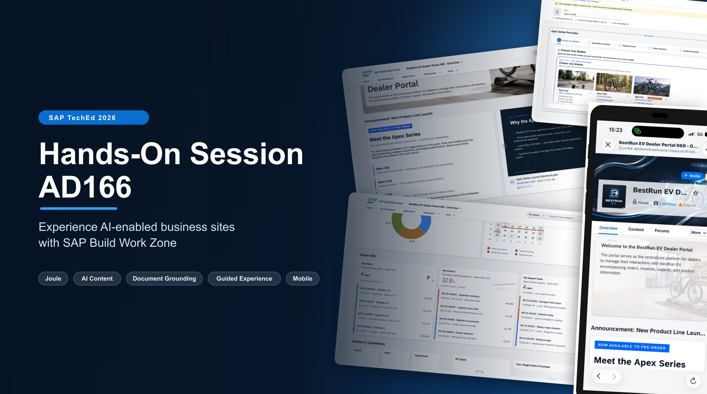
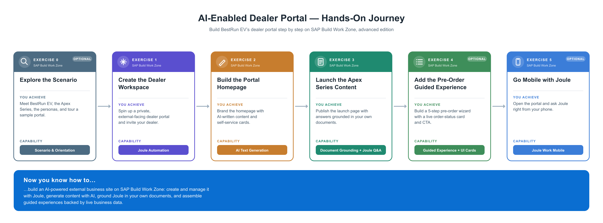

# AD166 - Experience AI-enabled business sites with SAP Build Work Zone

## Description

This repository contains the material for the SAP TechEd 2026 session **AD166 - Experience AI-enabled business sites with SAP Build Work Zone**.

## Overview

In this hands-on session, you take on the role of a Digital Experience Manager at **BestRun EV** — a premium electric mobility company launching a new product line, the **Apex Series**, through its 200+ strong authorized dealer network. Their existing dealer portal is a static website with PDF downloads and a contact form. With the Apex Series launching in 90 days, the team decides to migrate to an AI-powered external portal on **SAP Build Work Zone, advanced edition** — and use it as the launchpad for the new products.

You will build the dealer portal from scratch using Joule, give it a generic dealer-portal homepage with AI-generated content and self-service cards, then add a dedicated Apex Series product launch page grounded with product documents so dealers can get instant answers. At the end of each build exercise you switch to a dealer alias user to experience the portal exactly as a dealer would. Optional exercises add a Guided Experience wizard and mobile access.

### What you will learn

- How to use **Joule** to create and manage workspaces in SAP Build Work Zone
- How to generate professional content with **AI-assisted text generation**
- How to design rich, engaging workspace pages that bring together **unstructured content and live business data**
- How to configure **Document Grounding** so Joule can answer questions from your own documents
- How to assemble a structured workflow using a **Guided Experience** with pre-built UI cards (optional)
- How to access an external workspace from **Joule Work Mobile** (optional)

## Requirements

There are no specific technical requirements to follow exercises 0–3. For Exercise 5 (optional), you will need:

- A smartphone (iOS or Android) with **Joule Work Mobile** installed

> [!NOTE]
> For the SAP TechEd 2026 session we have already prepared the landscape with **SAP Build Work Zone, advanced edition**, Joule, and Document Grounding enabled. If following these exercises outside of SAP TechEd 2026, you will need to set up the environment first.

## Exercises

- [Exercise 0 - Detailed Overview of the Scenario (Optional)](exercises/ex0/) — Meet BestRun EV, the Apex Series, your personas, and explore a sample workspace
- [Exercise 1 - Create the External Dealer Workspace](exercises/ex1/)
    - [Exercise 1.1 - Access Work Zone and launch Joule](exercises/ex1/README.md#exercise-11-access-work-zone-and-launch-joule)
    - [Exercise 1.2 - Create the dealer portal workspace from a template](exercises/ex1/README.md#exercise-12-create-the-dealer-portal-workspace-from-a-template)
    - [Exercise 1.3 - Make the workspace private and external](exercises/ex1/README.md#exercise-13-make-the-workspace-private-and-external)
    - [Exercise 1.4 - Add your dealer alias user to the workspace](exercises/ex1/README.md#exercise-14-add-your-dealer-alias-user-to-the-workspace)
- [Exercise 2 - Update the Dealer Workspace Content](exercises/ex2/)
    - [Exercise 2.1 - Update the hero banner with a generic dealer portal tagline](exercises/ex2/README.md#exercise-21-update-the-hero-banner-with-a-generic-dealer-portal-tagline)
    - [Exercise 2.2 - Update the Key Highlights with generic portal content](exercises/ex2/README.md#exercise-22-update-the-key-highlights-with-generic-portal-content)
    - [Exercise 2.3 - Add the BestRun EV company specific info cards](exercises/ex2/README.md#exercise-23-add-the-bestrun-ev-company-specific-info-cards)
    - [Exercise 2.4 - Add the self-service cards section](exercises/ex2/README.md#exercise-24-add-the-self-service-cards-section)
    - [Exercise 2.5 - Update the footer section of the overview page](exercises/ex2/README.md#exercise-25-update-the-footer-section-of-the-overview-page)
    - [Exercise 2.6 - Experience the portal as a dealer](exercises/ex2/README.md#exercise-26-experience-the-portal-as-a-dealer)
- [Exercise 3 - Create the New Product Launch Content](exercises/ex3/)
    - [Exercise 3.1 - Copy the launch content from the Dealer Management workspace](exercises/ex3/README.md#exercise-31-copy-the-launch-content-from-the-dealer-management-workspace)
    - [Exercise 3.2 - Enable the workspace as an AI source for Joule document grounding](exercises/ex3/README.md#exercise-32-enable-the-workspace-as-an-ai-source-for-joule-document-grounding)
    - [Exercise 3.3 - Add a new product launch announcement section](exercises/ex3/README.md#exercise-33-add-a-new-product-launch-announcement-section)
    - [Exercise 3.4 - Experience the launch content as a dealer](exercises/ex3/README.md#exercise-34-experience-the-launch-content-as-a-dealer)
- [Exercise 4 - Create the Apex Pre-Order Page (Optional)](exercises/ex4/)
    - [Exercise 4.1 - Create the Apex Pre-Order page](exercises/ex4/README.md#exercise-41-create-the-apex-pre-order-page)
    - [Exercise 4.2 - Add the intro text widget](exercises/ex4/README.md#exercise-42-add-the-intro-text-widget)
    - [Exercise 4.3 - Add the guided experience section](exercises/ex4/README.md#exercise-43-add-the-guided-experience-section)
    - [Exercise 4.4 - Add the order status card](exercises/ex4/README.md#exercise-44-add-the-order-status-card)
    - [Exercise 4.5 - Add a button card on the Overview page](exercises/ex4/README.md#exercise-45-add-a-button-card-on-the-overview-page)
    - [Exercise 4.6 - Experience the full flow as Dealer-XXX](exercises/ex4/README.md#exercise-46-experience-the-full-flow-as-dealer-xxx)
- [Exercise 5 - Access the Dealer Portal from Joule Work Mobile (Optional)](exercises/ex5/)
    - [Exercise 5.1 - Set up Joule Work Mobile](exercises/ex5/README.md#exercise-51-set-up-joule-work-mobile)
    - [Exercise 5.2 - Access the BestRun EV Dealer Portal](exercises/ex5/README.md#exercise-52-access-the-bestrun-ev-dealer-portal)
    - [Exercise 5.3 - Ask Joule a question from your phone](exercises/ex5/README.md#exercise-53-ask-joule-a-question-from-your-phone)

## System Access

The following systems are used for this hands-on session. Please find your participant number on your desk. Login credentials will be provided by the instructor.

> [!IMPORTANT]
> Make sure to replace `XXX` throughout the exercises with your assigned participant number (e.g. **005** for participant AD166-005).

| System | URL |
|---|---|
| SAP Build Work Zone | [https://jw164-djmbomr8.workzone.cfapps.eu10.hana.ondemand.com/](https://jw164-djmbomr8.workzone.cfapps.eu10.hana.ondemand.com/) |

> [!NOTE]
> This URL is only accessible to in-person participants of the SAP TechEd 2026 hands-on session. Outside of the session, use your own SAP Build Work Zone tenant.

> [!NOTE]
> Outside of the hands-on session of SAP TechEd 2026, your own systems will be required to execute the exercises.

## Further Resources

- [SAP Build Work Zone on SAP Community](https://pages.community.sap.com/topics/work-zone)
- [Documentation for SAP Build Work Zone, advanced edition](https://help.sap.com/docs/WZ)
- [SAP Build Work Zone, advanced edition on Discovery Center](https://discovery-center.cloud.sap/serviceCatalog/sap-build-work-zone-advanced-edition?service_plan=advanced&region=all&commercialModel=btpea)
- [Joule documentation](https://help.sap.com/docs/joule)
- [SAP Builders on SAP Community](https://pages.community.sap.com/topics/low-code-no-code)

## Code of Conduct

Please read the [SAP Open Source Code of Conduct](https://github.com/SAP-samples/.github/blob/main/CODE_OF_CONDUCT.md).

## How to Obtain Support

Support for the content in this repository is available during the actual time of the online session for which this content has been designed. Otherwise, you may request support via the [Issues](../../issues) tab.

## License

Copyright (c) 2026 SAP SE or an SAP affiliate company. All rights reserved. This project is licensed under the Apache Software License, version 2.0 except as noted otherwise in the [LICENSE](LICENSES/Apache-2.0.txt) file.
