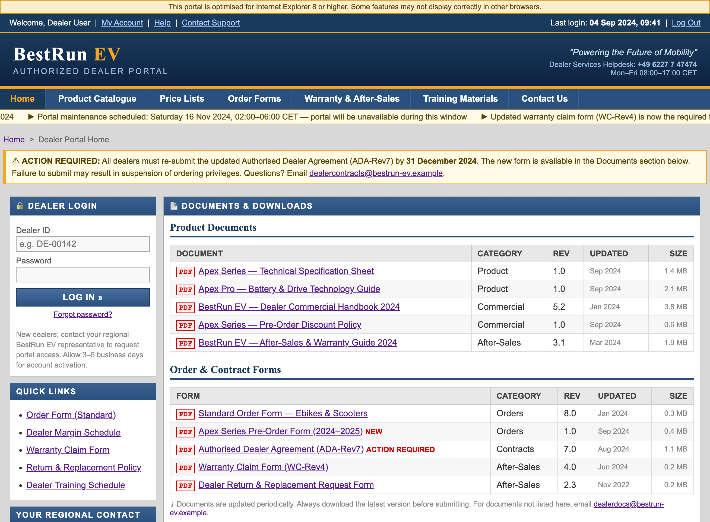
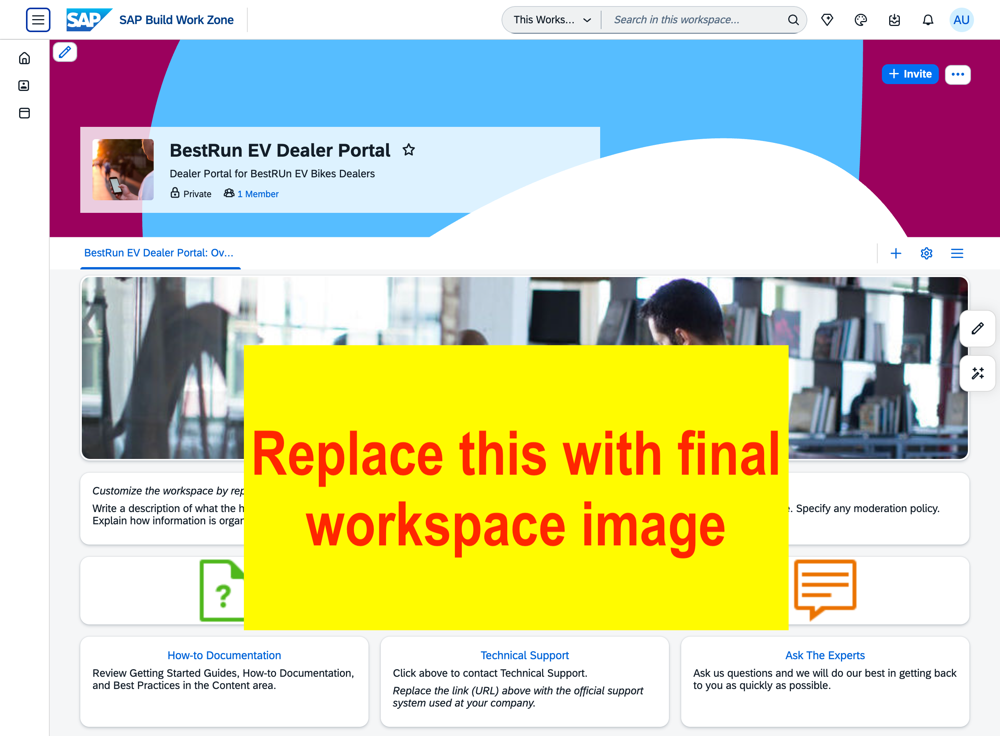

# Getting Started (Optional)

This section introduces the business scenario and tools you will work with throughout the session. If you are already familiar with SAP Build Work Zone, advanced edition, you can skip ahead to [Exercise 1](../ex1/README.md).

## The Scenario: BestRun EV

**BestRun EV** is a premium electric mobility company that designs and sells ebikes and electric scooters through an authorized dealer network of 200+ dealers across Europe and Asia-Pacific.

Their existing dealer portal is a static website — a collection of downloadable PDF spec sheets, a quarterly price list emailed to dealers, and a contact form. Dealers wait up to 48 hours for answers to product questions. There is no way to place an order through the portal.

BestRun EV is about to launch their most significant product line in five years: the **Apex Series**.

| Model | Type | Key Highlight |
|---|---|---|
| **Apex City** | Urban commuter scooter | Lightweight, city-optimized |
| **Apex Trail** | Adventure ebike | 140 km range, all-terrain |
| **Apex Pro** | Performance ebike | 200 km range, new LFP battery system |

With the launch 90 days away, the digital team has decided: **migrate from the static portal to SAP Build Work Zone, advanced edition, and launch the Apex Series on the new platform.**

| Legacy Dealer Portal | Work Zone AI-enabled Dealer Workspace |
|:---:|:---:|
|  |  |

## What is SAP Build Work Zone, Advanced Edition?

SAP Build Work Zone, advanced edition is a digital experience platform that lets organizations create structured workspaces — internal or external-facing — for teams, partners, and customers. It brings together apps, content, documents, and processes in one place, accessible from any device.

In this session, you are using it to build an **external-facing dealer portal** — a workspace that BestRun EV's authorized dealers can access to find product information, place pre-orders, and get instant answers using AI.

## Tools You Will Use

### Joule

Joule is SAP's AI copilot. In this session, Joule has two roles:

1. **Content Creator tool** — you use Joule to create and configure the workspace (exercises 1–4)
2. **Dealer assistant** — once the portal is live, dealers use Joule to ask product questions and get answers grounded in the uploaded documents (exercise 5)

### AI-Assisted Text Generation

SAP Build Work Zone includes built-in AI text generation powered by Joule. You use it to draft dealer-facing content for the workspace — product announcements, model overviews, and page copy — without leaving the editor.

### Document Grounding

Document Grounding allows Joule to answer questions based on documents you upload to the workspace. Instead of a dealer downloading a 40-page PDF and searching manually, they ask Joule a natural language question and receive a sourced answer in seconds.

### Guided Experience

A Guided Experience is a structured multi-step workflow built from UI cards. In this session, you will assemble a four-step pre-order wizard from pre-built cards already loaded in the workspace card catalog. Dealers use the wizard to configure and submit a pre-order for Apex Series units.

### Joule Work Mobile

Joule Work Mobile (formerly SAP Mobile Start) is the mobile app for accessing SAP Build Work Zone workspaces. In Exercise 6 (optional), you access the dealer portal from a smartphone.

## Your Personas

During this session you play two roles:

| Persona | When | What you do |
|---|---|---|
| **Digital Experience Manager, BestRun EV** | Exercises 1–4 | Build and configure the dealer portal |
| **Authorized Dealer, Amsterdam** | Exercises 5–6 | Experience and use the portal as a dealer |

## Summary

You now have the context to start building. The landscape is already provisioned — you have access to SAP Build Work Zone, advanced edition with Joule and Document Grounding enabled.

The landscape for this session is already fully configured. You have access to:

- **SAP Build Work Zone, advanced edition** — your starting point for every exercise
- **Joule** — available directly within SAP Build Work Zone, no BTP cockpit access required
- **Document Grounding** — already connected and ready to be enabled per workspace

Open the following URL to access the landscape:

> **[https://jw164-djmbomr8.workzone.cfapps.eu10.hana.ondemand.com/](https://jw164-djmbomr8.workzone.cfapps.eu10.hana.ondemand.com/)**

> [!NOTE]
> This URL is only accessible on-site at SAP TechEd 2026. Login credentials will be provided by the instructor.

> [!IMPORTANT]
> Throughout the exercises, replace `XXX` with your assigned participant number (e.g. if you are participant **AD166-005**, use **005**).

Continue to — [Exercise 1 - Set Up the Dealer Portal with Joule](../ex1/README.md)
