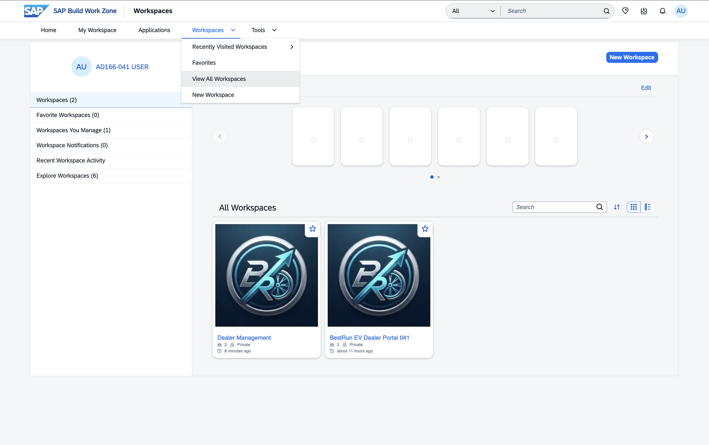
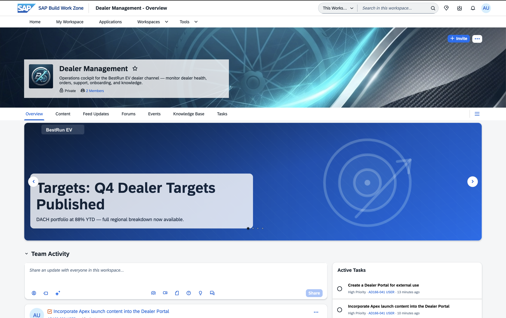
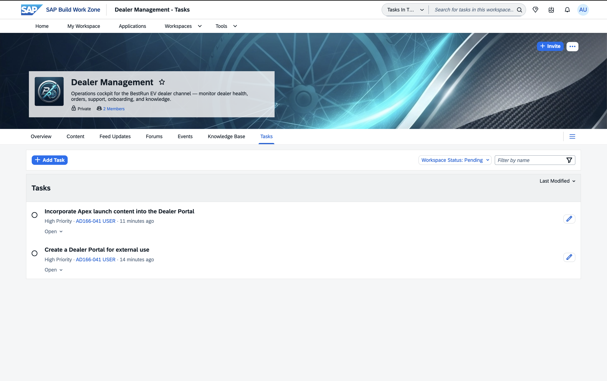
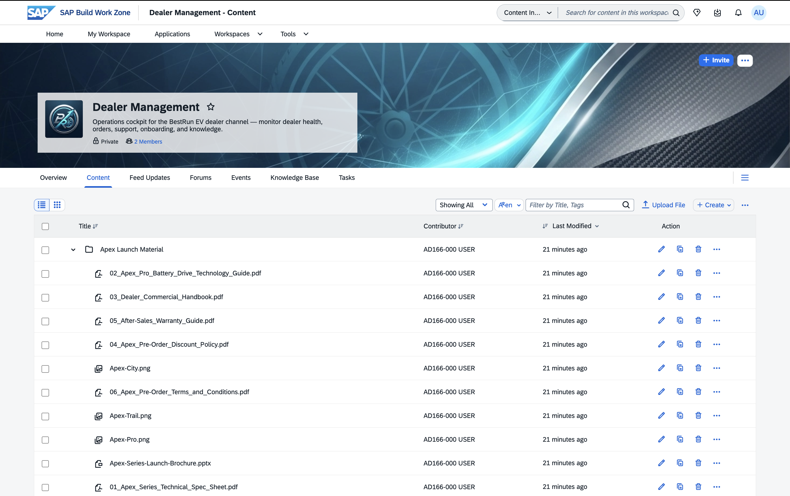

# Exercise 0 - Detailed Overview of the Scenario (Optional)

This section introduces the business scenario, the personas you will play, and the SAP Build Work Zone environment you will work in. If you are already familiar with SAP Build Work Zone, advanced edition, you can skim this and jump ahead to [Exercise 1](../ex1/README.md).

## Exercise 0.1 Learn About the Company, Scenario, and Personas

### The Company: BestRun EV

**BestRun EV** is a premium electric mobility company that designs and sells ebikes and electric scooters through an authorized dealer network of 200+ dealers across Europe and Asia-Pacific.

Their existing dealer portal is a static website — a collection of downloadable PDF spec sheets, a quarterly price list emailed to dealers, and a contact form. Dealers wait up to 48 hours for answers to product questions, and there is no way to place an order through the portal.

BestRun EV is about to launch their most significant product line in five years: the **Apex Series**.

| Model | Type | Key Highlight |
|---|---|---|
| **Apex City** | Urban commuter scooter | Lightweight, city-optimized |
| **Apex Trail** | Adventure ebike | 140 km range, all-terrain |
| **Apex Pro** | Performance ebike | 200 km range, new LFP battery system |

With the launch in a few days, the digital team has decided: **migrate from the static portal to SAP Build Work Zone, advanced edition, and subsequently launch the Apex Series on the new platform.**

| Legacy Dealer Portal | Work Zone AI-enabled Dealer Workspace |
|:---:|:---:|
|  |  |

### Your Personas

During this session you play two roles. You start as the portal admin who builds the portal, and at the end of each build exercise you switch to a dealer alias user to experience what you just built from a end-user's perspective.

| Persona | When | What you do |
|---|---|---|
| **Digital Experience Manager, BestRun EV** | Building steps of ex1–ex4 | Create and configure the dealer portal, add content, build the product launch page |
| **Authorized Dealer** (your `Dealer-XXX` alias) | Final step of ex2, ex3, ex4, and all of ex5 | Switch to your dealer alias user and experience the portal as a dealer would |

> [!NOTE]
> You will be given a dealer alias user — **Dealer-XXX**, matching your participant number (e.g. participant **AD166-005** uses **Dealer-005**). You switch to this alias from your user profile when an exercise asks you to experience the portal as a dealer.

### Tools You Will Use

- **SAP Build Work Zone, advanced edition** — the digital experience platform where you build the external-facing dealer portal.
- **Joule** — SAP's AI copilot. You use it to create and configure the workspace, generate content, and (as a dealer) ask product questions.
- **Document Grounding** — lets Joule answer questions based on the documents uploaded to the workspace, so a dealer gets a sourced answer in seconds instead of searching a PDF.
- **Guided Experience** — a structured multi-step wizard built from UI cards (optional ex4).
- **Joule Work Mobile** — the mobile app for accessing SAP Build Work Zone workspaces (optional ex5).

## Exercise 0.2 Launch SAP Build Work Zone and See What's Where

1. Open the following URL in your browser and log in with your participant credentials:

    **[https://jw164-djmbomr8.workzone.cfapps.eu10.hana.ondemand.com/](https://jw164-djmbomr8.workzone.cfapps.eu10.hana.ondemand.com/)**

    > [!NOTE]
    > This URL is only accessible on-site at SAP TechEd 2026. Login credentials will be provided by the instructor.

2. Take a moment to orient yourself on the SAP Build Work Zone home page — the top menu bar, the Joule icon, and the Workspaces navigation.

    > [!IMPORTANT]
    > Throughout the exercises, replace `XXX` with your assigned participant number (e.g. if you are participant **AD166-005**, use **005**).

## Exercise 0.3 Access the "Dealer Management" Workspace

A sample workspace called **Dealer Management** has been pre-provisioned in this landscape — the internal operations cockpit for the BestRun EV dealer channel. Opening it first gives you a feel for how a Work Zone workspace is organized before you build your own.

1. In the top navigation bar, open the **Workspaces** menu and choose **View All Workspaces**.

    

    > [!NOTE]
    > Right now you see the **Dealer Management** workspace. After Exercise 1 you will also see your own **BestRun EV Dealer Portal XXX** here.

2. Open the **Dealer Management** workspace. Its **Overview** page appears.

    

    Take a moment to notice the anatomy of a workspace:

    - **Header** — the workspace cover image, name, and description ("Operations cockpit for the BestRun EV dealer channel — monitor dealer health, orders, support, onboarding, and knowledge"), along with its **Private** visibility and member count.
    - **Tab bar** — **Overview**, **Content**, **Feed Updates**, **Forums**, **Events**, **Knowledge Base**, and **Tasks**. Each tab is a different facet of the same workspace.
    - **Overview page content** — a banner, a **Team Activity** feed, and an **Active Tasks** panel. This is the kind of page you will build for your own portal in Exercises 2 and 3.

## Exercise 0.4 Explore the Workspace: Tasks and Content

Two tabs matter most for the story you are about to live out — **Tasks** (what the dealer-management team needs to get done) and **Content** (the material you will reuse).

1. Open the **Tasks** tab.

    

    The team has two open, high-priority tasks:

    - **Create a Dealer Portal for external use**
    - **Incorporate Apex launch content into the Dealer Portal**

    These are exactly what you will accomplish in this hands-on: in **Exercise 1** you create the external dealer portal, and in **Exercise 3** you incorporate the Apex launch content into it. You are, in effect, picking up the dealer-management team's to-do list.

2. Open the **Content** tab.

    

    Inside the **Apex Launch Material** folder you will find everything needed for the product launch — the Apex Series documents (PDFs), the three product images, and the launch brochure (PPTX). In **Exercise 3** you will copy this material straight into your own dealer portal workspace, so there is nothing to download.

    > [!NOTE]
    > More guidance on exploring a Work Zone workspace will be added here as the sample workspace is expanded.

## Summary

You now understand the scenario, your two personas, and the SAP Build Work Zone environment. The landscape is already provisioned with SAP Build Work Zone, advanced edition, Joule, and Document Grounding.

Continue to — [Exercise 1 - Create the External Dealer Workspace](../ex1/README.md)
