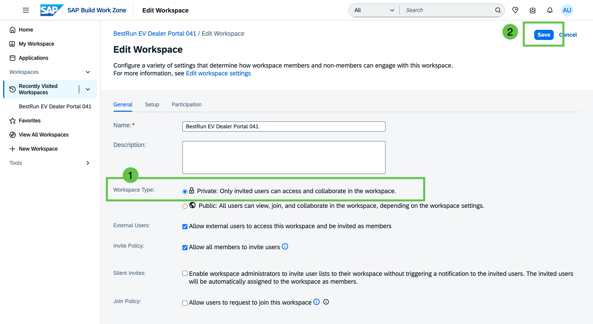
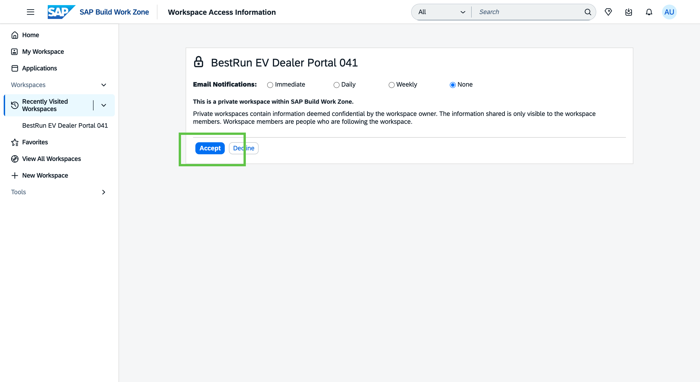

# Exercise 1 - Set Up the Dealer Portal with Joule

In this exercise, you take on the role of the **Digital Experience Manager at BestRun EV**. You will use Joule to create the dealer portal workspace, add the first team members, and configure it as an external-facing portal accessible to the dealer network.

By the end of this exercise, you will have a live workspace ready to receive content.

## Exercise 1.1 Log In and Open Joule

Joule is available directly within SAP Build Work Zone — no BTP cockpit access is needed. You will log in to the Work Zone site and open Joule from the top menu bar.

1. Open the following URL in your browser and log in with your participant credentials:

    **[https://jw164-djmbomr8.workzone.cfapps.eu10.hana.ondemand.com/](https://jw164-djmbomr8.workzone.cfapps.eu10.hana.ondemand.com/)**

    

2. In the top menu bar, click the ** Joule icon** to open the Joule panel.

    

### Summary

You are logged in to SAP Build Work Zone and the Joule panel is open. Continue to the next step to create your workspace.

---

## Exercise 1.2 Create the BestRun EV Dealer Portal Workspace

There are two ways to create a workspace in SAP Build Work Zone — using Joule with a natural language prompt, or through the classical workspace creation UI. Both lead to the same result.

> [!NOTE]
> Replace `XXX` in the workspace name with your assigned participant number (e.g. **005** for participant AD166-005).

---

<details open>
<summary><strong>Option A — Create with Joule (recommended)</strong></summary>

1. With the Joule panel open, type the following prompt:

    ```
    Create a new private workspace called "BestRun EV Dealer Portal XXX"
    ```

    
   

2. Joule may ask you to select a workspace template. If prompted, select **Partner Portal Template** from the list (Click on "View More" to locate the correct template).

    > [!NOTE]
    > Joule may skip this step if it selects the template automatically based on your prompt. If no template selection appears, continue to the next step.

    
  

3. Joule creates the workspace. Once complete, a **notification appears on the Work Zone home page** with a link to the new workspace. Click the notification link to open **BestRun EV Dealer Portal XXX** in the same tab — this keeps Joule accessible on the right side.

    > [!TIP]
    > Prefer the **notification link** over the link inside the Joule chat panel. The notification opens the workspace in the same tab, keeping the Joule panel visible. The Joule chat link opens a new tab, which closes the panel.

    

    > [!NOTE]
    > If no notification appears on the home page, open the **Workspaces** menu in the top navigation and browse to **BestRun EV Dealer Portal XXX** from the list of your workspaces.

4. Once inside the workspace, check that it is set to **Private** visibility.
Open **Edit Workspace** (Under More workspace options '...' > 'Workspace Admin Settings' > 'Edit Workspace') and confirm the visibility setting.

    

5. Update it to **Private**, and save.

    

6. Keep the **Email Notifications** option to 'None' and click Accept button.

    

</details>

---

<details>
<summary><strong>Option B — Create via the Workspaces menu (standard UI)</strong></summary>

1. In the SAP Build Work Zone Left navigation menu, Expand  **Workspaces** item and select and click on **New Workspace**.

    


2. In the option of the type of the workspace dialog, Select **Private Workspace**.

    

3. In the workspace creation dialog, enter the name **BestRun EV Dealer Portal XXX**, select **Partner Portal Template** from the template list and Click **Finish** .
 
    


4. After a few seconds, the new workspace opens.

    

    > [!NOTE]
    > You might need to refresh the workspace to get the Cover image from the template.

</details>

---

### Summary

Your workspace **BestRun EV Dealer Portal XXX** is created. Next, you will add your team members.

---

## Exercise 1.3 Add Team Members Using Joule

You will add the session moderator account as a member of your workspace. **AD166-000** is the moderator user shared by the session instructors — adding this account to every participant workspace allows the moderators to log in, review content, and assist during the session without needing a separate invitation each time.

1. With the Joule panel open, type the following prompt:

    ```
    Add user AD166-000 as a member of BestRun EV Dealer Portal XXX
    ```
    
  

2. Confirm the member addition in the Joule panel. Open the workspace **Members** settings to verify the new member appears in the list.

    

3. Make sure the User name *AD166-000* you added to your workspace (sent an invite from the Joule prompt) is part of the Members list.   

    
 

### Summary

Team members have been added to the workspace using Joule. You are now ready to configure the portal settings.

---

## Exercise 1.4 Configure the Workspace as an External-Facing Portal

By default, a workspace is accessible only to internal users. To make the BestRun EV Dealer Portal accessible to the external dealer network, you need to enable external user access in the workspace settings.

1. Open **Edit Workspace** (workspace menu **'...'** > **Workspace Admin Settings** > **Edit Workspace**).

    

2. Locate the **External Users** field and check **"Allow external users to access this workspace and be invited as members"**. This enables external access to your Dealer Portal.

    

3. Click **Save** to apply the settings.

    

### Summary

The workspace is now configured as an external-facing dealer portal. The foundation is in place — move on to Exercise 2 to start building the Apex Series launch content.

Continue to — [Exercise 2 - Build the Apex Series Launch Content with AI](../ex2/README.md)
