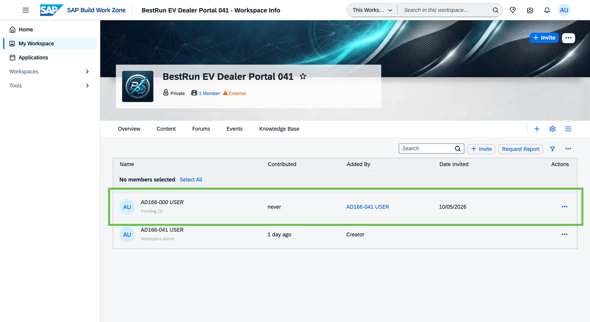

# Exercise 1 - Set Up the Dealer Portal with Joule

In this exercise, you take on the role of the **Digital Experience Manager at BestRun EV**. You will use Joule to create the dealer portal workspace, add the first team members, and configure it as an external-facing portal accessible to the dealer network.

By the end of this exercise, you will have a live workspace ready to receive content.

## Exercise 1.1 Log In and Open Joule

Joule is available directly within SAP Build Work Zone — no BTP cockpit access is needed. You will log in to the Work Zone site and open Joule from the top menu bar.

1. Open the following URL in your browser and log in with your participant credentials:

    > **[https://jw164-djmbomr8.workzone.cfapps.eu10.hana.ondemand.com/](https://jw164-djmbomr8.workzone.cfapps.eu10.hana.ondemand.com/)**

    
    > *📸 Capture: The SAP Build Work Zone home screen as it appears immediately after participant login — showing the site launchpad or home page.*

2. In the top menu bar, click the ** Joule icon** to open the Joule panel.

    
    > *📸 Capture: The SAP Build Work Zone top menu bar with the Joule diamond icon highlighted. The Joule side panel should be visible opening on the right side of the screen.*

### Summary

You are logged in to SAP Build Work Zone and the Joule panel is open. Continue to the next step to create your workspace.

---

## Exercise 1.2 Create the BestRun EV Dealer Portal Workspace

There are two ways to create a workspace in SAP Build Work Zone — using Joule with a natural language prompt, or through the classical workspace creation UI. Both lead to the same result.

> [!NOTE]
> Replace `XXX` in the workspace name with your assigned participant number (e.g. **005** for participant AD166-005).

---

<details open>
<summary><strong>Option A — Create with Joule (recommended)</strong></summary>

1. With the Joule panel open, type the following prompt:

    ```
    Create a new private workspace called "BestRun EV Dealer Portal XXX"
    ```

    
    > *📸 Capture: Joule's response after entering the prompt — showing Joule processing the request or presenting a template selection.*

2. Joule may ask you to select a workspace template. If prompted, select **External Portal Template** from the list.

    > [!NOTE]
    > Joule may skip this step if it selects the template automatically based on your prompt. If no template selection appears, continue to the next step.

    
    > *📸 Capture: Joule's template selection list with "External Portal Template" highlighted or selected.*

3. Joule creates the workspace. Once complete, a **notification appears on the Work Zone home page** with a link to the new workspace. Click the notification link to open **BestRun EV Dealer Portal XXX** in the same tab — this keeps Joule accessible on the right side.

    > [!TIP]
    > Prefer the **notification link** over the link inside the Joule chat panel. The notification opens the workspace in the same tab, keeping the Joule panel visible. The Joule chat link opens a new tab, which closes the panel.

    
    > *📸 Capture: The Work Zone home page with a notification banner or card indicating the new workspace "BestRun EV Dealer Portal XXX" was created, including a clickable link.*

    > [!NOTE]
    > If no notification appears on the home page, open the **Workspaces** menu in the top navigation and browse to **BestRun EV Dealer Portal XXX** from the list of your workspaces.

4. Once inside the workspace, check that it is set to **Private** visibility. Open **Edit Workspace** (workspace settings or the edit icon in the header) and confirm the visibility setting. If it is not Private, update it and save.

    
    > *📸 Capture: The Edit Workspace panel showing the visibility/privacy setting. The Private option should be selected.*

</details>

---

<details>
<summary><strong>Option B — Create via the Workspaces menu (standard UI)</strong></summary>

1. In the SAP Build Work Zone top navigation, click **Workspaces** and select **New Workspace**.

    
    > *📸 Capture: The Workspaces dropdown menu open, with the New Workspace option visible.*

2. In the workspace creation dialog, enter the name **BestRun EV Dealer Portal XXX** and set the visibility to **Private**.

    > [!IMPORTANT]
    > **TODO:** Confirm the exact fields in the classical workspace creation dialog for this version of SAP Build Work Zone advanced edition.

    
    > *📸 Capture: The workspace creation form showing the name field and the Private visibility option selected.*

3. Click **Create**. After a few seconds, the new workspace opens.

    
    > *📸 Capture: The newly created workspace as it appears after classical UI creation.*

</details>

---

### Summary

Your workspace **BestRun EV Dealer Portal XXX** is created. Next, you will add your team members.

---

## Exercise 1.3 Add Team Members Using Joule

The BestRun EV regional sales managers need access to the workspace so they can review and contribute content. You will use Joule to add them as workspace members.

1. With the Joule panel open, type the following prompt:

    ```
    Add user AD166-XXX as a member of BestRun EV Dealer Portal XXX
    ```

    > [!IMPORTANT]
    > **TODO:** Confirm the exact Joule prompt format for adding members — specify whether the user identifier is an email address, display name, or user ID, and update the prompt above accordingly.

    
    > *📸 Capture: Joule's response to the add member prompt — showing a confirmation card with the user's name and the workspace they are being added to.*

2. Confirm the member addition in the Joule panel.

    
    > *📸 Capture: Joule's success message confirming the user has been added to the workspace.*

3. Open the workspace **Members** settings to verify the new member appears in the list.

    > [!IMPORTANT]
    > **TODO:** Add navigation path to the workspace members panel (e.g., workspace settings → members, or the admin console path).

    
    > *📸 Capture: The workspace Members panel listing the newly added user alongside the workspace owner.*

### Summary

Team members have been added to the workspace using Joule. You are now ready to configure the portal settings.

---

## Exercise 1.4 Configure the Workspace as an External-Facing Portal

By default, a workspace is accessible only to internal users. To make the BestRun EV Dealer Portal accessible to the external dealer network, you need to configure it as an external-facing portal.

1. In the workspace administration view, navigate to **Settings**.

    > [!IMPORTANT]
    > **TODO:** Confirm the exact navigation path to external workspace settings in this version of SAP Build Work Zone advanced edition.

    
    > *📸 Capture: The workspace overview or admin panel with the Settings menu item clearly visible and selected.*

2. Locate the **Visibility** or **Access** section and enable **External Access**.

    
    > *📸 Capture: The settings panel showing the external access configuration option. The toggle or dropdown should be visible in its default (internal) state.*

3. Enable external access and configure the required settings.

    > [!IMPORTANT]
    > **TODO:** Document the specific fields that need to be configured for external access — e.g., domain allowlist, identity provider settings, invitation mode. Add sub-steps per field.

    
    > *📸 Capture: The settings panel after enabling external access — showing the confirmed configuration with a green indicator or enabled toggle.*

4. Click **Save** to apply the settings.

    
    > *📸 Capture: The success message or updated settings panel confirming changes were saved.*

### Summary

The workspace is now configured as an external-facing dealer portal. The foundation is in place — move on to Exercise 2 to start building the Apex Series launch content.

Continue to — [Exercise 2 - Build the Apex Series Launch Content with AI](../ex2/README.md)
