# Exercise 1 - Create the External Dealer Workspace

In this exercise, you take on the role of the **Digital Experience Manager at BestRun EV**. You will use Joule to create the dealer portal workspace from a template, configure it as a private, external-facing portal, and add your dealer alias user so you can experience it later as a dealer.

By the end of this exercise, you will have a live workspace ready to receive content.

## Exercise 1.1 Access Work Zone and Launch Joule

Joule is available directly within SAP Build Work Zone — no BTP cockpit access is needed. You will log in, open Joule, and ask it to show the workspaces you manage to orient yourself.

1. Open the following URL in your browser and log in with your participant credentials:

    **[https://jw164-djmbomr8.workzone.cfapps.eu10.hana.ondemand.com/](https://jw164-djmbomr8.workzone.cfapps.eu10.hana.ondemand.com/)**

    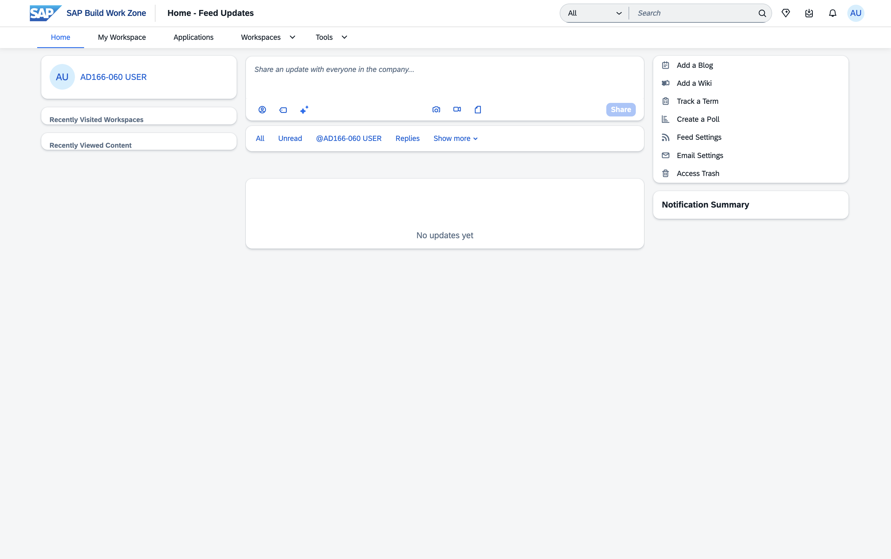

2. In the top menu bar, click the ** Joule icon** to open the Joule panel.

    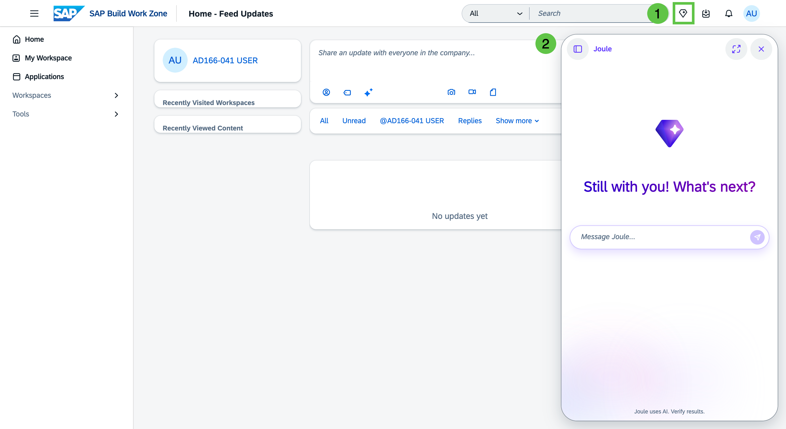

3. With the Joule panel open, ask Joule to list the workspaces you are part of:

    ```
    Show me my workspaces
    ```

    Joule returns a card-based overview of your workspaces — right now just **Dealer Management**, each with a **Visit** link to open it directly. This is a quick way to see what you already have before you create a new one.

    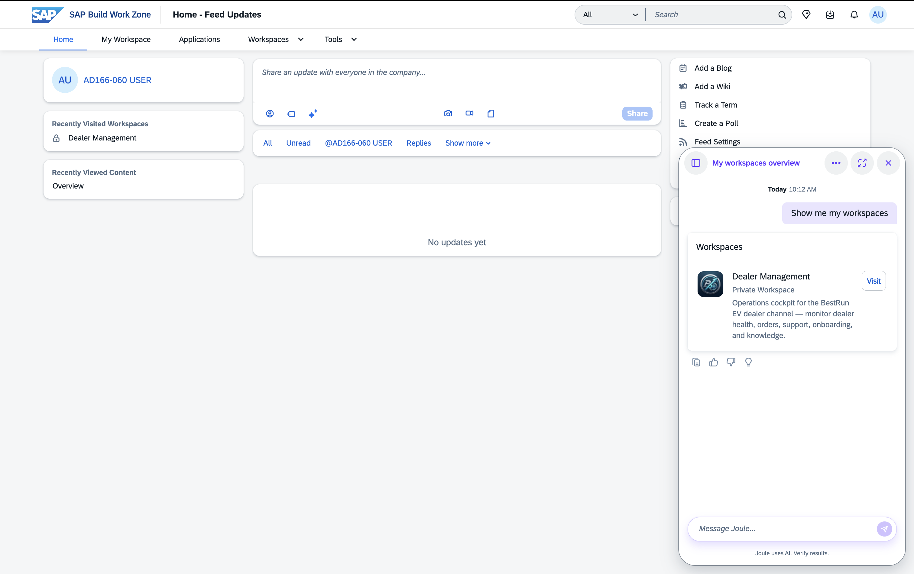

> [!NOTE]
> Joule in SAP Build Work Zone goes beyond general chat — it understands **Work Zone–specific actions**. Alongside listing your workspaces, it can create new workspaces, add members, navigate to content, and more. You will use several of these Work Zone capabilities in the exercises that follow — starting with creating your dealer portal in the next step.

### Summary

You are logged in to SAP Build Work Zone, the Joule panel is open, and you have seen your managed workspaces. Continue to the next step to create the dealer portal workspace.

---

## Exercise 1.2 Create the Dealer Portal Workspace from a Template

There are two ways to create a workspace in SAP Build Work Zone — using Joule with a natural language prompt, or through the classical workspace creation UI. Both lead to the same result.

> [!NOTE]
> Replace `XXX` in the workspace name with your assigned participant number (e.g. **005** for participant AD166-005).

---

<details open>
<summary><strong>Option A — Create with Joule (recommended)</strong></summary>

1. With the Joule panel open, type the following prompt:

    ```
    Create a new workspace called "BestRun EV Dealer Portal XXX"
    ```

    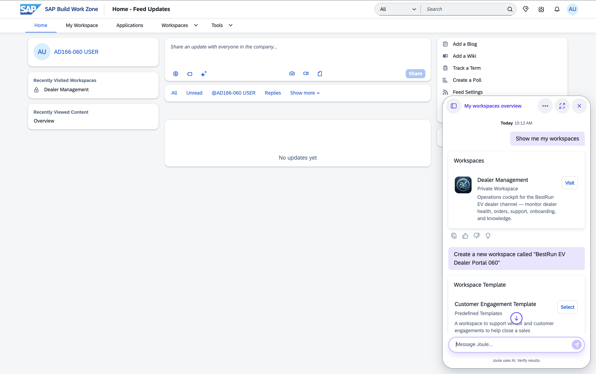

2. Joule responds with a list of workspace templates. **Scroll down to the end of the list** in the Joule panel to find the **Partner Portal** template — described as a template for "engaging and informative external-facing partner portals, such as dealer portals." Click **Select** next to it.

    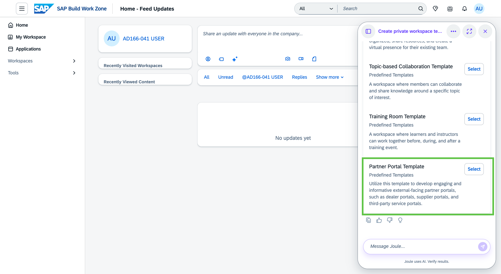

> [!NOTE]
> Joule may skip the template list if it selects a template automatically based on your prompt. If no template selection appears, continue to the next step.

3. Joule creates the workspace and confirms with **"Great! The workspace has been created, and you can start building it."**

    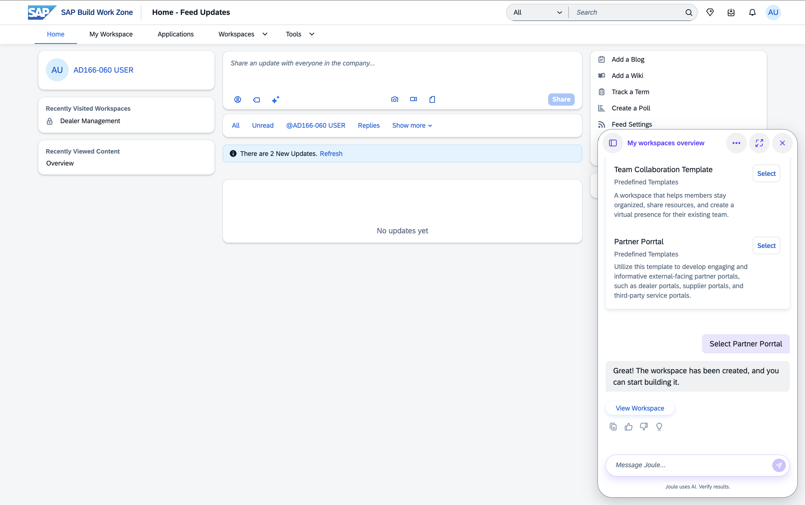

4. Open your new workspace from the Work Zone home feed. A banner reading **"There are 2 New Updates"** appears above the feed — click **Refresh**.

    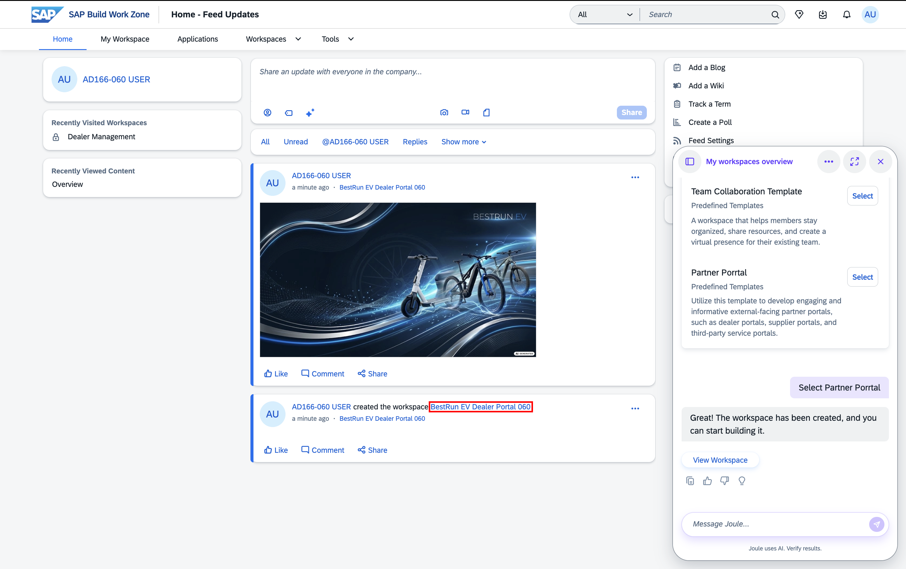

> [!TIP]
> Opening the workspace from the feed link keeps the Joule panel available on the right. You can also use the **View Workspace** button in the Joule chat, but that opens the workspace in a new tab and closes the panel.

> [!NOTE]
> If you don't see the update, open the **Workspaces** menu in the top navigation and browse to **BestRun EV Dealer Portal XXX** from the list of your workspaces.

5. Your new **BestRun EV Dealer Portal XXX** workspace opens on its **Overview** page. Close the Joule panel (the **X** in the top-right of the panel) to give yourself the full width for the next steps.

    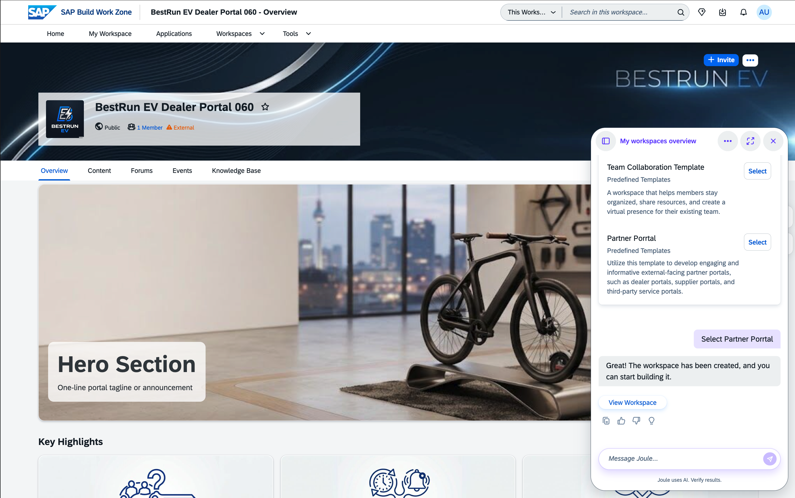

6. Take a look at the full **Overview** page. Because you created it from the **Partner Portal** template, it already comes with a complete, professionally laid-out structure — just with placeholder content:

    - a **Hero Section** banner with a sample image and a "One-line portal tagline or announcement" placeholder,
    - a **Key Highlights** row (**Who & What?**, **Why?**, **How?**) with suggested-text prompts,
    - a **Utilities & Capabilities** area with tiles (Search, Applications, Notifications, Calendar, and more), a forum/activity feed, and a single-point-of-contact card,
    - and a partner-portal footer.

    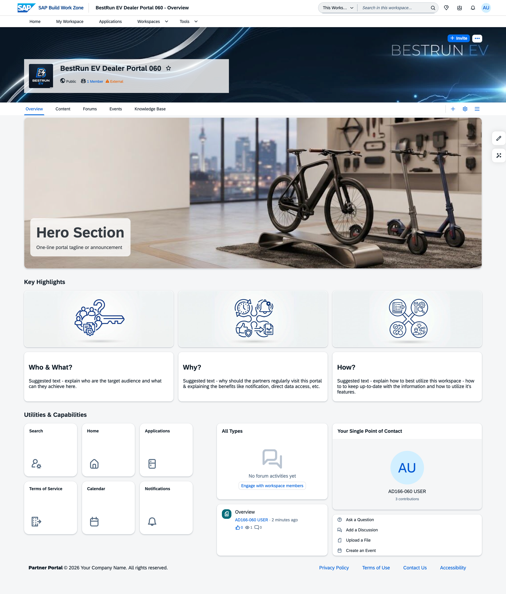

    This template gives you a running start. Over the next exercises you will replace the placeholder content and make the portal dealer-ready — personalizing this Overview page in **Exercise 2**, adding the Apex Series product launch content in **Exercise 3**, and building a dedicated **Apex Pre-Order** page with a 5-step guided wizard and a live order status card in **Exercise 4**.

</details>

---

<details>
<summary><strong>Option B — Create via the Workspaces menu (standard UI)</strong></summary>

1. In the SAP Build Work Zone left navigation menu, expand the **Workspaces** item and click **New Workspace**.

    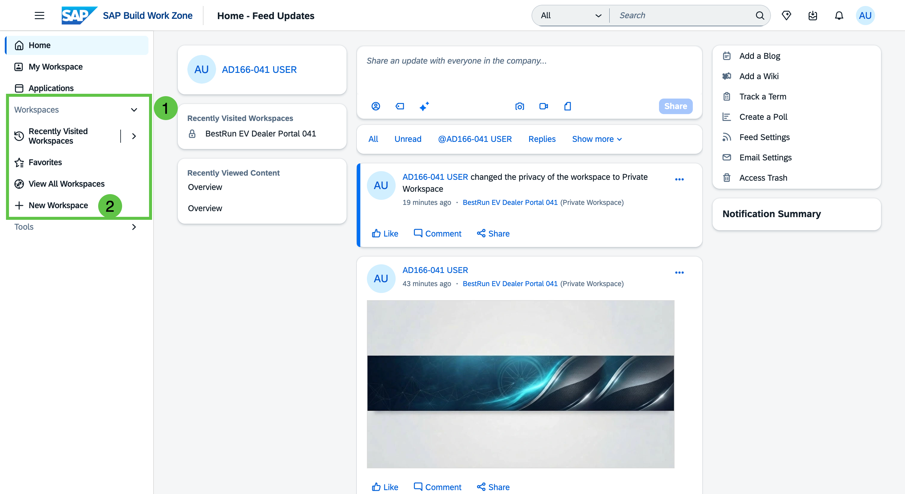

2. In the workspace type dialog, select **Private Workspace**.

    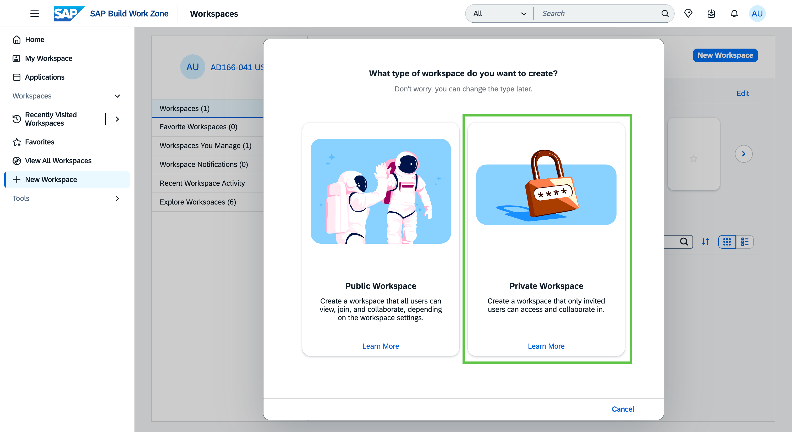

3. In the workspace creation dialog, enter the name **BestRun EV Dealer Portal XXX**, select **Partner Portal Template** from the template list, and click **Finish**.

    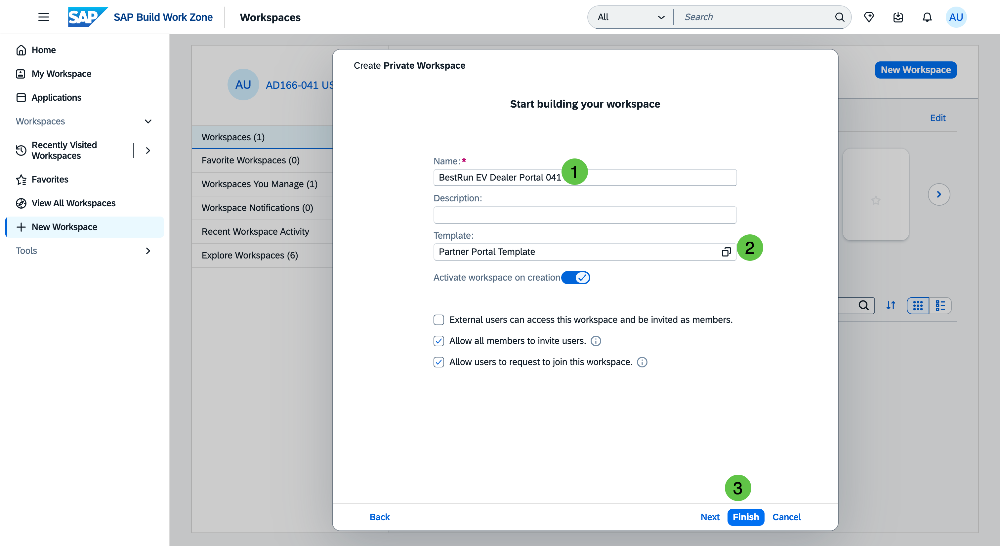

4. After a few seconds, the new workspace opens.

    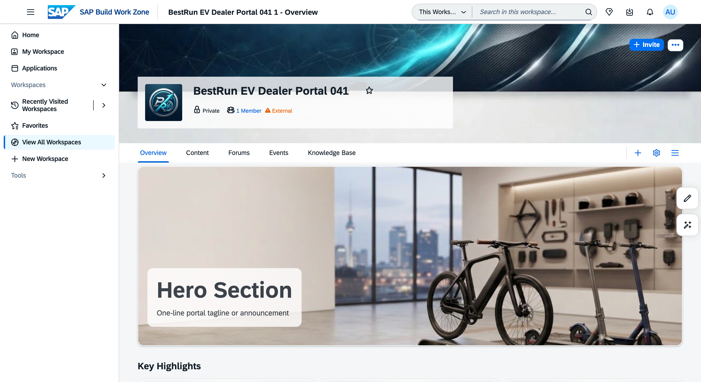

> [!NOTE]
> You might need to refresh the workspace to get the cover image from the template.

</details>

---

### Summary

Your workspace **BestRun EV Dealer Portal XXX** is created from the Partner Portal Template. Next, you will configure its visibility and external access.

---

## Exercise 1.3 Make the Workspace Private and External

By default a workspace is internal. To make the BestRun EV Dealer Portal a private portal that your external dealer network can be invited into, you configure both the visibility and external access settings in **Edit Workspace**.

1. Inside the workspace, open **Edit Workspace** (More workspace options **'...'** > **Workspace Admin Settings** > **Edit Workspace**).

    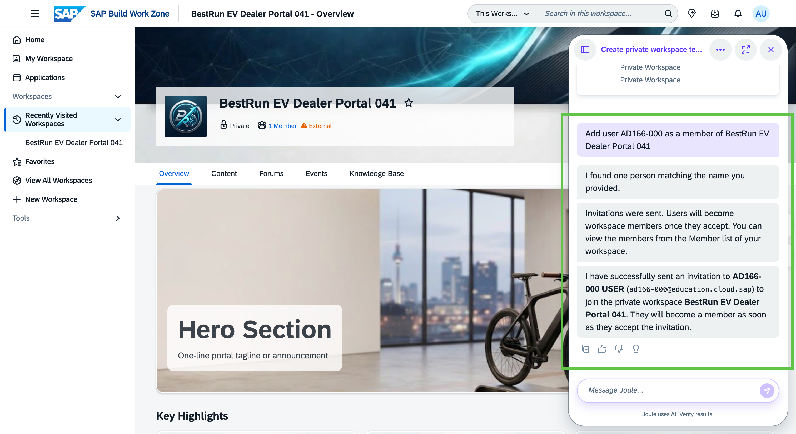

2. On the **General** tab, configure the access settings:

    - Set **Workspace Type** to **Private** — only invited users can access the workspace.
    - Under **External Users**, make sure **"Allow external users to access this workspace and be invited as members"** is **checked**. The Partner Portal template usually enables this already; if it is not checked, select it now. This is what lets your external dealer network be invited.

    Then click **Save** (top right) to apply the changes.

    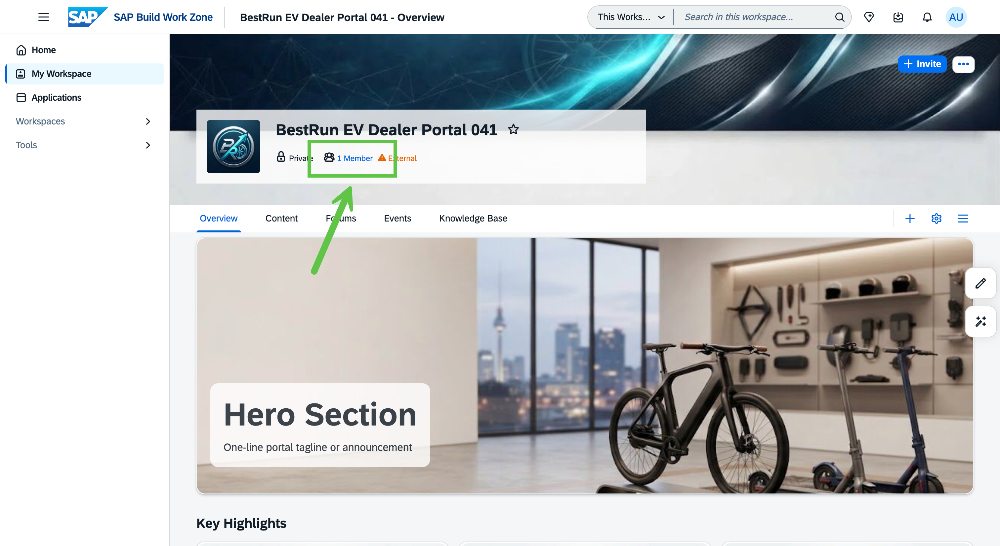

### Summary

The workspace is now a private, external-facing dealer portal. Next, you will add your dealer alias user as a member.

---

## Exercise 1.4 Add Your Dealer Alias User to the Workspace

Every participant has been assigned a corresponding **alias user**, named **Dealer XXX** — where `XXX` is the same three digits as your participant ID for this hands-on session (e.g. participant **AD166-005** has the alias **Dealer 005**). You will use this alias user throughout the session to experience the Dealer Portal from a **dealer's perspective** — reviewing the product launch content in Exercise 3 and walking through the full Apex Series pre-order wizard in Exercise 4.

Add this alias as a member now, so that later — when an exercise asks you to switch to the dealer view — your alias already has access.

> [!NOTE]
> Replace `XXX` with your participant number — e.g. if you are **AD166-005**, use **Dealer 005**.

There are two ways to add a member to the workspace. **Option A** uses Joule; **Option B** adds the member directly through the workspace settings.

---

<details open>
<summary><strong>Option A — Add with Joule (recommended)</strong></summary>

1. Open the **Joule** panel again and start with a simple request:

    ```
    add a member to the workspace
    ```

    Joule replies that it first needs to find the correct workspace and asks you to provide the name (or part of the name) of the workspace you want to search for.

    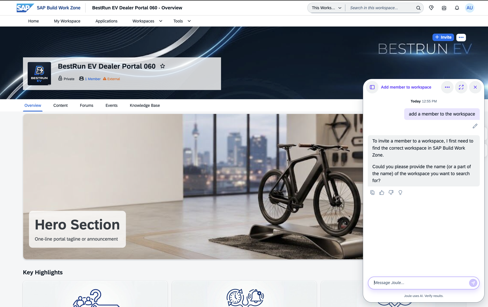

2. Reply with your workspace name (replace `XXX` with your participant number):

    ```
    BestRun EV Dealer Portal XXX
    ```

    Joule searches and returns the exact matching workspace. Click **Select** next to **BestRun EV Dealer Portal XXX**.

    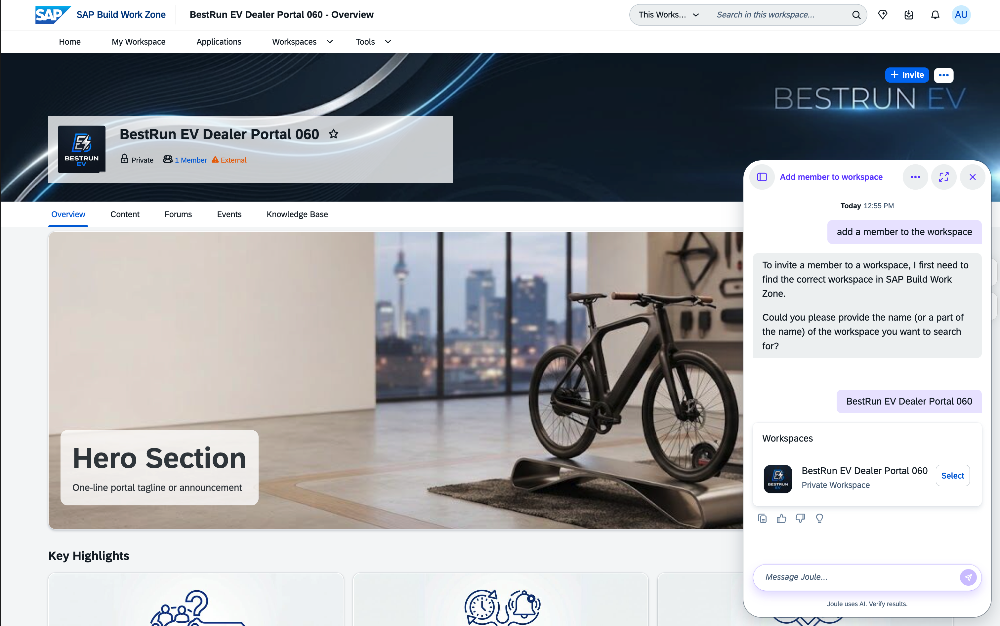

3. With the workspace selected, Joule now needs to identify the user to add. It asks you to provide the full or partial name of the person you want to search for.

    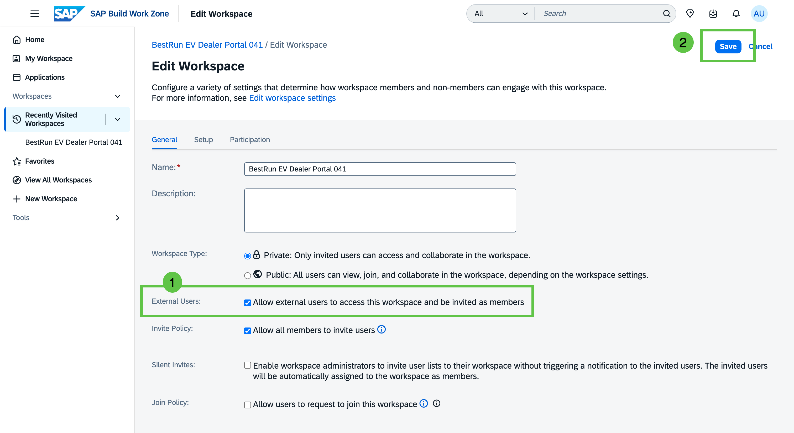

4. Enter your dealer alias name (replace `XXX` with your participant number):

    ```
    Dealer XXX
    ```

    Joule finds the matching person. Confirm it is the correct dealer alias for your participant number — e.g. **Dealer 005** (`dealer-005@bestrunevdealers.com`) — and click **Select**.

    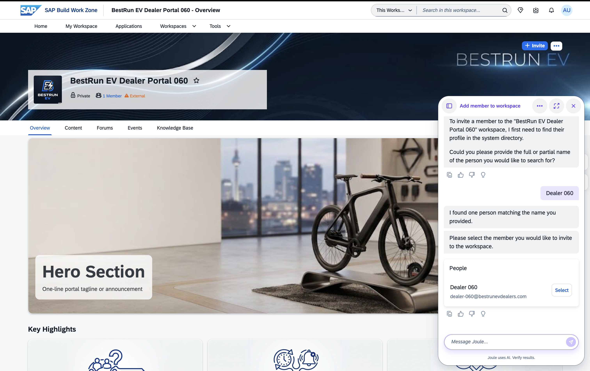

5. Joule confirms: **"Invitations were sent. Users will become workspace members once they accept."** Your dealer alias has now been invited.

    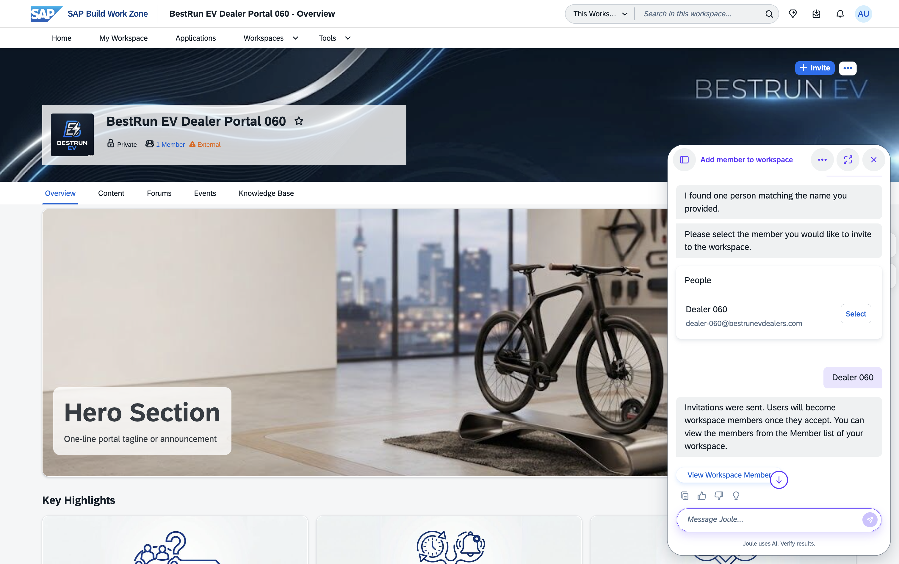

</details>

---

<details>
<summary><strong>Option B — Add directly in workspace settings</strong></summary>

1. Open the workspace **Members** list — click the **1 Member** link in the workspace header (between the **Private** and **External** indicators). On the members list, click **+ Invite** in the top-right toolbar.

    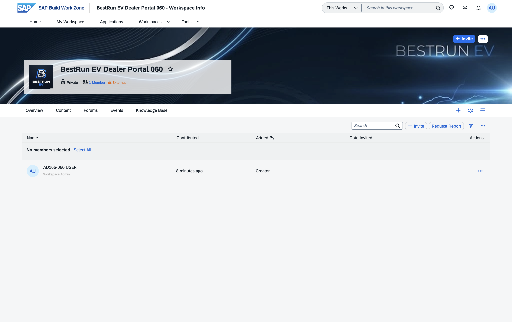

2. On the **Invite Workspace Members** page (**Send Invites** tab), start typing your dealer alias name **Dealer XXX** in the **Invite Users** field and select the matching alias from the suggestions (e.g. **Dealer 005** — `dealer-005@bestrunevdealers.com`). Optionally add a personal message, then click **Send**.

    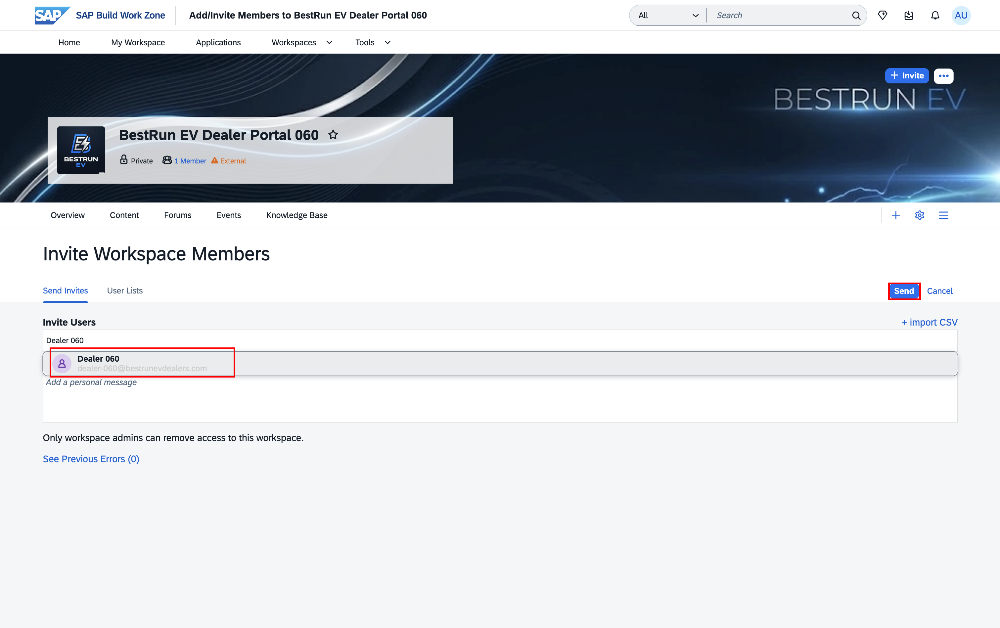

</details>

---

### Verify the Result

Whichever option you used, verify the invitation from the workspace header: click the **1 Member** link (between the **Private** and **External** indicators) to open the members list.

You should see two entries — yourself (**AD166-XXX USER**, Workspace Admin / Creator) and **Dealer XXX**, shown as **Pending** until the alias accepts the invitation.


### Summary

Your workspace is created, configured as a private external portal, and your **Dealer XXX** alias has been invited as a member. The foundation is in place — move on to Exercise 2 to start building the portal content.

Continue to — [Exercise 2 - Update the Dealer Workspace Content](../ex2/README.md)
