# Exercise 2 - Update the Dealer Workspace Content

In this exercise you take the raw workspace generated from the Partner Portal Template and transform it into a professional, external dealer-facing portal — using the capabilities built into SAP Build Work Zone. You reshape the hero banner and the Key Highlights with the **AI text generation embedded in each content widget**; showcase company's position covering **Factory Inventory**, **eBike Portfolio Performance**, **eBike Demand Mix** and **BestRun EV events** calendar through series of up-to-date UI cards; give dealers at-a-glance access through a row of pre-built self-service cards — **My Orders**, **My Invoices**, and **My Tickets** — and finally switch to your dealer alias user to experience the result as a dealer would for the first time.

> [!NOTE]
> **Use the embedded AI assisted text generation capability** Every widget in SAP Build Work Zone that accepts text has a built-in AI text-generation button — the  icon in the rich-text toolbar (or next to a text field). Clicking it opens a menu:
> - **Generate Text** — appears when the field is empty; you type a short prompt and it writes the copy.
> - **Change Tone** — rewrites existing text in a different tone (e.g. Professional, Confident).
> - **Adjust Length** — makes existing text shorter or longer.
> - **Fix Spelling and Grammar** — cleans up existing text.
>
> You will use **Generate Text** to create copy from a prompt, and **Change Tone / Adjust Length** to refine text that already exists. This is the SAP Build Work Zone editing experience — the standalone Joule panel is not needed here.

> [!NOTE]
> **TODO (screenshots):** The screenshots in this exercise are being recaptured to match the generic dealer portal content. Current images may still show earlier product-specific content.

## Exercise 2.1 Update the Hero Banner with a Generic Dealer Portal Tagline

The Partner Portal Template comes with a hero banner that has placeholder title and description text. You will replace the copy using the widget's embedded AI, so dealers immediately understand what the portal is for.

1. Open **BestRun EV Dealer Portal XXX** and enter the page editor. Look for the **Edit** button in the workspace header or the pencil icon on the Overview page.

    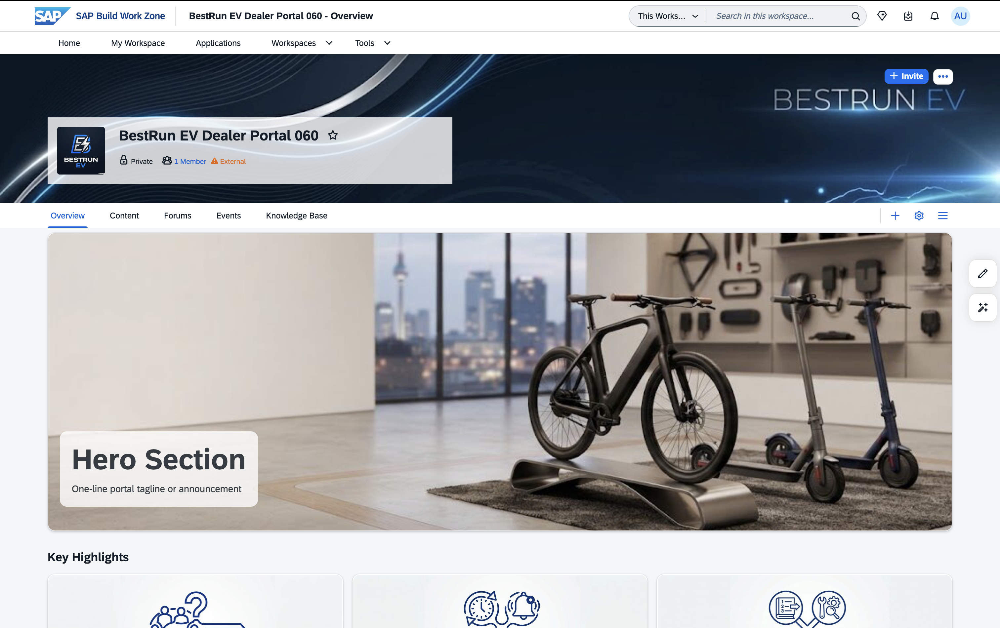

2. **Hover** over the hero banner widget — an **Edit widget** (gear) icon appears in the top-right corner of the widget. (This icon is only visible while your mouse is over the widget.) Click it to open the **Rotating Banner Widget** dialog, which shows the **Title**, **Description**, and other slide settings.

    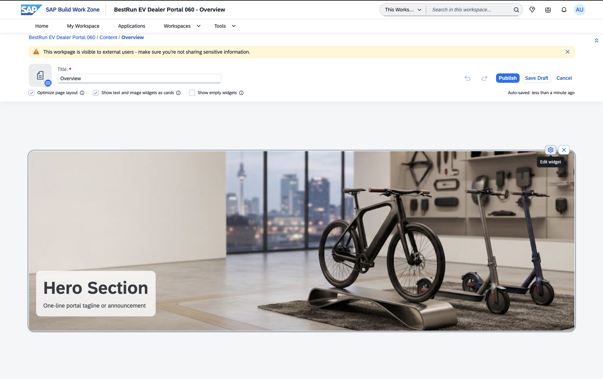

3. In the **Title** field, type a short, generic welcome title, for example:

    ```
    Welcome to the BestRun EV Dealer Portal
    ```

4. Click into the **Description** field and type a one-line tagline in your own words, for example:

    ```
    The portal is the single place where dealers manage their relationship with BestRun EV — orders, invoices, support, and product information.
    ```

       Add your own description, then use the embedded AI to refine it to your needs. Click the  (AI assist) button next to the field and choose **Change Tone → Make More Professional** to polish your draft.

    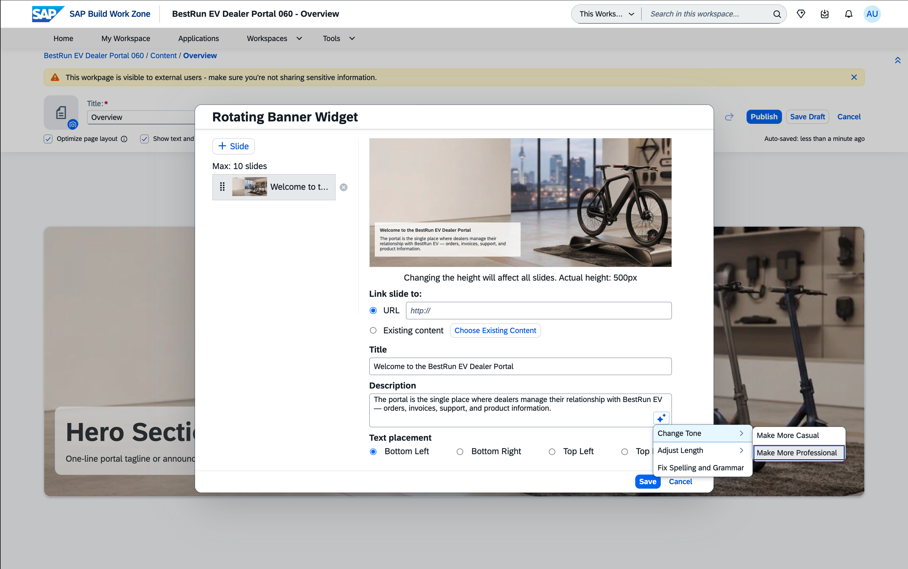

5. The AI opens a **Make More Professional** dialog showing your **Selected Text** alongside its **Suggested Text**. Review the suggestion and click **Accept** to apply it (or **Retry** for another variation, **Discard** to keep your original).

    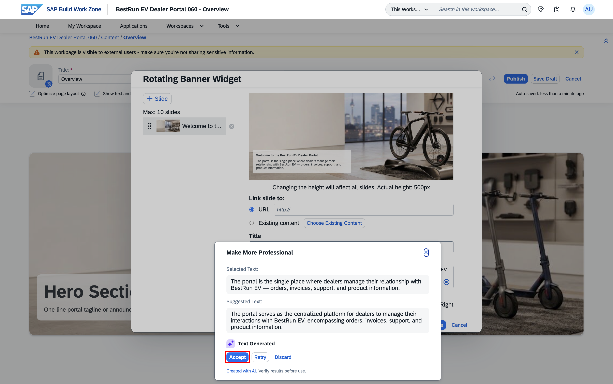

6. Back in the **Rotating Banner Widget**, the accepted tagline now fills the **Description** field. Click **Save** to apply the banner copy.

    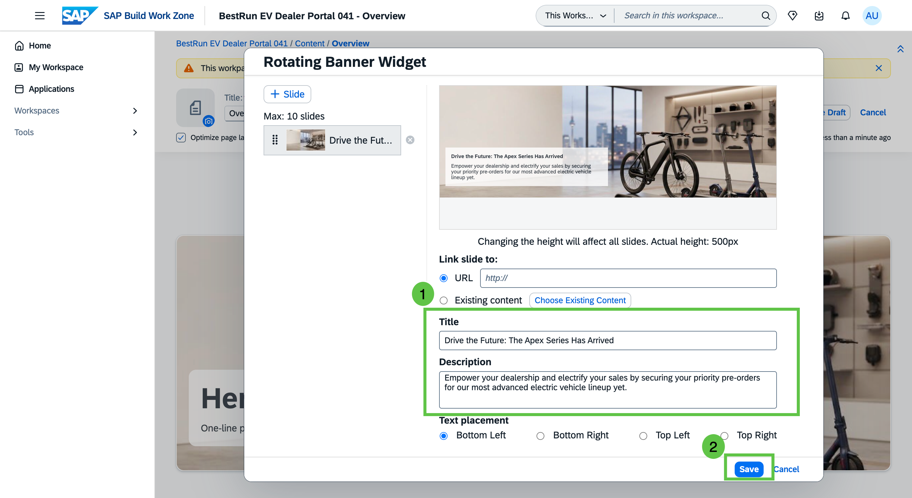

7. Verify the result. The hero banner now shows your new title and the polished tagline directly on the Overview page.

    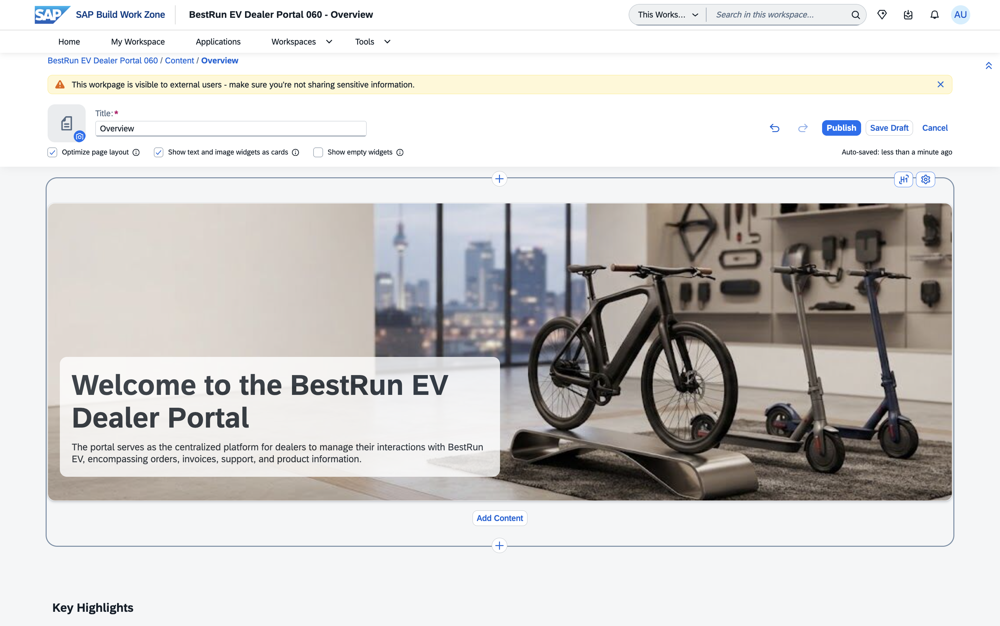

### Summary

The hero banner now welcomes dealers to the portal, written with the widget's embedded AI. Next you will update the Key Highlights cards the same way.

---

## Exercise 2.2 Update the Key Highlights with Generic Portal Content

The Key Highlights section has three text cards — **Who & What?**, **Why?**, and **How?** — that explain the portal to dealers. Each card is a rich-text field with the embedded AI. You will build the **Who & What?** card step by step, then apply the same approach to the **Why?** and **How?** cards using the prompts provided.

> [!NOTE]
> The card copy is **generated by AI**, so your results will differ from the screenshots in this guide — that is expected. Treat the output as a starting point and refine it with **Change Tone** or **Adjust Length** as needed.

> [!IMPORTANT]
> Each card starts with placeholder **"Suggested text …"** copy. Before generating, **delete the existing suggested text** in each card so it does not interfere with or get mixed into the AI-generated content.

### The Who & What? Card

1. Click into the **Who & What?** card to open its rich-text toolbar. Open the  (AI assist) menu in the toolbar and select **Generate Text**.

    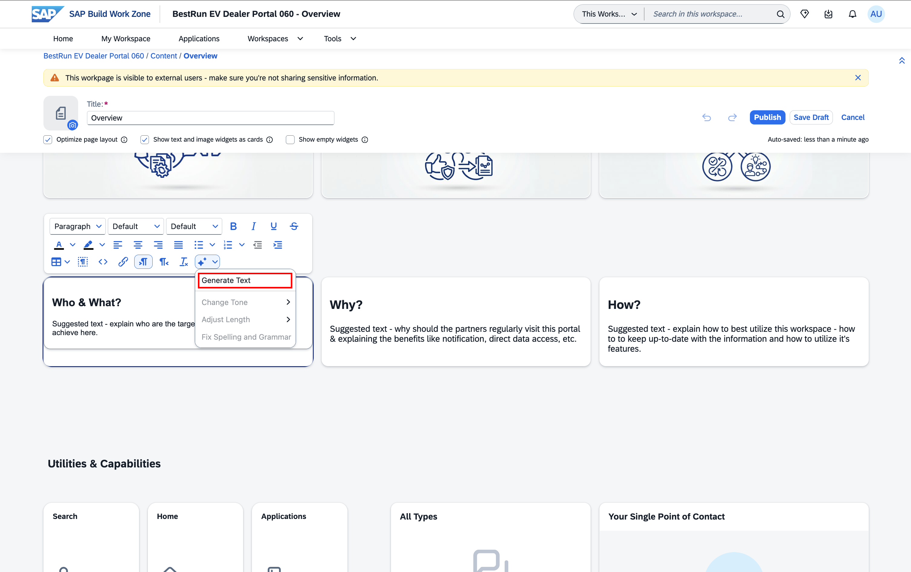

2. In the **Generate Text** dialog, enter a prompt describing what the card should say, for example:

    ```
    Write a short description for the "Who & What?" card telling who this workspace
    is for and what to find here. This workspace is for dealers of BestRun EV, where
    they can find information about the company, products, and dealer-specific
    self-service, and collaborate with other dealers and the company contact. Max 60 words.
    ```

    Review the **Generated Text** and click **Accept** to insert it into the card. If you would like a different result, use **Retry** to regenerate, or **Discard** and try your own prompt or wording.

    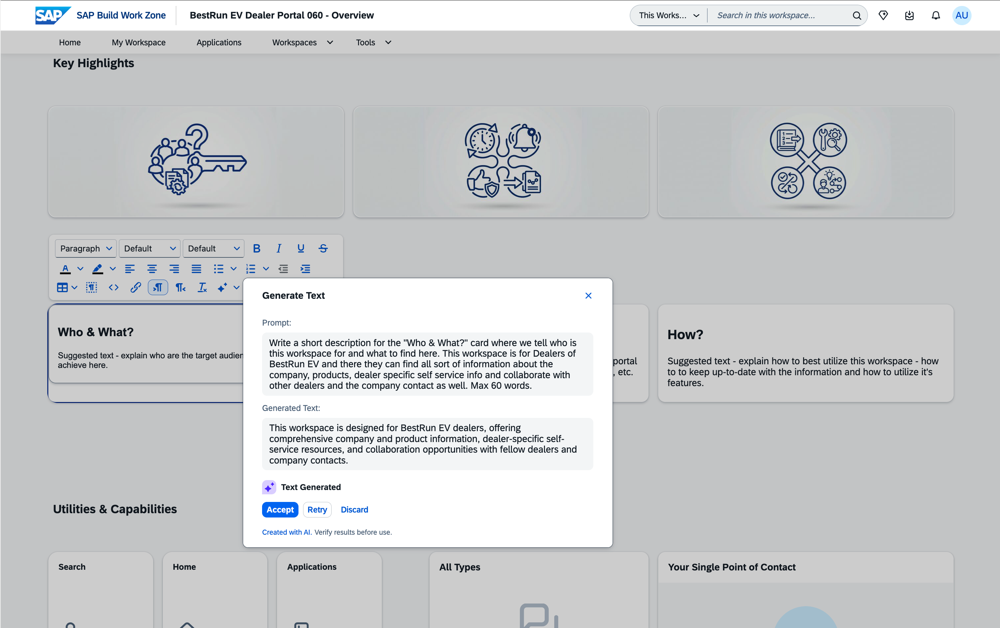

### The Why? and How? Cards

Repeat the same **Generate Text** flow for the remaining two cards, using the prompts below. The **Who & What?** card now shows your accepted text — do the same for **Why?** and **How?**.

**Why?**

```
Write 2 short sentences for a portal welcome card titled "Why?".
The card is on the BestRun EV authorized dealer portal. Explain why dealers
should use the portal regularly — a single place for orders, invoices, support,
and the latest product news from BestRun EV. Maximum 60 words total.
```

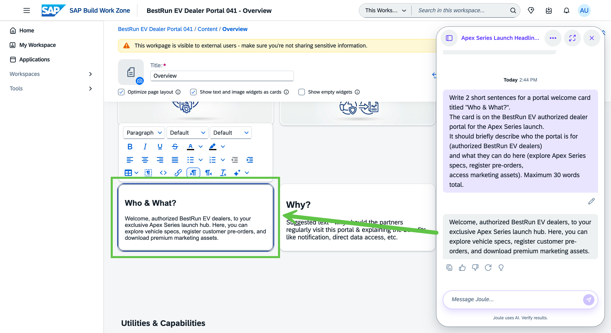

**How?**

```
Write a short description for a dealer portal welcome card titled "How?".
Explain how to navigate the portal — use the UI cards to view company-related
data, self-service cards to view outstanding invoices and tickets, review
documents in the Content tab, use the forum to engage in discussions, and
browse company events in the Events tab. Maximum 60 words.
```

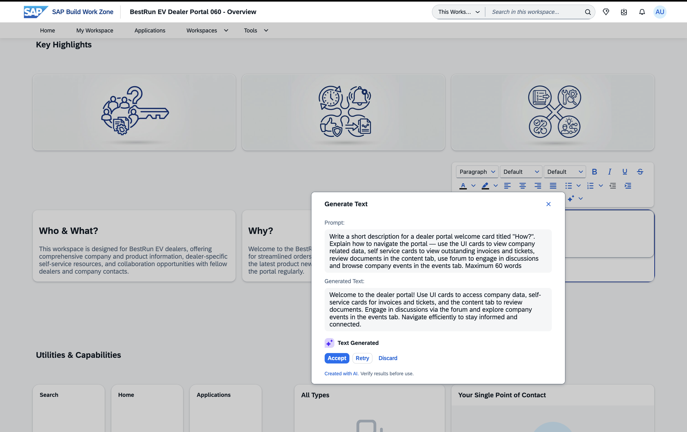

### Save and Review

Once all three cards have their generated content, your Key Highlights section is complete.

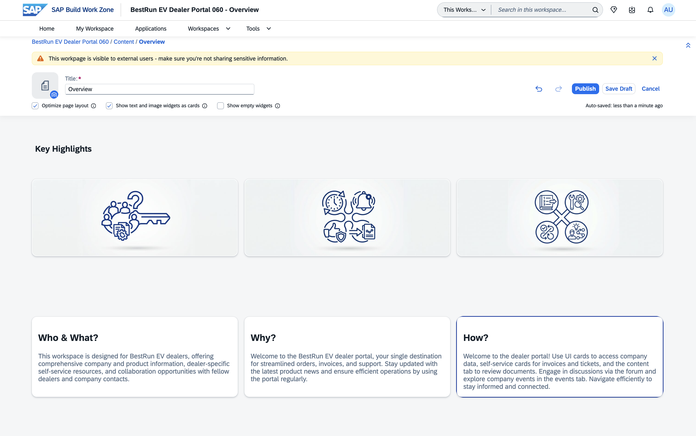

Click **Publish** (top-right of the page editor) to make your changes live.

Every time you publish, a **Publish** dialog appears. It lets you post the change as an update message in the workspace feed and set the item's permissions. Since the workspace is still in its initial stages, update messages don't add value yet — **uncheck "Show in Feed Updates"** and click **Publish**.

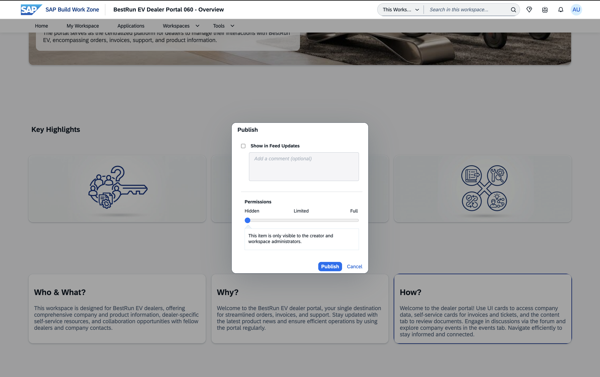

View the Overview page to see the latest state of the portal.

### Summary

The Key Highlights section now explains the portal to dealers, authored entirely with the widgets' embedded AI. Next you will add the self-service cards.

---

## Exercise 2.3 Add the BestRun EV company specific info cards

1. Enter the page editor for the Overview page (the same **Edit** entry point you used in Exercise 2.1, step 1).

2. Scroll down to the **Utilities & Capabilities** section and **hover** over it. A bounding outline appears around the section, along with an **Add section** button at its top edge. Click **Add section** to insert a new section **above** Utilities & Capabilities.

    In the **Add Section** popover, choose **Freestyle**. (A Freestyle section lets you place UI cards directly. The **Wizard** option is for a Guided Experience, which you will build later.)

    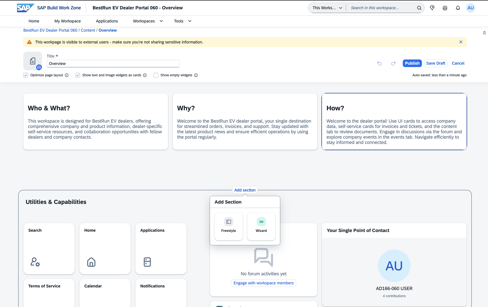

3. A new empty Freestyle section appears above Utilities & Capabilities. **Hover** over it to reveal the **Add Content** button, then click it.

    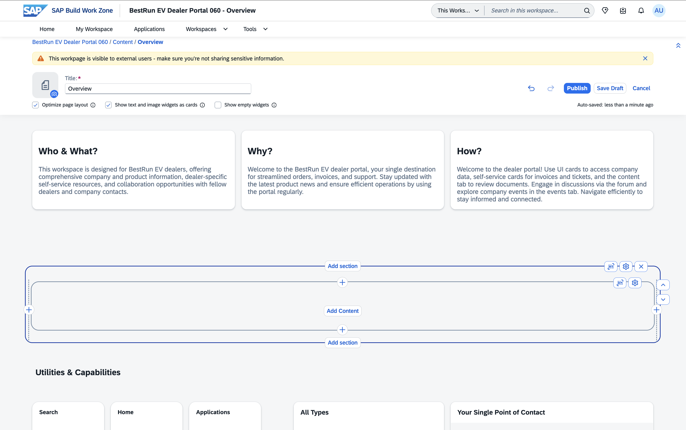

4. The **Add Content** selection screen opens, listing the content types you can add (Tiles, Cards, Image, Text, and more). Select **Cards** — "Show content from various sources to enable user interaction."

    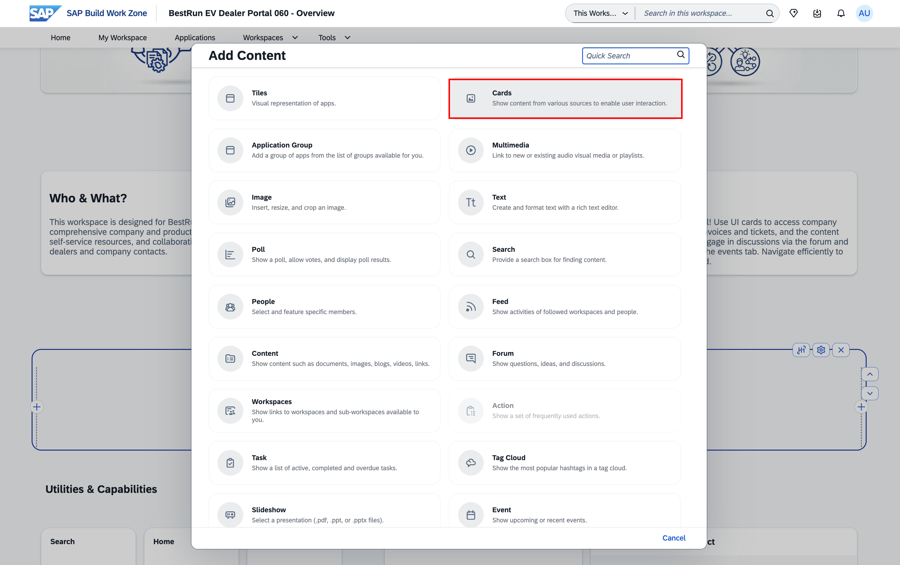

5. The **Add Cards** screen lists the pre-built cards available in this landscape (**All Cards (9)**) — including company info cards such as Factory Inventory, Portfolio Performance, and eBike Demand Mix. For the first card, select **BestRun EV | Factory Inventory** — "Available-to-ship factory inventory by eBike model, with stock threshold reference lines."

    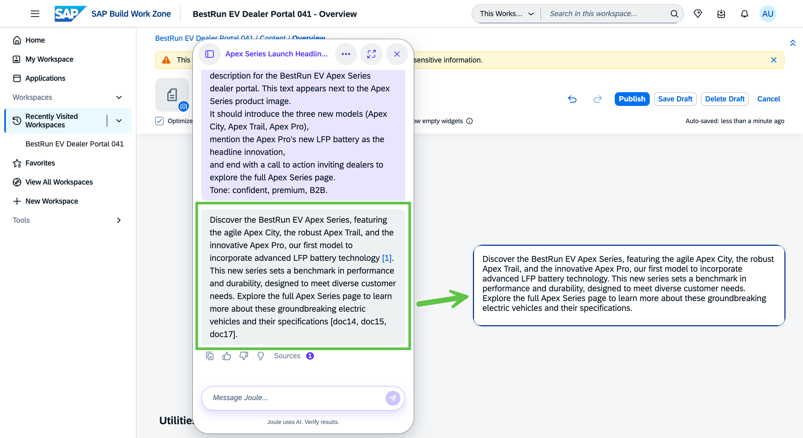

6. The **Factory Inventory** card is added to the section. To place the next card beside it, **hover** over the section and click the **+ (Add column)** button on the right edge of the card to create a new column for the second card.

    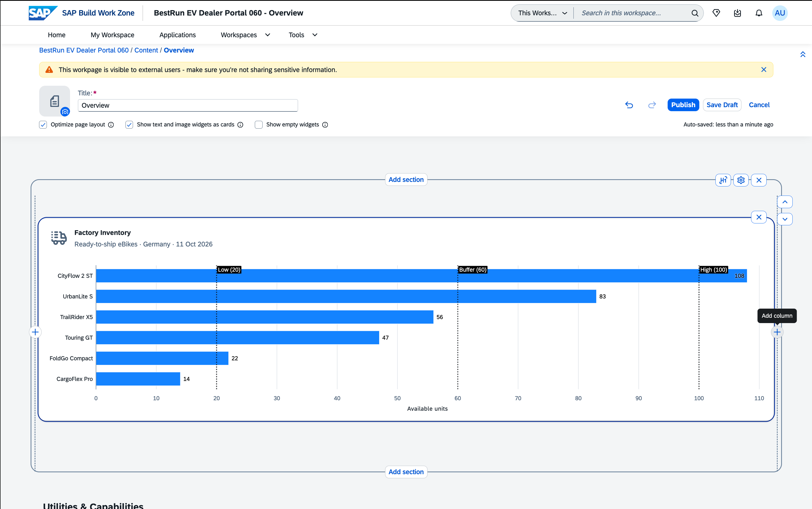

7. The Factory Inventory card resizes and a new empty cell appears to its right. Click **Add Content** in that cell and repeat the same steps as before (**Cards** → select a card), this time choosing **BestRun EV | Portfolio Performance** — "Portfolio comparison of volume, margin and sales revenue by eBike model."

    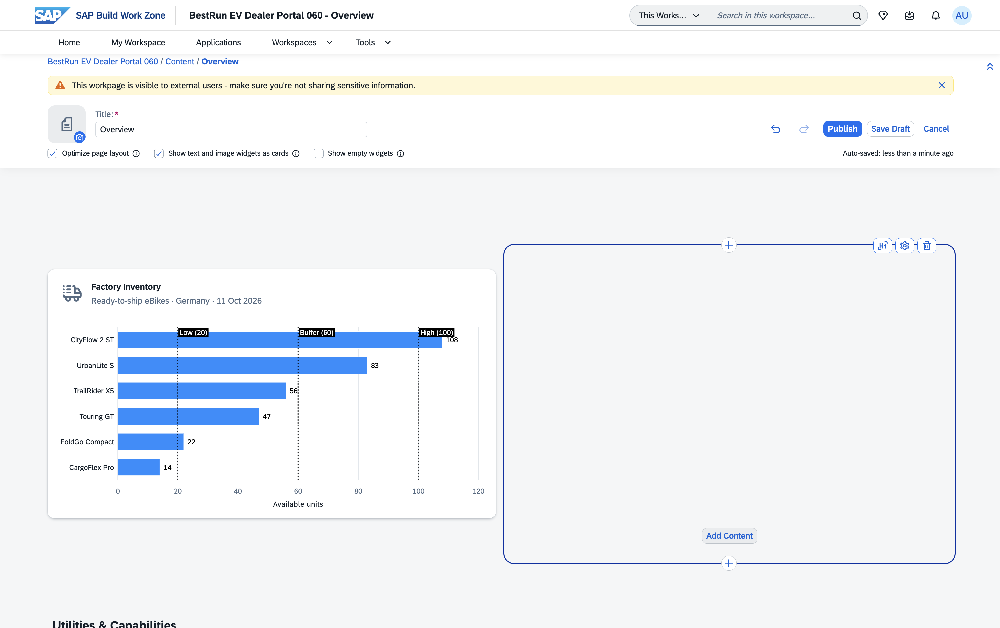

8. You now have two cards side by side — **Factory Inventory** and **eBike Portfolio Performance**. Next, add a card **below** the Factory Inventory card: **hover** slightly below it until an **Add Content** button appears, click it, and repeat the flow (**Cards** → select), this time choosing **BestRun EV | eBike Demand Mix** — "Germany Q4 2026 market demand forecast by eBike product category."

    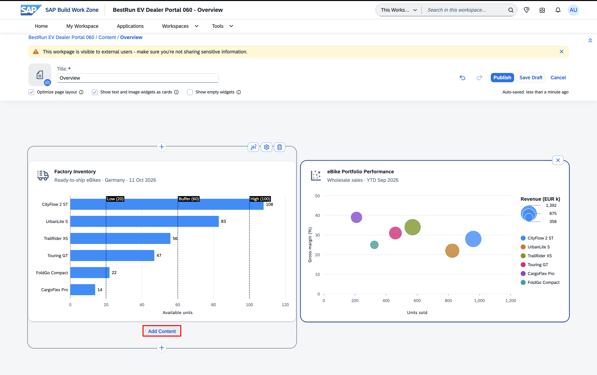

9. The **eBike Demand Mix** card is added below Factory Inventory. For the fourth and final card in this section — a company calendar of upcoming events a dealer may care about — use the same pattern: **hover** slightly below the **eBike Portfolio Performance** card (right column), click **Add Content**, and add **BestRun EV | Events Calendar** — "Public BestRun EV campaign and event schedule for October and November 2026."

    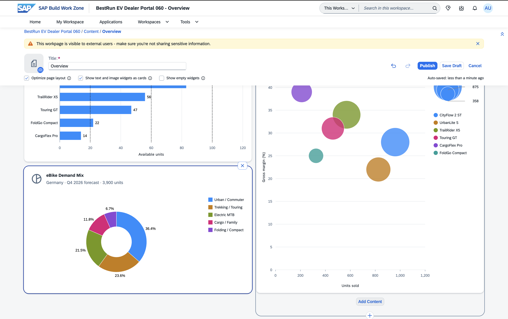

10. Your company info section is now complete — a 2×2 grid of cards: **Factory Inventory**, **eBike Portfolio Performance**, **eBike Demand Mix**, and **BestRun EV Events**. Click **Publish** to make it live. In the **Publish** dialog, uncheck **Show in Feed Updates** and click **Publish**, then review the Overview page.

    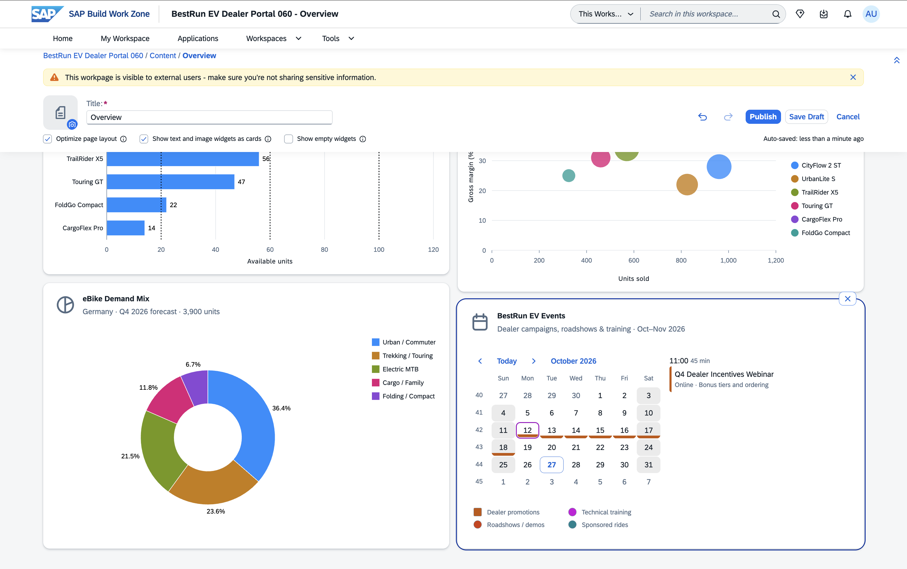

### Summary

The Overview page now features a section of BestRun EV company info cards — inventory, portfolio performance, demand mix, and an events calendar — giving dealers an at-a-glance operational view. Next you will add the self-service cards.

---

## Exercise 2.4 Add the Self-Service Cards Section

1. Still in the page editor, add another section — this time **below** the company info section you just built. **Hover** near the bottom edge of that section until the **Add section** button appears beneath it, then click it (choose **Freestyle** when prompted).

    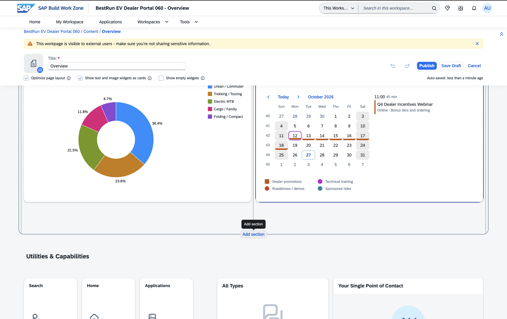

2. **Hover** inside the newly added section to reveal its toolbar in the top-right corner, then click the **Show section header** button. This lets you give the section a title.

    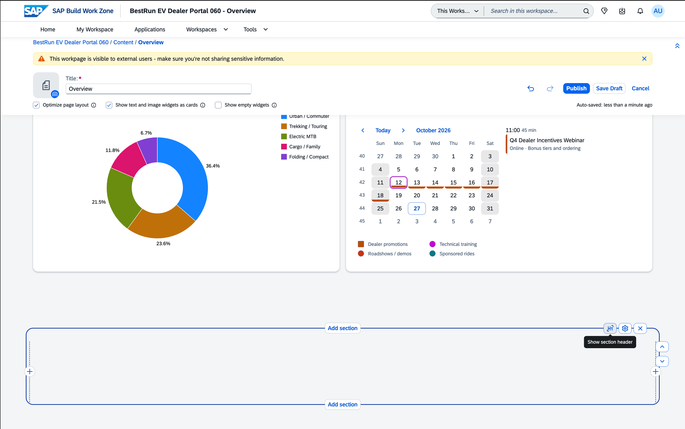

3. In the section header, enter the title **Dealer 360**.

    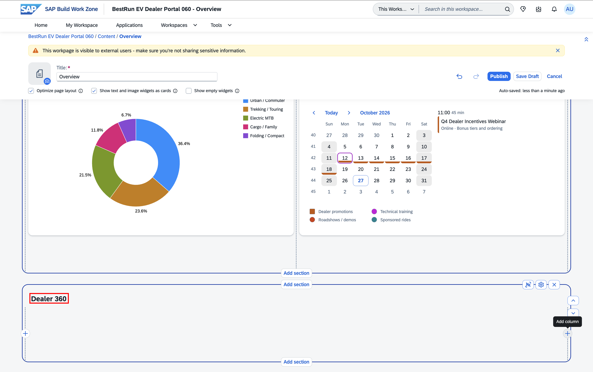

4. You will add **three** self-service cards side by side, so set up the columns first. **Hover** over the section and click the **+ (Add column)** icon on the left edge **twice** — the section now has three columns ready for the cards.

5. Each column shows an **Add Content** button. Using the same flow as before (**Add Content** → **Cards** → select), add one card to each column, in order:

    - **BestRun EV | My Orders** — "Outstanding wholesale e-bike orders placed by the signed-in BestRun EV dealer."
    - **BestRun EV | My Invoices** — "Outstanding invoices issued by BestRun EV to its signed-in dealer."
    - **BestRun EV | My Support Cases** — "Outstanding dealer issues including returns, shipping delays and e-bike warranty requests."

    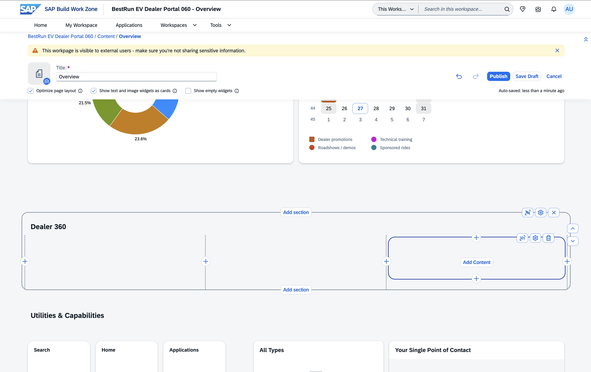

6. The three cards are added, but they show **"No open orders / invoices / support cases found."** This is **expected, not a bug** — these are **self-service cards** that only load data for the signed-in **dealer** user. As the admin, you have no dealer data, so they appear empty. The cards will show real content later, when you switch to your **Dealer XXX** alias in Exercise 3.

    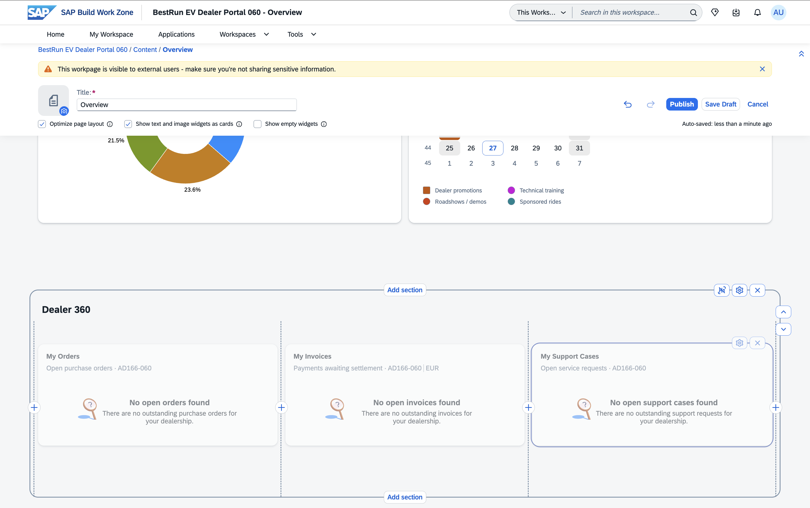

### Summary

The **Dealer 360** section is in place with the three self-service cards. They look empty for you as the admin, but will come to life for the dealer. Next you will update the footer section of the Overview page.

---

## Exercise 2.5 Update the footer section of the overview page

1. Still in the page editor, **scroll all the way down** to the footer. **Hover** over the footer text widget (the generic **"Partner Portal © 2026 Your Company Name. All rights reserved."** line) and click it to open its rich-text toolbar for editing.

    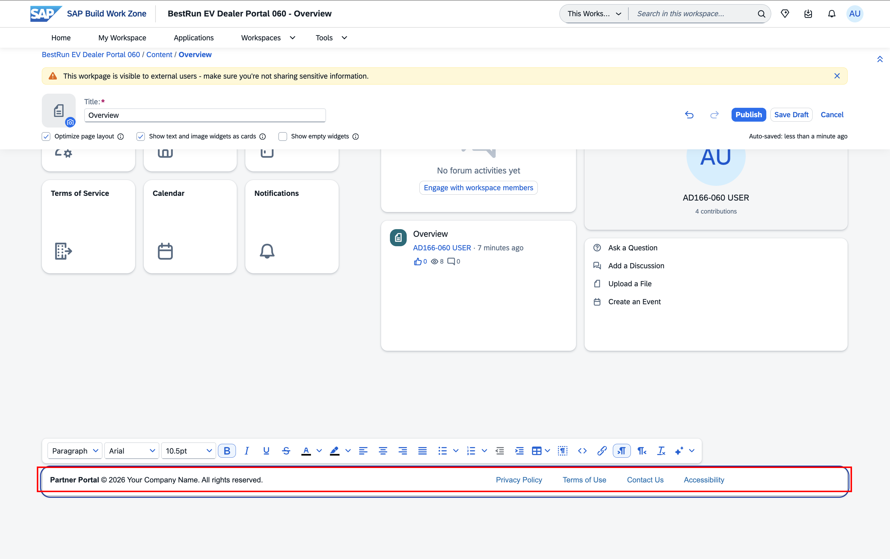

2. Edit the footer text to reflect BestRun EV:

    ```
    Dealer Portal © 2026 BestRun EV. All rights reserved.
    ```

    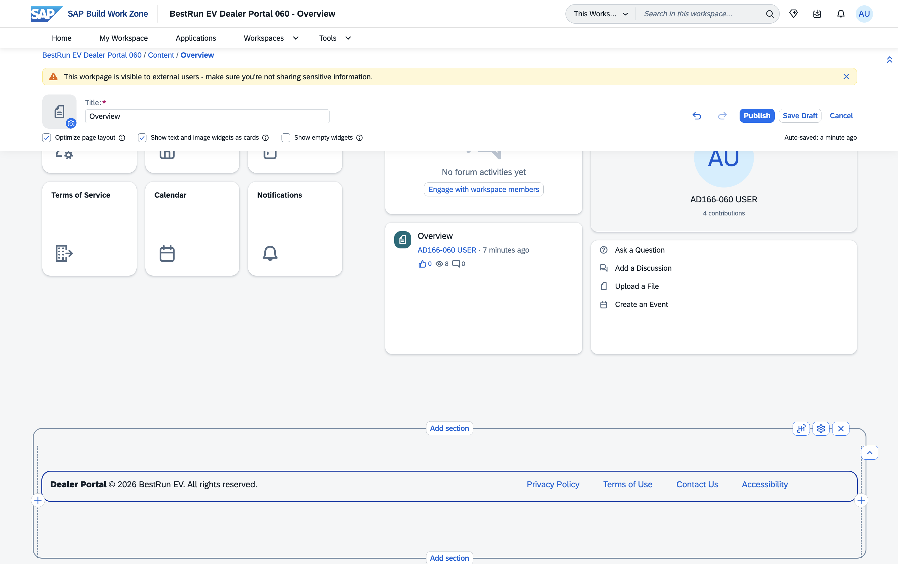

3. With all your Overview page changes in place — hero banner, Key Highlights, the company info cards, the Dealer 360 self-service cards, and the footer — click **Publish**. In the **Publish** dialog, uncheck **Show in Feed Updates** and click **Publish**.

### Summary

Your BestRun EV Dealer Portal Overview page is now fully personalized: a welcoming hero, generic Key Highlights, a section of company info cards, a Dealer 360 self-service section, and a branded footer — all published and live. At this stage, your Overview page should look something like this:

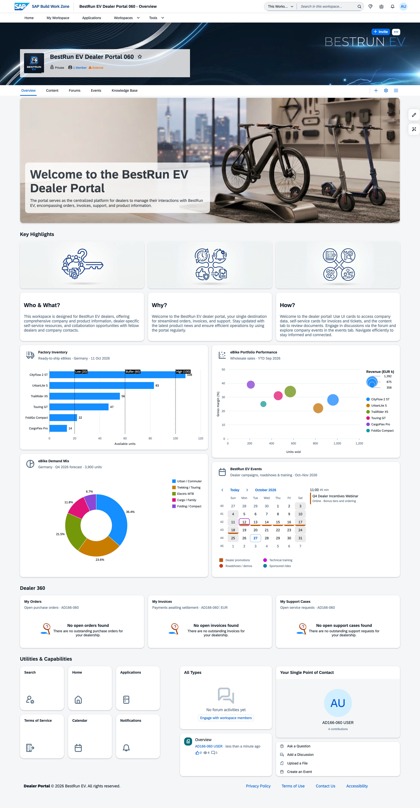

---

## Exercise 2.6 Experience the Portal as a Dealer

Now you switch roles. Using your **Dealer XXX** alias user, you view the Overview page you just built — exactly as a dealer would see it.

1. Click the **user avatar / profile icon** on the far right of the top menu bar, then select **Alias Account Switcher**.

    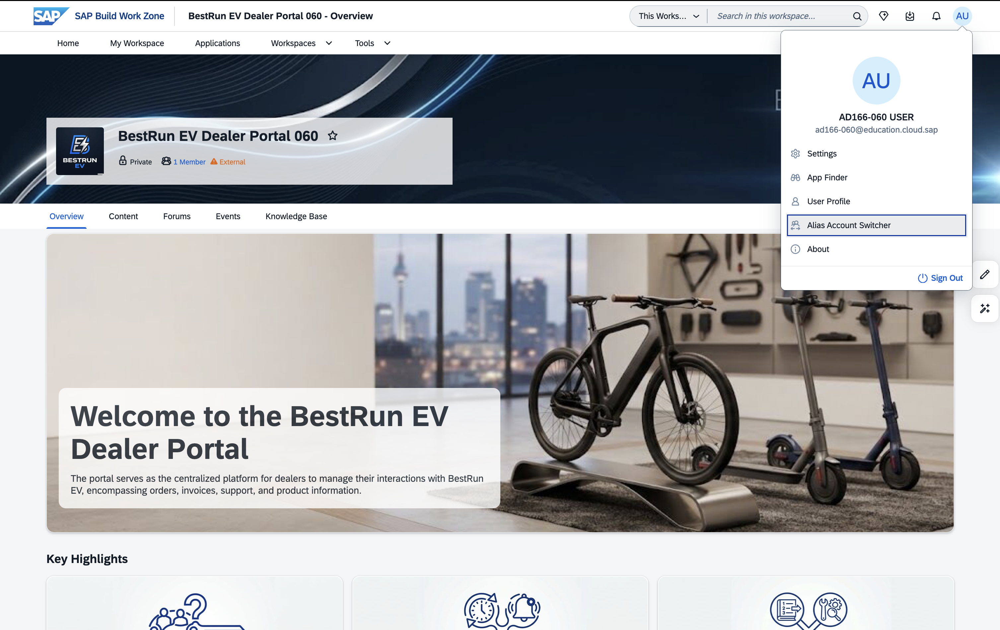

2. In the **Alias Account Switcher** dialog, select your **Dealer XXX** alias (only your own alias appears here) and click **Save**.

    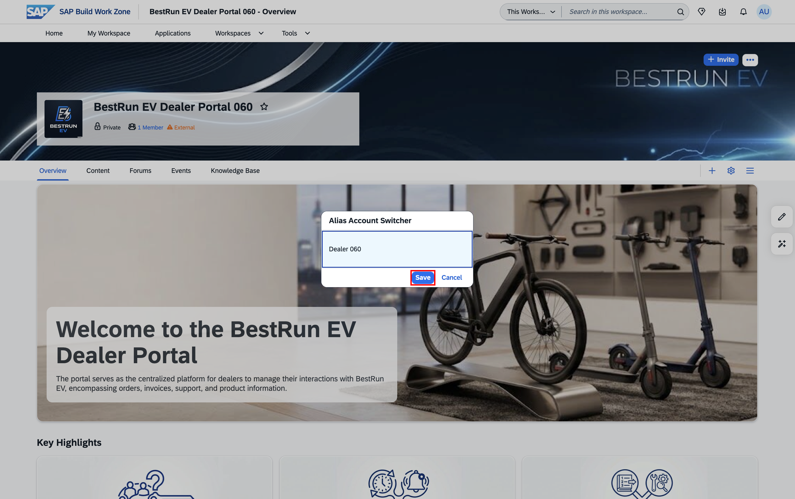

3. The UI reloads with **Dealer XXX** as the logged-in user — a banner at the top confirms **"Currently acting as an Alias Account."** In the **Notification Summary** widget (bottom-right), you have **1 invitation** (to the dealer portal workspace). Click **View all invitations**.

    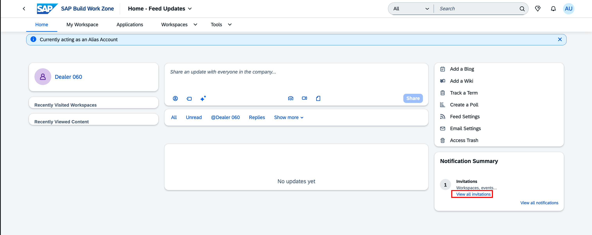

4. On the **Invitations** list, you'll see an invite from **AD166-XXX USER** to join the workspace **BestRun EV Dealer Portal XXX**. Click **Join**.

    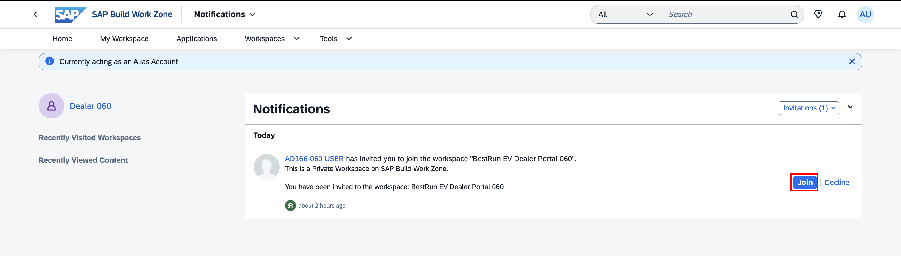

5. A **Workspace Access Information** screen appears, asking you to choose an **Email Notifications** preference. Leave it as is (**None**) and click **Accept** — this takes you into the workspace.

    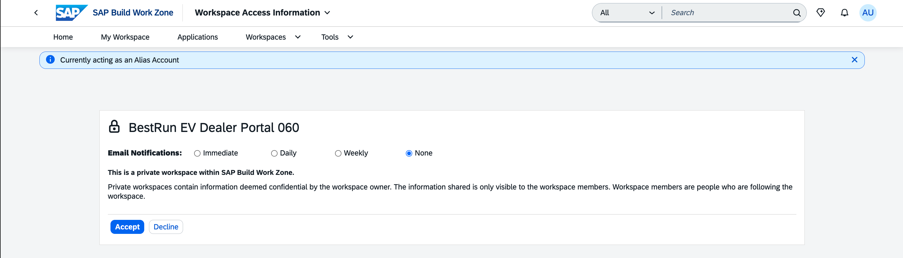

6. You are now in the **BestRun EV Dealer Portal** as the dealer. Move around and browse the Overview page the way a dealer would. Notice that the **Dealer 360** self-service cards — **My Orders**, **My Invoices**, and **My Support Cases** — now show real data for your dealership (open orders, outstanding invoices, support cases), unlike the empty states you saw as the admin.

    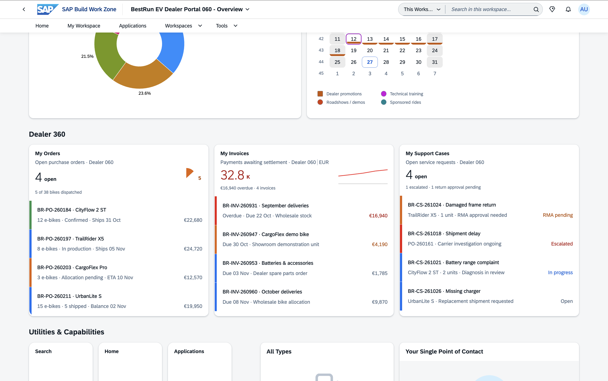

7. To come out of the alias view, open the **user avatar / profile icon** menu again and select **Alias Account Switcher**. This time it shows your **Primary Account** — **AD166-XXX USER**. Select it and click **Save** to return to your own company-internal user view.

    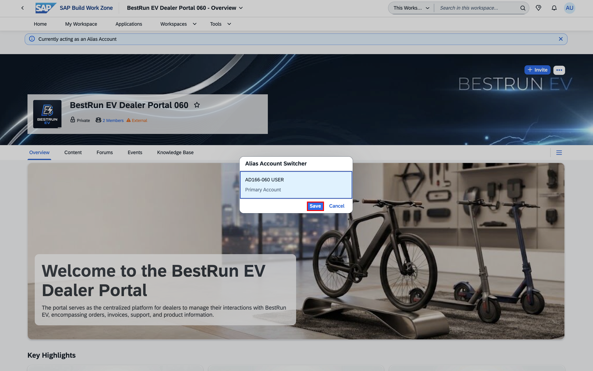

### Summary

You experienced the portal from the dealer's perspective: the same page you built as the admin now surfaces the dealer's own business data in the self-service cards. This is the power of role-aware content in SAP Build Work Zone. You then switched back to your primary admin account, ready for the next exercise.

---

Continue to — [Exercise 3 - Create the New Product Launch Content](../ex3/README.md)
