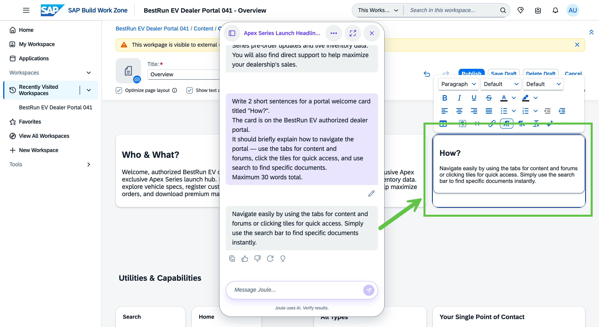

# Exercise 2 - Build the Apex Series Launch Content with AI

In this exercise, you build the core content of the dealer portal. You will create the Apex Series landing page, use AI-assisted text generation to draft a launch announcement, and add individual model overview sections — all without leaving the workspace editor.

By the end of this exercise, the portal will have a complete, dealer-ready Apex Series presentation page.

## Exercise 2.1 Create the Apex Series Landing Page

You will add a new page to the workspace and set it up as the main entry point for Apex Series content.

1. In the **BestRun EV Dealer Portal XXX** workspace, open the page management view.

    > [!IMPORTANT]
    > **TODO:** Confirm the navigation path to add a new page in the workspace (e.g., via the page editor, workspace admin, or a + button in the navigation).

    
    > *📸 Capture: The workspace editor or admin view showing the current pages list and a clearly visible option to add a new page.*

2. Click **Add Page** (or the equivalent action) and name the page **Apex Series**.

    
    > *📸 Capture: The new page dialog or inline editor showing the page name field filled with "Apex Series".*

3. Set the page layout to a **full-width** or **hero** layout suitable for a product launch page.

    > [!IMPORTANT]
    > **TODO:** Confirm the available page layout options and the recommended layout for a product content page. Update step text with the exact layout name.

    
    > *📸 Capture: The page layout picker showing available layout options. The recommended full-width or hero layout option should be visible.*

4. Add the **Apex Series hero image** to the page header.

    > [!IMPORTANT]
    > **TODO:** Confirm where the hero images are stored (shared content library, image upload, or pre-loaded in the landscape). Update this step with the exact path to upload or select the BestRun EV hero image.

    
    > *📸 Capture: The page header area with the hero image applied. The image should show the Apex Pro model against a mountain or outdoor backdrop.*

### Summary

The Apex Series page is created with a visual header. Next you will populate it with AI-generated launch content.

---

## Exercise 2.2 Use AI to Draft the Launch Announcement

You will use the built-in AI text generation feature to draft a professional dealer-facing launch announcement for the Apex Series.

1. In the page editor, add a **Text** widget or **Rich Text** section below the page header.

    
    > *📸 Capture: The page editor showing the hero image above and a new empty text section below it, ready for content.*

2. Click the **AI Assist** or **Generate with AI** option within the text editor.

    > [!IMPORTANT]
    > **TODO:** Confirm the exact name and location of the AI text generation entry point within the SAP Build Work Zone page editor (button label, toolbar option, or context menu item).

    
    > *📸 Capture: The text editor toolbar with the AI generation option highlighted — showing how the AI assist feature is accessed from within the editor.*

3. In the AI generation panel, enter the following prompt:

    ```
    Write a professional announcement for our authorized dealer network introducing the BestRun EV Apex Series — our new line of premium electric bikes and scooters. The announcement should cover the three new models (Apex City, Apex Trail, Apex Pro), highlight the key innovation of the Apex Pro's new LFP battery system, and invite dealers to explore the portal for full specifications and pre-order information. Tone: confident, premium, B2B.
    ```

    
    > *📸 Capture: The AI generation panel or dialog with the prompt text entered and ready to submit.*

4. Click **Generate** and review the output.

    
    > *📸 Capture: The AI-generated announcement text in the preview panel. The text should be a professional, multi-paragraph dealer announcement covering the three models.*

5. If the output is satisfactory, click **Insert** (or **Accept**) to add the text to the page. If needed, regenerate or edit the text inline.

    
    > *📸 Capture: The page editor showing the AI-generated announcement text now placed in the text section below the hero image.*

### Summary

The launch announcement is in place. Next you will add individual sections for each Apex Series model.

---

## Exercise 2.3 Add Model Overview Sections

Each Apex model gets its own section on the page. You will add a card or section per model with a product image and space for the AI-generated overview copy.

1. Below the launch announcement, add a new **three-column** or **card grid** layout section.

    > [!IMPORTANT]
    > **TODO:** Confirm the exact widget or section type used for the model overview cards (e.g., Image + Text card, Tile widget, Image card widget). Update this step with the correct widget name.

    
    > *📸 Capture: The section/widget picker open in the editor, showing available layout options. A three-column or card grid option should be visible.*

2. Add the **Apex City** model image to the first card and set the card title to **Apex City**.

    > [!IMPORTANT]
    > **TODO:** Confirm where model product images are stored in the landscape (content library or upload path). Add the image filenames once assets are ready.

    
    > *📸 Capture: The first model card showing the Apex City product image (urban commuter scooter on a city street) with the "Apex City" title label.*

3. Repeat for **Apex Trail** and **Apex Pro**, adding their respective product images and titles.

    
    > *📸 Capture: All three model cards side by side in the editor — Apex City, Apex Trail, Apex Pro — each with a product image and title. Apex Pro should use the mountain/terrain image.*

### Summary

The three model cards are in place. Next you will generate the overview copy for each model using AI.

---

## Exercise 2.4 Generate Model Copy with AI

You will use AI text generation for each model card to produce consistent, professionally worded dealer-facing overviews.

1. Open the text field within the **Apex City** card and use AI Assist to generate the following:

    ```
    Write a short dealer-facing product overview for the Apex City — a lightweight urban electric commuter scooter by BestRun EV. Highlight: city-optimized design, ease of use, low maintenance, and ideal customer profile (urban commuters, last-mile delivery). Keep it under 80 words. Tone: clear, practical, professional.
    ```

    
    > *📸 Capture: The Apex City card with the AI-generated product overview text inserted. The text should be a concise paragraph visible below the product image.*

2. Accept the generated text and repeat for the **Apex Trail** card:

    ```
    Write a short dealer-facing product overview for the Apex Trail — a mid-range adventure electric bike by BestRun EV. Highlight: 140 km range, all-terrain capability, aluminum frame, and ideal customer profile (outdoor enthusiasts, weekend riders). Keep it under 80 words. Tone: energetic, performance-focused, professional.
    ```

    
    > *📸 Capture: The Apex Trail card with the AI-generated overview text inserted. The card should show the trail/forest product image above the text.*

3. Accept the generated text and repeat for the **Apex Pro** card:

    ```
    Write a short dealer-facing product overview for the Apex Pro — the flagship performance electric bike by BestRun EV. Highlight: 200 km range, new LFP battery system, off-road capability, and positioning as BestRun EV's most advanced model to date. Keep it under 80 words. Tone: premium, innovation-focused, professional.
    ```

    
    > *📸 Capture: The Apex Pro card with the AI-generated overview text inserted. This card should visually feel more premium — use the mountain/outdoor hero image for Apex Pro.*

4. **Save** the page and use the **Preview** option to review the full Apex Series page as a dealer would see it.

    
    > *📸 Capture: The full-page preview of the Apex Series landing page — hero image at top, launch announcement below, three model cards (City / Trail / Pro) in a grid at the bottom. This is the "wow" view of the portal content.*

### Summary

The Apex Series landing page is complete with AI-generated content throughout. You have used AI text generation to produce dealer-facing copy at professional quality — quickly and consistently across all three models.

Continue to — [Exercise 3 - Enable Document Grounding](../ex3/README.md)
