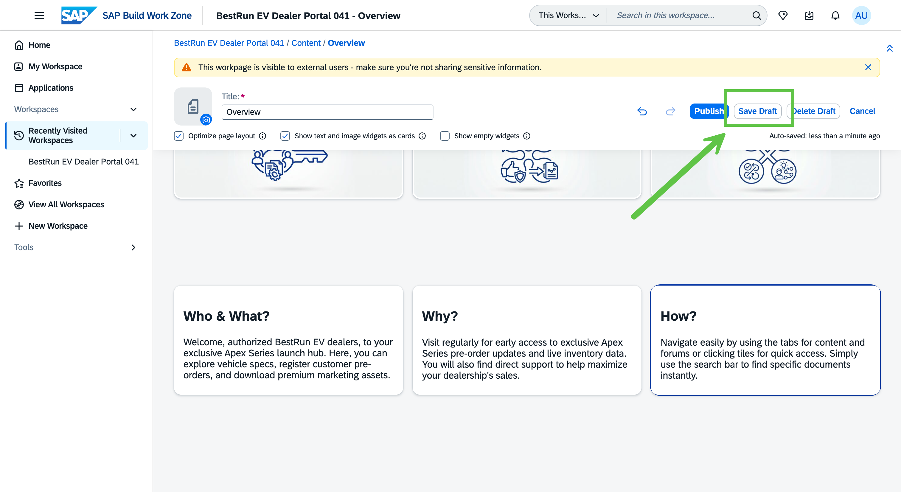

# Exercise 2 - Update the Dealer Workspace Content

In this exercise you make the workspace your own. Using the **AI text generation built into each content widget**, you update the hero banner and the Key Highlights with **generic dealer portal** content, then add a row of pre-built self-service cards — **My Orders**, **My Invoices**, and **My Tickets**. Finally, you switch to your dealer alias user to experience the portal as a dealer for the first time.

> [!IMPORTANT]
> This exercise builds the **generic dealer portal** — content that applies to the whole dealer relationship, not to any single product. The **Apex Series** product launch comes later, in Exercise 3, on a dedicated page. Keep the content here product-neutral.

> [!NOTE]
> **Use the embedded AI, not the Joule panel.** Every widget in SAP Build Work Zone that accepts text has a built-in AI text-generation button — the **✨ sparkle icon** in the rich-text toolbar (or next to a text field). Clicking it opens a menu:
> - **Generate Text** — appears when the field is empty; you type a short prompt and it writes the copy.
> - **Change Tone** — rewrites existing text in a different tone (e.g. Professional, Confident).
> - **Adjust Length** — makes existing text shorter or longer.
> - **Fix Spelling and Grammar** — cleans up existing text.
>
> You will use **Generate Text** to create copy from a prompt, and **Change Tone / Adjust Length** to refine text that already exists. This is the SAP Build Work Zone editing experience — the standalone Joule panel is not needed here.

> [!NOTE]
> **TODO (screenshots):** The screenshots in this exercise are being recaptured to match the generic dealer portal content. Current images may still show earlier product-specific content.

## Exercise 2.1 Update the Hero Banner with a Generic Dealer Portal Tagline

The Partner Portal Template comes with a hero banner that has placeholder title and description text. You will replace the copy using the widget's embedded AI, so dealers immediately understand what the portal is for.

1. Open **BestRun EV Dealer Portal XXX** and enter the page editor. Look for the **Edit** button in the workspace header or the pencil icon on the Overview page.

    

2. Click **Edit Widget Settings** at the top right of the hero banner. The **Rotating Banner Widget** dialog opens, showing **Title**, **Description**, and other slide settings.

    

3. In the **Title** field, type a short, generic welcome title, for example:

    ```
    Welcome to the BestRun EV Dealer Portal
    ```

4. Click into the **Description** field and clear any placeholder text. Click the **✨ sparkle (AI assist)** button next to the field and choose **Generate Text**. Paste the following prompt:

    ```
    Write a one-sentence tagline for the hero banner of the BestRun EV authorized
    dealer portal. The portal is the single place where dealers manage their
    relationship with BestRun EV — orders, invoices, support, and product
    information. Keep it welcoming and product-neutral.
    ```

    

5. Review the generated tagline. To refine it, click the **✨ sparkle** button again and try **Change Tone → Professional** or **Adjust Length → Shorter** until it reads the way you want.

    

6. Click **Save** to apply the banner copy.

    

### Summary

The hero banner now welcomes dealers to the portal, written with the widget's embedded AI. Next you will update the Key Highlights cards the same way.

---

## Exercise 2.2 Update the Key Highlights with Generic Portal Content

The Key Highlights section contains three text cards — **Who & What?**, **Why?**, and **How?** — that explain the purpose of the portal. Each card is a rich-text field with the same embedded AI button. You will **generate** the first cards from a prompt and **refine** with Change Tone / Adjust Length.

1. In the page editor, click into the **Who & What?** card to open its rich-text toolbar.

    

2. Click the **✨ sparkle** button in the toolbar and choose **Generate Text**. Paste this prompt:

    ```
    Write 2 short sentences for a portal welcome card titled "Who & What?".
    The card is on the BestRun EV authorized dealer portal. Describe who the portal
    is for (authorized BestRun EV dealers) and what they can do here (manage orders,
    view invoices, raise support tickets, and access product information).
    Maximum 30 words total.
    ```

    

3. If the generated text is a little long for the card, click the **✨ sparkle** button again and choose **Adjust Length → Shorter**.

    

4. Click into the **Why?** card, open the **✨ sparkle** menu, choose **Generate Text**, and paste:

    ```
    Write 2 short sentences for a portal welcome card titled "Why?".
    The card is on the BestRun EV authorized dealer portal. Explain why dealers
    should use the portal regularly — a single place for orders, invoices, support,
    and the latest product news from BestRun EV. Maximum 30 words total.
    ```

    

5. For the **How?** card, this time practice refining existing text. The card already contains template placeholder copy — click into it, open the **✨ sparkle** menu, and use **Change Tone → Professional** and then **Adjust Length → Shorter** to turn the placeholder into concise, on-brand copy. (If you prefer, you can use **Generate Text** here as well.)

    ```
    (Optional Generate Text prompt for the How? card)
    Write 2 short sentences for a portal welcome card titled "How?".
    Explain how to navigate the portal — use the tiles for quick access to orders,
    invoices, and tickets, and use search to find documents. Maximum 30 words total.
    ```

    

6. Save the Key Highlights widget (click **Save Draft**).

    

7. All three Key Highlights cards now show generic portal content.

    

> [!TIP]
> You just used three of the embedded AI tools: **Generate Text** to write from scratch, **Change Tone** to shift the voice, and **Adjust Length** to fit the space. Any text widget in the workspace offers the same options.

### Summary

The Key Highlights section now explains the portal to dealers, authored entirely with the widgets' embedded AI. Next you will add the self-service cards.

---

## Exercise 2.3 Add the Self-Service Cards Section

You will add a row of three pre-built cards — **My Orders**, **My Invoices**, and **My Tickets** — that give dealers at-a-glance access to their business data.

> [!NOTE]
> These three cards are **pre-built sample cards** already available in this landscape. They display representative business data to show how live data appears in a workspace — they are not connected to a real backend system.

1. In the page editor, scroll below the Key Highlights section and add a new section using the **Add Section** button between sections. Choose a layout that fits three cards side by side.

    

2. Open the card / widget picker and add the **My Orders** card.

    

3. Add the **My Invoices** card beside it.

    

4. Add the **My Tickets** card beside it.

    

5. Save the section (**Save Draft**). The three self-service cards now appear side by side on the Overview page.

    

### Summary

The Overview page now has a welcoming hero, generic Key Highlights, and a row of self-service cards. Time to see it as a dealer.

---

## Exercise 2.4 Experience the Portal as a Dealer

Now you switch roles. Using your **Dealer-XXX** alias user, you accept the invitation to join the workspace and view the Overview page you have built so far — exactly as a dealer would see it.

1. Switch to your dealer alias user. Open your **user profile** menu and switch to **Dealer-XXX** (matching your participant number — e.g. **Dealer-005** for participant AD166-005).

    > [!NOTE]
    > **TODO:** Confirm and capture the exact user-profile switch path for the dealer alias in this landscape.

    

2. As the dealer, locate and **accept the invitation** to join **BestRun EV Dealer Portal XXX**.

    > [!NOTE]
    > **TODO:** Confirm how the workspace invitation is surfaced to the dealer alias (notification, invitations page, or email) and capture it.

    

3. Open the workspace and view the **Overview** page as a dealer — the hero, the Key Highlights, and the My Orders / My Invoices / My Tickets cards.

    

### Summary

You have experienced the portal as a dealer for the first time. Switch back to your admin user and continue to Exercise 3, where you add the Apex Series product launch content.

Continue to — [Exercise 3 - Create the New Product Launch Content](../ex3/README.md)
