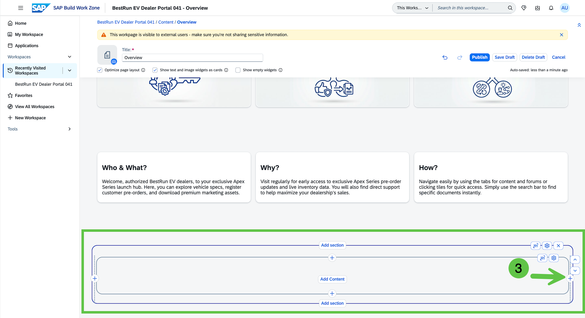
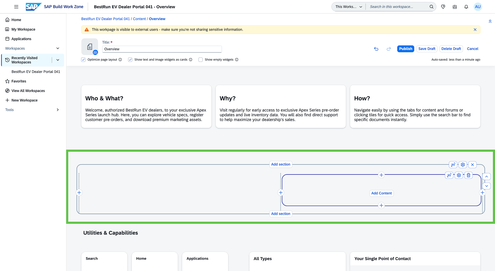
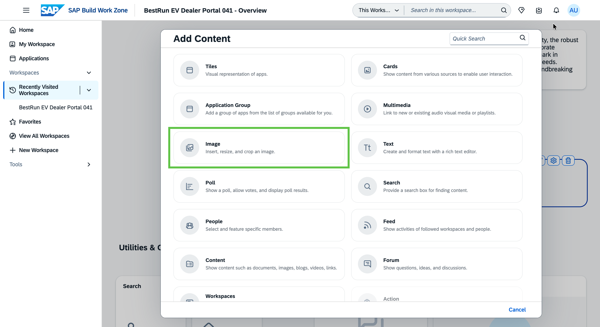
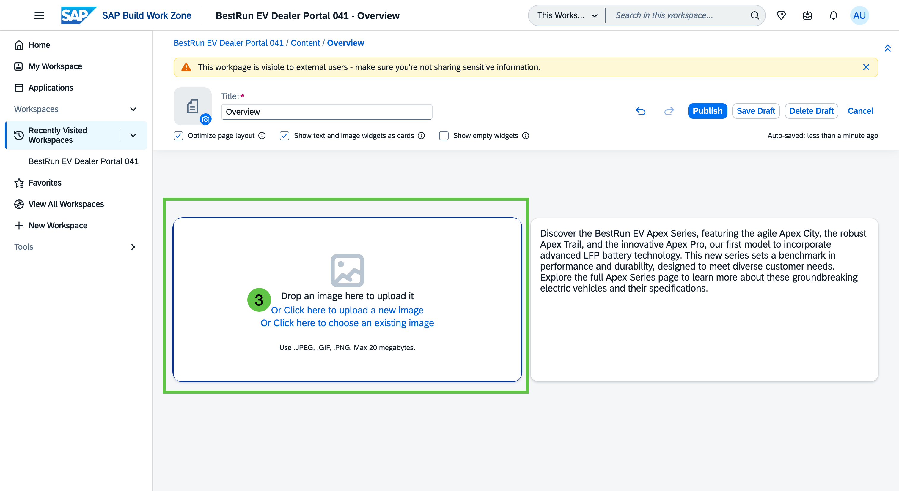
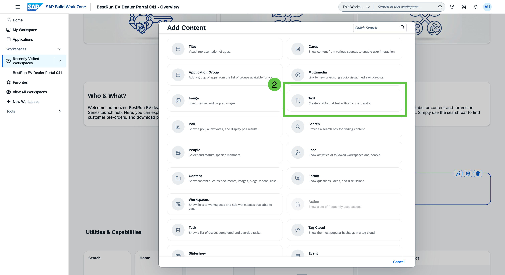

# Exercise 2 - Personalize the Portal and Launch the Apex Series

In this exercise, you take the workspace created from the External Portal Template and make it your own. Using Joule, you will update the Hero section, generate dealer-facing content for the Key Highlights, add a Featured section introducing the Apex product line, and create a dedicated Apex Series product announcement page.

By the end of this exercise, the BestRun EV Dealer Portal will have a compelling first impression and a full product launch page for the Apex Series.

## Exercise 2.1 Update the Hero Title and Tagline with Joule

The External Portal Template comes with a placeholder hero image and generic title text. Your first task is to replace these with copy that immediately communicates what this portal is about and what is launching.

1. Open **BestRun EV Dealer Portal XXX** and enter the page editor. Look for the **Edit** button in the workspace header or the pencil icon on the Overview page.

    
    > *📸 Capture: The Overview page of the workspace with the edit mode button clearly visible — either as a toolbar button or a floating pencil icon on the page.*

 2. Click on the **Edit Widget Settings** at the top right of the Hero Section.

    

3. The widget should show an edit overlay or a toolbar with title and Description fields.

    

4. With the Joule panel open, enter the following prompt to get copy suggestions for the hero:

    ```
    Suggest a short headline and tagline for the hero section of the BestRun EV dealer portal, 
    introducing the Apex Series launch. The headline should be under 8 words and energize 
    dealers. The tagline should be one sentence that sets up the pre-order opportunity.
    ```

    

5. Copy Joule's suggested headline into the Hero widget's **Title field** and the tagline into the **Description field** and Save the hero widget.

    

    > [!TIP]
    > You can ask Joule to refine the suggestion if the first output is too long or not quite the right tone. Try: *"Make the headline punchier and under 6 words."*

    

### Summary

The Hero section now reflects the Apex Series launch. Next you will update the Key Highlights cards with AI-generated content.

---

## Exercise 2.2 Update the Key Highlights with Joule

The Key Highlights section contains three text template cards — **Who & What?**, **Why?**, and **How?** — that explain the purpose and value of the portal to incoming dealers. You will use Joule to generate the body copy for each card.

1. In the page editor, click on the **Key Highlights widget** to enter its edit view.

    

2. Open the Joule panel and use the following prompt to generate the body text for the first card (Who & What?):

    ```
    Write 2 short sentences for a portal welcome card titled "Who & What?". 
    The card is on the BestRun EV authorized dealer portal for the Apex Series launch. 
    It should briefly describe who the portal is for (authorized BestRun EV dealers) 
    and what they can do here (explore Apex Series specs, register pre-orders, 
    access marketing assets). Maximum 30 words total.
    ```

    
 

3. Copy the generated text into the body field of the **Who & What?** card (to open the Card text for Edit, simply click on it).
    
    

4. Repeat using Joule for the **Why?** card:

    ```
    Write 2 short sentences for a portal welcome card titled "Why?". 
    The card is on the BestRun EV authorized dealer portal. 
    It should explain why dealers should visit regularly — early access to Apex Series 
    pre-order information, live inventory data, and direct support from BestRun EV. 
    Maximum 30 words total.
    ```
    

5. Repeat for the **How?** card:

    ```
    Write 2 short sentences for a portal welcome card titled "How?". 
    The card is on the BestRun EV authorized dealer portal. 
    It should briefly explain how to navigate the portal — use the tabs for content and 
    forums, click the tiles for quick access, and use search to find specific documents. 
    Maximum 30 words total.
    ```

    

6. Save the Key Highlights widget (Click the 'Save Draft' button).

    

7. All three Key Highlights cards updated with Joule-generated body text in the editor.
    

### Summary

The Key Highlights section is complete. Next you will add a Featured section to introduce the Apex product line visually.

---

## Exercise 2.3 Add a Featured Section for the Apex Product Line

The Featured section sits below the Key Highlights and gives the portal a visual showcase for a specific product or campaign. You will add two widgets side by side — a product image on the left and a descriptive text block on the right — to spotlight the Apex Series launch.

1. In the page editor, scroll below the Key Highlights section. Add a new **Freestyle two-column section** using the 'Add Section' button between sections.

    

    

    
  

2. In the **left column**, add an **Image widget**. Upload or select the Apex Series product image provided in the session materials.

    > [!IMPORTANT]
    > **TODO:** Confirm the source location for the Apex Series product image (shared content library, session materials upload, or pre-loaded asset). Add the exact filename and path once confirmed.

    

    

    

3. In the **right column**, add a **Text widget**.

    

    

4. Open the Joule panel and generate the featured copy:

    ```
    Write a short 3–4 sentence featured section description for the BestRun EV Apex Series 
    dealer portal. This text appears next to the Apex Series product image. 
    It should introduce the three new models (Apex City, Apex Trail, Apex Pro), 
    mention the Apex Pro's new LFP battery as the headline innovation, 
    and end with a call to action inviting dealers to explore the full Apex Series page.
    Tone: confident, premium, B2B.
    ```

    

5. Accept the generated text, then save the section (Save Draft)

    


### Summary

The Overview page now has a complete visual introduction to the Apex Series. Next you will create a dedicated product announcement page with full model details.

---

## Exercise 2.4 Create the Apex Series Product Announcement Page

The Overview page introduces the portal and the product line at a glance. Now you will build a dedicated **Apex Series** page where dealers can find the full launch announcement and detailed content for each model.

1. In the workspace navigation, open the **Pages** or **Site Map** management view and add a new page.

    > [!IMPORTANT]
    > **TODO:** Confirm the navigation path to create a new workspace page in this version of SAP Build Work Zone advanced edition — e.g., via the workspace admin, a page manager tab, or an inline + button in the navigation bar.

    
    > *📸 Capture: The workspace admin or page management view showing the current page list and a clearly visible button or option to create a new page.*

2. Name the new page **Apex Series** and save.

    
    > *📸 Capture: The new page creation dialog showing the page name field filled with "Apex Series".*

3. Enter the editor for the new **Apex Series** page and add a **Text widget** at the top. Open the Joule panel and generate the launch announcement:

    ```
    Write a professional launch announcement for the BestRun EV authorized dealer portal 
    introducing the Apex Series — our new premium electric bike and scooter product line. 
    The announcement should:
    - Open with a brief introduction to the Apex Series and why it matters to dealers
    - Describe the three new models: Apex City (urban commuter), Apex Trail (adventure bike), 
      Apex Pro (flagship with 200 km range and new LFP battery system)
    - Highlight the pre-order opportunity and the 90-day launch timeline
    - Close with an invitation to explore the full portal and register interest
    Tone: confident, premium, B2B. Length: 150–200 words.
    ```

    
    > *📸 Capture: The Joule panel next to the Apex Series page, showing the prompt entered and Joule generating the launch announcement text.*

4. Insert the generated announcement text into the **Text widget** at the top of the Apex Series page.

    
    > *📸 Capture: The Apex Series page editor showing the announcement text widget with the Joule-generated content — a professional, multi-paragraph dealer announcement.*

5. Below the announcement, add a **three-column card section** or three separate widgets for the individual model overviews. Use the Joule panel to generate copy for each:

    **Apex City:**
    ```
    Write a short dealer-facing product overview for the Apex City — a lightweight urban 
    electric commuter scooter by BestRun EV. Highlight city-optimized design, ease of use, 
    low maintenance, and ideal customer profile (urban commuters, last-mile delivery). 
    Under 60 words. Tone: clear, practical, professional.
    ```

    **Apex Trail:**
    ```
    Write a short dealer-facing product overview for the Apex Trail — a mid-range adventure 
    electric bike by BestRun EV. Highlight 140 km range, all-terrain capability, aluminum 
    frame, and ideal customer profile (outdoor enthusiasts, weekend riders). 
    Under 60 words. Tone: energetic, performance-focused, professional.
    ```

    **Apex Pro:**
    ```
    Write a short dealer-facing product overview for the Apex Pro — the flagship performance 
    electric bike by BestRun EV. Highlight 200 km range, new LFP battery system, 
    off-road capability, and positioning as BestRun EV's most advanced model to date. 
    Under 60 words. Tone: premium, innovation-focused, professional.
    ```

    
    > *📸 Capture: The Apex Series page editor showing three model overview sections (Apex City / Apex Trail / Apex Pro), each with a title and the Joule-generated product description.*

6. **Save** the Apex Series page and use **Preview** to review the full page as a dealer would see it.

    
    > *📸 Capture: The full-page preview of the Apex Series landing page — the launch announcement at the top, followed by the three model overview sections (City / Trail / Pro). This is the "wow" view of the launch content.*

### Summary

The Apex Series product announcement page is complete with a full launch announcement and AI-generated model overviews for all three models. You used Joule to produce professional dealer-facing copy at scale — in minutes.

Continue to — [Exercise 3 - Enable Document Grounding](../ex3/README.md)
