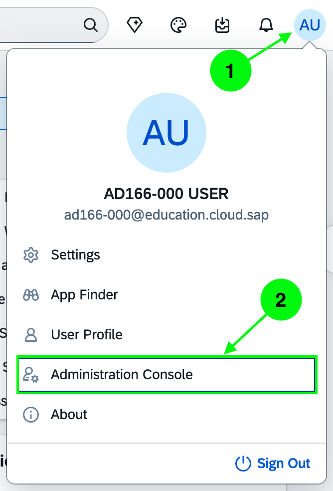
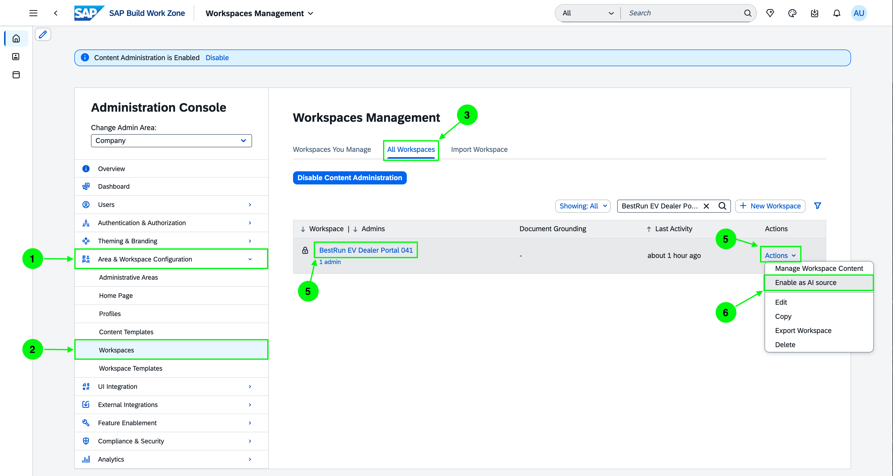
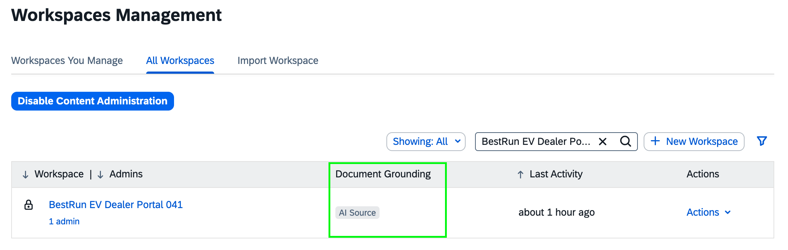

# Exercise 3 - Create the New Product Launch Content

In this exercise you add the **Apex Series** product launch content to your dealer portal — directly on the **Overview page** you built in Exercise 2. Instead of creating files from scratch, you copy a ready-made content set from the shared **Dealer Management** workspace, then surface it on the page: a presentation-and-announcement section, and product images in the hero carousel. Finally, you switch to your dealer alias and ask Joule about the new product.

> [!NOTE]
> There is **no new page** in this exercise — you enrich the existing Overview page. The launch content is copied from an existing workspace rather than downloaded and uploaded.

> [!NOTE]
> **TODO (screenshots):** Screenshots in this exercise are being recaptured to match the copy-content flow.

## Exercise 3.1 Copy the Launch Content from the Dealer Management Workspace

The Apex Series launch files are already prepared in the shared **Dealer Management** workspace, inside an **Apex Launch Material** folder. You copy them into your own workspace in a single multi-select action — no download or upload needed.

1. Open the **Dealer Management** workspace (the sample workspace you explored in Exercise 0) and go to its **Content** area.

    

2. Open the **Apex Launch Material** folder. It contains the Apex Series product images, the launch presentation, and the product documents (PDFs).

    

3. **Multi-select** all files in the folder (select the first file, then Shift-click or use the checkboxes to select the rest), then choose **Copy**.

    

4. In the copy dialog, choose **BestRun EV Dealer Portal XXX** as the destination workspace and confirm.

    

5. Open your **BestRun EV Dealer Portal XXX** workspace Content and verify the copied files are now there.

    

> [!IMPORTANT]
> The copied **PDF documents** are what **Document Grounding** indexes so Joule can answer product questions (Exercise 3.4). Grounding is enabled by your instructor for your workspace — if you have not already notified them (Exercise 1.2), do so now.

### Summary

The launch content is in your workspace. Next you will surface it on the Overview page.

---

## Exercise 3.2 Add a Presentation and Announcement Section

You will add a two-column section to the Overview page — the Apex Series **presentation** on one side and a styled **announcement** on the other.

1. Open **BestRun EV Dealer Portal XXX**, enter the page editor, and scroll below the self-service cards. Add a new **two-column section** using the **Add Section** button.

    

2. In the **left column**, add a **Multimedia card** and point it at the copied **Apex Series presentation** (`Apex-Series-Launch-Brochure.pptx`). Dealers can page through the launch brochure inline.

    

3. In the **right column**, add a **Text widget**. Open the **`<>` (source code)** view in the toolbar and paste the announcement HTML prepared for this session (see [`planning/TextWidgetHTMLContent.html`](../../planning/TextWidgetHTMLContent.html)).

    

4. Save the section. The presentation and the announcement now sit side by side.

    

### Summary

The launch section is live. Next you will bring the product imagery into the hero banner.

---

## Exercise 3.3 Add Product Images to the Hero Carousel

The hero banner at the top of the Overview page is a **Rotating Banner Widget** — it can hold up to 10 slides. You will add one slide per Apex model, turning the hero into a product carousel.

1. In the page editor, open **Edit Widget Settings** on the hero banner to open the **Rotating Banner Widget** dialog.

    

2. Click **+ Slide** and add a slide for each model, using the copied product images and the following **Title** and **Description (subtitle)**. Repeat for all three:

    | Image | Title | Subtitle |
    |---|---|---|
    | `Apex-City.png` | Apex City | Lightweight urban commuter scooter |
    | `Apex-Trail.png` | Apex Trail | 140 km adventure ebike, built for any terrain |
    | `Apex-Pro.png` | Apex Pro | 200 km flagship with the new LFP battery |

    

    > [!TIP]
    > Each slide's **Description** field has the embedded **✨ AI** button. Use **Change Tone** or **Adjust Length** to refine a subtitle without rewriting it by hand.

3. Save the hero banner. The Overview page now opens with a rotating showcase of the three Apex models.

    

### Summary

The Overview page now leads with the Apex Series and carries the full launch content. Time to see it — and Document Grounding — as a dealer.

---

## Exercise 3.4 Experience the Launch Content as a Dealer

Switch to your dealer alias and ask Joule a question about the new product. With Document Grounding enabled on your workspace, Joule answers from the copied product documents.

> [!IMPORTANT]
> This step requires Document Grounding to be active for your workspace. If your instructor has not yet confirmed grounding is ready, wait for the go-ahead before testing the Joule query.

1. Switch to your **Dealer-XXX** alias user and open **BestRun EV Dealer Portal XXX**. Review the Overview page — the Apex carousel, the presentation, and the announcement — as a dealer.

    

2. Open the **Joule** panel from within the workspace and ask a question about the new product:

    ```
    What is the maximum range of the Apex Pro in eco mode?
    ```

    

3. Verify that Joule's answer includes a **source reference** to one of the copied documents.

    > [!NOTE]
    > A correctly grounded answer shows a citation or document reference. If Joule answers without one, grounding may not yet be active for your workspace — check with your instructor.

### Summary

As a dealer, you got an instant, sourced answer about the new product — without opening a single file. Switch back to your admin user. The core session is complete.

The next exercises are **optional**:
- [Exercise 4 - Create a Guided Experience (Optional)](../ex4/README.md)
- [Exercise 5 - Access the Dealer Portal from Joule Work Mobile (Optional)](../ex5/README.md)
