# Exercise 3 - Create the New Product Launch Content

The Apex Series launch is coming close, and it is time to announce the new product line to the dealer network. The internal documents and graphic content for dealers have already been prepared by the **marketing team** — your job now is to bring that content into the **Dealer Portal** so dealers are aware of the upcoming launch and the pre-order discount offer.

Rather than downloading and uploading files, you will **copy** the ready-made content provided directly by the marketing team into the internal team workspace, **Dealer Management**, into your dealer portal — then surface it on the Overview page so that dealers can get to know about this launch, benefits for the dealer for pre-order and learn all about the new product line.

> [!NOTE]
> This exercise is performed as the **portal admin** (your primary **AD166-XXX** account). If you are still on your dealer alias from Exercise 2.6, switch back via the **Alias Account Switcher** first.

## Exercise 3.1 Copy the Launch Content from the Dealer Management Workspace

1. Navigate to the **Dealer Management** workspace. Open the **Workspaces** menu in the top navigation, hover **Recently Visited Workspaces**, and select **Dealer Management**. (It appears here because you visited it in Exercise 0.)

    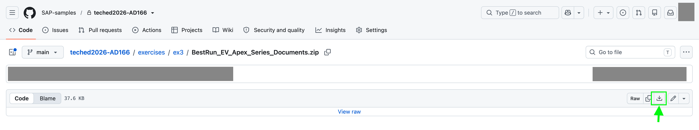

2. Open the **Content** tab and find the **Apex Launch Material** folder. Expand it and take a look at the launch content — product documents, images, and the launch brochure — prepared jointly by the marketing, finance, and dealer-management teams. Select the top-level **Apex Launch Material** folder (its checkbox), then open the overflow (**...**) menu and choose **Copy selected items to…**.

    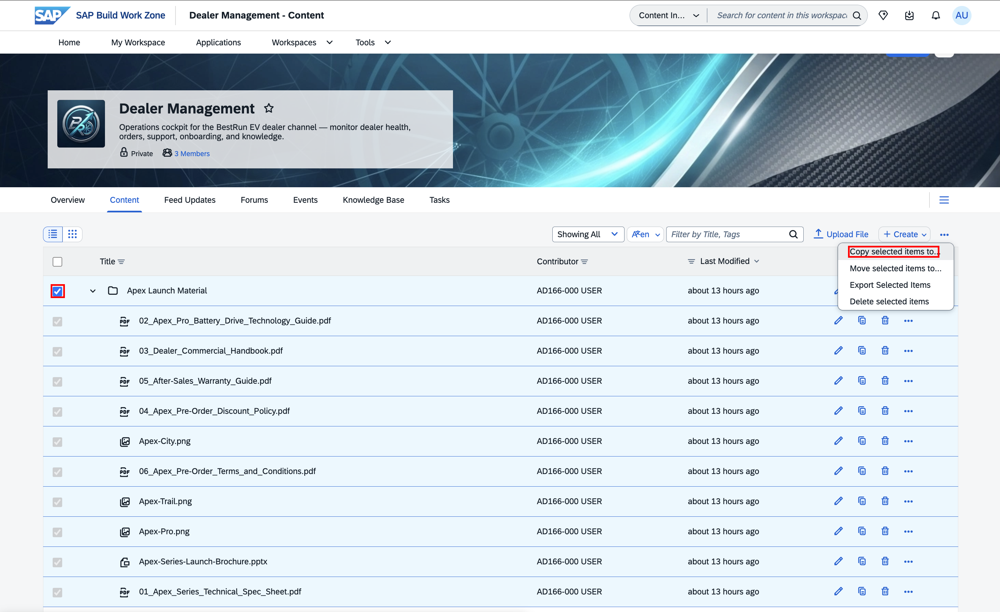

3. In the **Copy To…** dialog that opens, use the dropdown to select the **Dealer Portal** you created in Exercise 2 (e.g. *BestRun EV Dealer Portal AD166-XXX*) as the target workspace. Then click **Select Folder** to start the copy.

    > [!NOTE]
    > This is a **copy** — the original content stays in the **Dealer Management** workspace so that all other participants can still copy it for themselves.
    >
    > The copy may take a few minutes. You can continue with the next steps once it completes.

    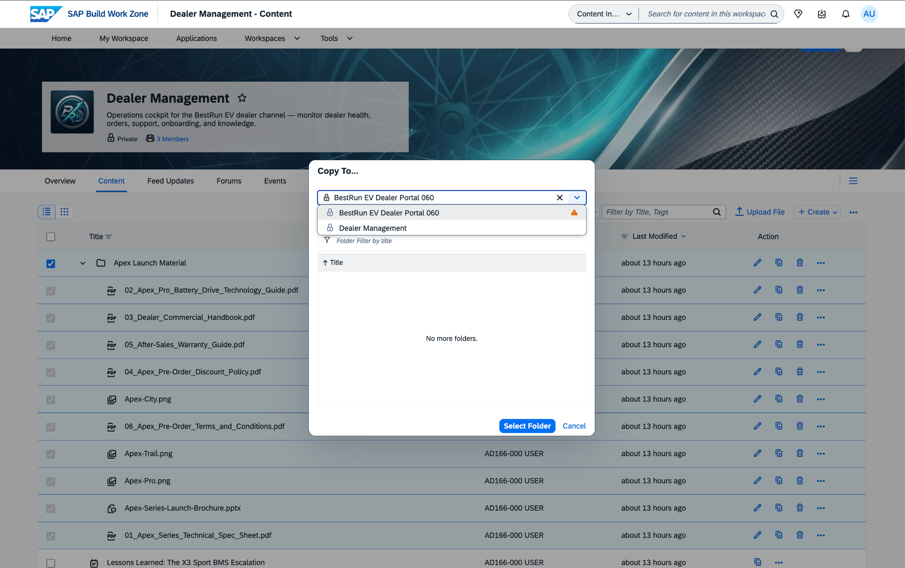

4. Once the copy completes, navigate to your **BestRun EV Dealer Portal AD166-XXX** — the workspace you created in Exercise 2. Open the **Workspaces** menu in the top navigation, hover **Recently Visited Workspaces**, and select your Dealer Portal. In the next steps you will use the copied content to build the product launch section.

    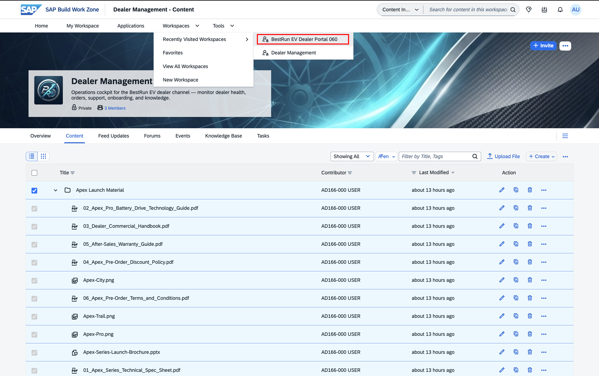

5. Open the **Content** tab of your Dealer Portal and confirm that the **Apex Launch Material** folder and all its files have been copied over successfully from the Dealer Management workspace.

    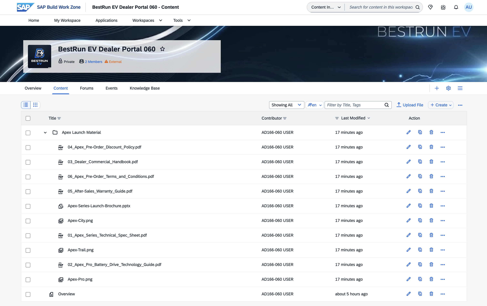

---

## Exercise 3.2 Enable the Workspace as an AI Source for Joule Document Grounding

For dealers to be able to ask Joule questions and get answers grounded in the Apex Launch Material documents, the **Dealer Portal workspace** must be registered as an AI content source. This is done once by a Work Zone administrator.

> [!IMPORTANT]
> Participants do **not** have the Work Zone Administrator role and cannot perform this step themselves. Please **call over one of the session instructors** and let them know your participant number (**AD166-XXX**) so they can enable document grounding for your workspace.
>
> You may continue reading the collapsible section below while you wait, to understand what the instructor will do on your behalf.

<details>
<summary><strong>How to enable a workspace as an AI source (administrator steps)</strong></summary>

### Step 1 — Open the Administration Console

Open the **profile menu** (your avatar / initials in the top-right corner). The **Administration Console** option is only visible to users with the Work Zone Administrator role.

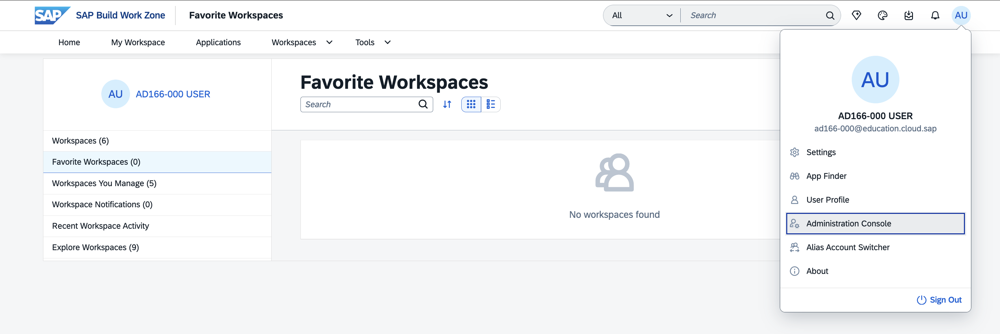

### Step 2 — Enable Content Administration and open Workspaces

In the Administration Console, expand **Area & Workspace Configuration** in the left navigation and click **Workspaces**, then open the **All Workspaces** tab. Because the administrator may not be a member of every participant's workspace, click **Enable Content Administration** first — this grants temporary admin access to manage workspaces they are not personally part of.

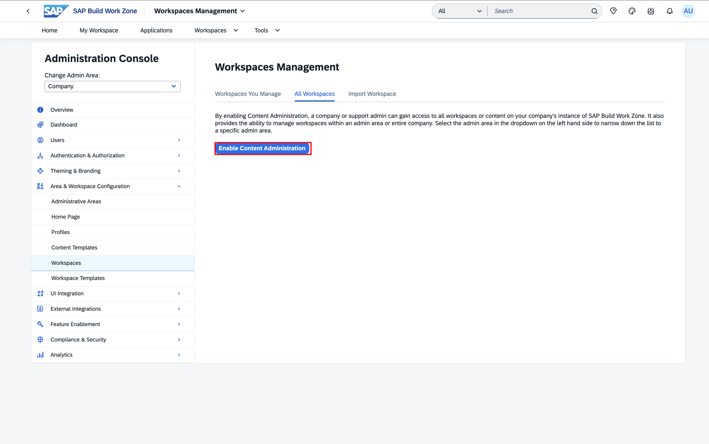

### Step 3 — Find the participant's workspace and enable it as an AI source

With Content Administration active (the blue banner confirms it), use the search box to filter by **BestRun EV Dealer Po...** to locate the participant's workspace. Open its **Actions** dropdown and choose **Enable as AI source**.

Once enabled, the **Document Grounding** column for that workspace changes to **AI Source**, confirming it is now registered as a grounding corpus for Joule.

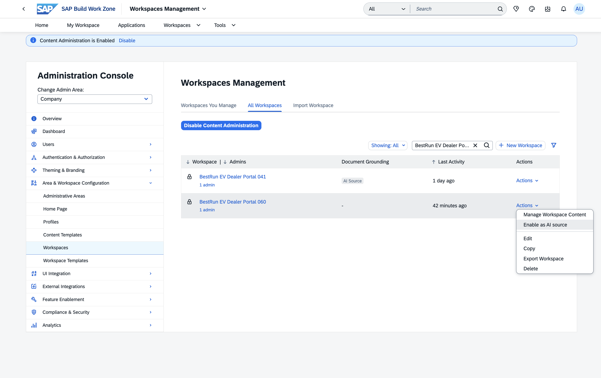

</details>

### What happens next — content ingestion

Registering the workspace as an AI source tells the Document Grounding service to index its content. Ingestion is driven by a **cron schedule** configured at the system level — in this tenant it is set to run **every hour**. Once ingested, Joule can answer questions grounded in the documents and pages from that workspace.

> [!NOTE]
> **During this workshop**, the instructors will manually trigger the ingestion pipeline every **5–10 minutes** via APIs so your content reaches the Document Grounding service well within the session time. After the instructor enables your workspace, wait a few minutes before moving to Exercise 3.4 to ask Joule questions about the Apex Series.

For details on how Document Grounding is configured with SAP Build Work Zone content — including the cron expression, index scope, and supported content types — refer to the official documentation:
- [SAP Build Work Zone, advanced edition — Help Portal](https://help.sap.com/docs/WZ)
- [Joule documentation](https://help.sap.com/docs/joule)

---

## Exercise 3.3 Add a New Product Launch Announcement Section

In this exercise you will add a dedicated **Apex Series Launch** announcement section directly below the hero carousel on the Overview page — the first thing dealers see when they open the portal.

1. From your Dealer Portal, open the **Overview** page and enter **Edit** mode (click the pencil / edit icon in the top-right area, just as you did in Exercise 2). Hover just below the hero carousel until the **Add section** button appears, then click it to insert a new section and select a **Freestyle** section type.

    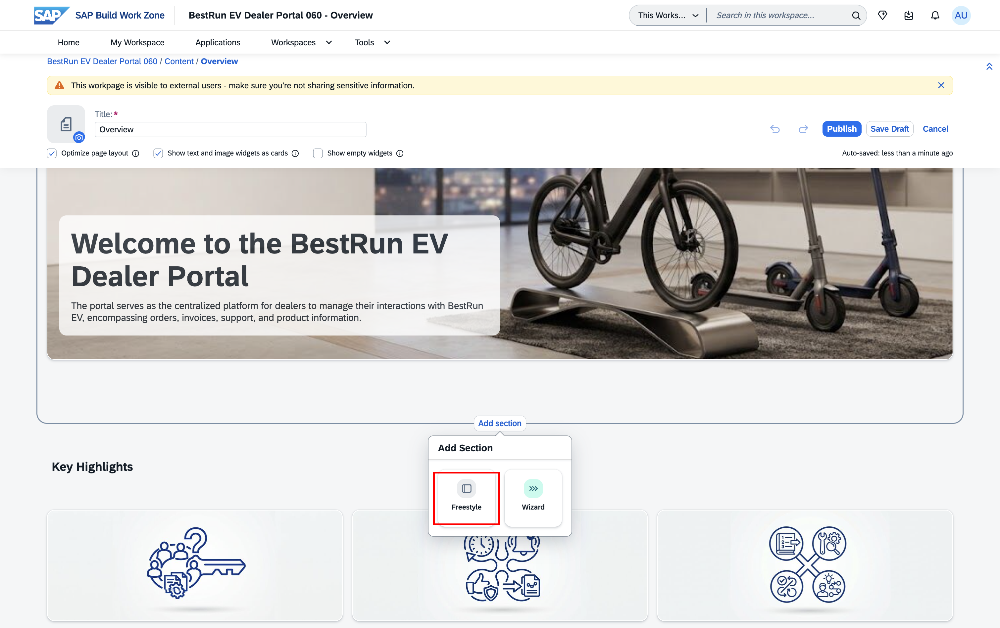

2. Hover over the new empty section to reveal the **+** (Add Content) button. Click it to open the **Add Content** widget picker. Select **Slideshow** — this widget accepts `.pdf`, `.ppt`, and `.pptx` files, which is exactly the format of the Apex Series launch brochure you copied over.

    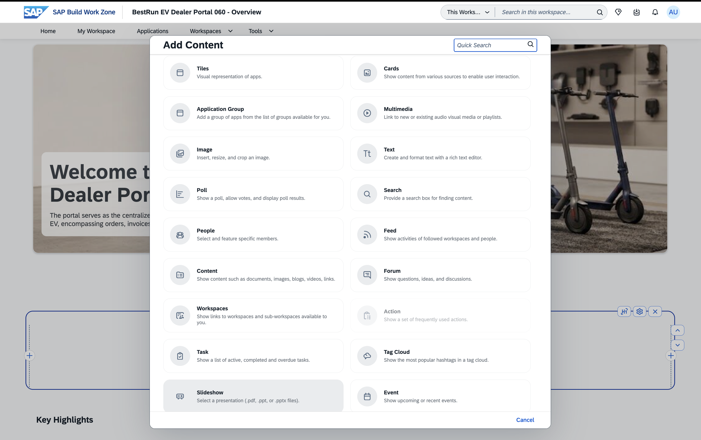

3. The new section now shows an empty slideshow placeholder. Click the **"Select a PDF or presentation file to display as a slideshow"** link inside it to open the file picker.

    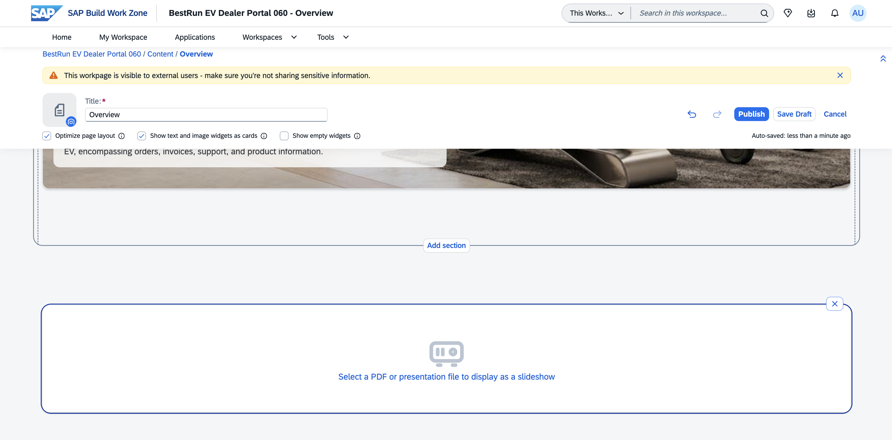

4. In the **Choose Existing Content** dialog that opens, navigate into the **Apex Launch Material** folder. Select the **Apex-Series-Launch-Brochure.pptx** (the only PowerPoint file in the folder) and click **Select**.

    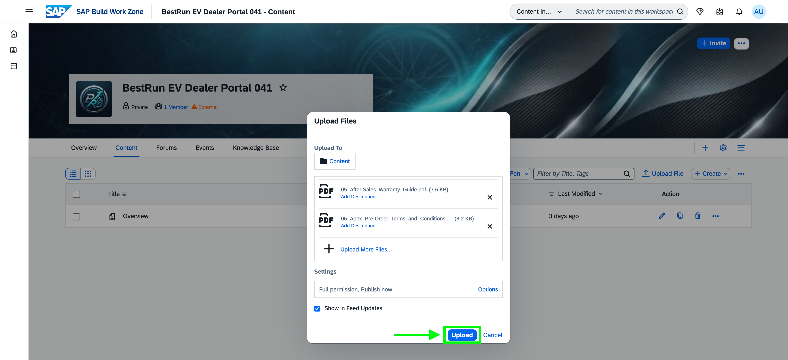

5. The brochure now appears as a slideshow widget in the section. Next, add a rich text announcement alongside it: hover over the left edge of the section until the **Add column** (**+**) button appears, then click it to insert a new column to the left of the slideshow.

    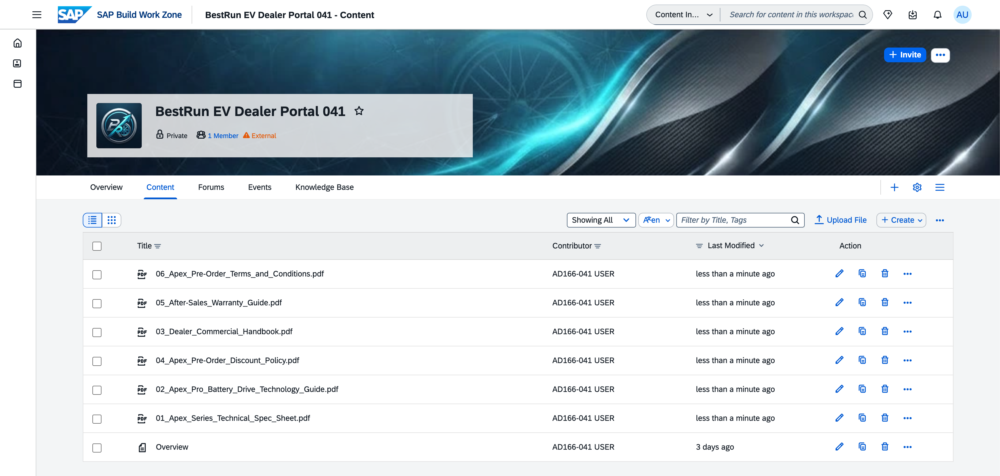

6. The slideshow shifts to the right half of the section and a new empty column appears on the left. Hover over the empty column and click **Add Content**, then select **Text** from the widget picker to add a rich text announcement widget.

    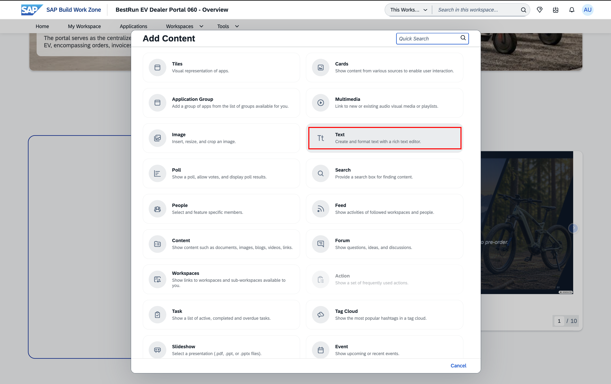

7. The empty text editor opens on the left, with the brochure slideshow on the right. To give the announcement a rich, styled look we will paste pre-built HTML directly. Click the **`<>`** (Source code) button in the text widget toolbar to switch to HTML source mode.

    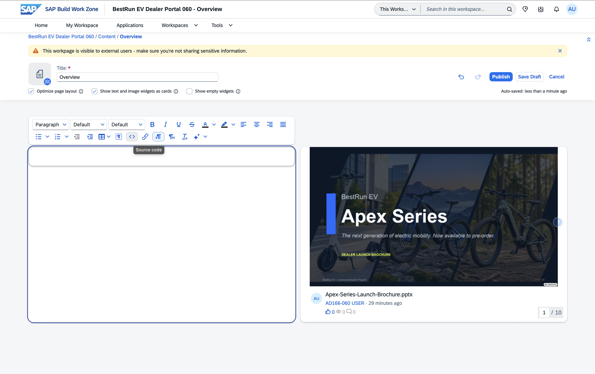

8. A **Source Code** popup opens. Replace any existing content with the HTML below, then click **Save**.

    ```html
    <div style="font-family: Arial,Helvetica,sans-serif; color: #1a2733; line-height: 1.5; max-width: 620px;">
    <!-- Eyebrow -->
    <div style="display: inline-block; background: #0066FF; color: #ffffff; font-size: 12px; font-weight: bold; letter-spacing: 1.5px; padding: 5px 12px; border-radius: 3px;">NOW AVAILABLE TO PRE-ORDER</div>
    <!-- Headline -->
    <h2 style="font-size: 30px; font-weight: bold; color: #0b1a2b; margin: 16px 0 4px;">Meet the Apex Series</h2>
    <p style="font-size: 16px; color: #5a6b7b; font-style: italic; margin: 0 0 18px;">Our most advanced electric lineup yet &mdash; built for your dealership.</p>
    <!-- Lead -->
    <p style="font-size: 15px; margin: 0 0 20px;">The Apex Series is BestRun EV's biggest launch in five years: three new models spanning urban commuting, weekend adventure, and flagship performance. Secure your priority allocation now, ahead of the public launch.</p>
    <!-- Model list -->
    <div style="border-top: 1px solid #e3e8ee; padding-top: 16px;">
      <div style="padding: 10px 0; border-left: 4px solid #0066FF; padding-left: 14px; margin-bottom: 12px;">
        <div style="font-size: 17px; font-weight: bold; color: #0b1a2b;">Apex City</div>
        <div style="font-size: 14px; color: #5a6b7b;">Urban commuter scooter &mdash; lightweight, city-optimized, low maintenance.</div>
      </div>
      <div style="padding: 10px 0; border-left: 4px solid #0066FF; padding-left: 14px; margin-bottom: 12px;">
        <div style="font-size: 17px; font-weight: bold; color: #0b1a2b;">Apex Trail</div>
        <div style="font-size: 14px; color: #5a6b7b;">Adventure ebike &mdash; 140&nbsp;km range, all-terrain aluminium frame.</div>
      </div>
      <div style="padding: 10px 0; border-left: 4px solid #0066FF; padding-left: 14px;">
        <div style="font-size: 17px; font-weight: bold; color: #0b1a2b;">Apex Pro</div>
        <div style="font-size: 14px; color: #5a6b7b;">Flagship performance ebike &mdash; 200&nbsp;km range, new LFP battery system.</div>
      </div>
    </div>
    <!-- Closing CTA -->
    <p style="font-size: 15px; margin: 0;"><strong style="color: #0b1a2b;">Explore the full brochure</strong> on the right, review the technical documents in this workspace, and <strong style="color: #0066ff;">ask Joule</strong> any product question for an instant answer.</p>
    </div>
    ```

    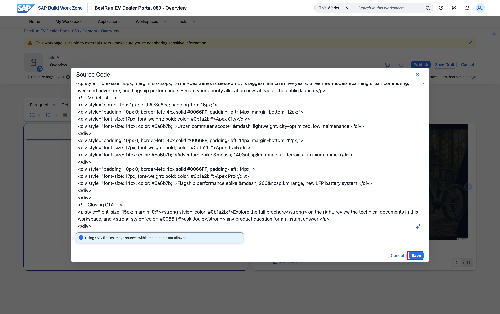

9. The styled announcement now renders on the left alongside the brochure slideshow. To label the whole section, hover over the outer section border until the section toolbar appears in the top-right corner, then click **Show section header**.

    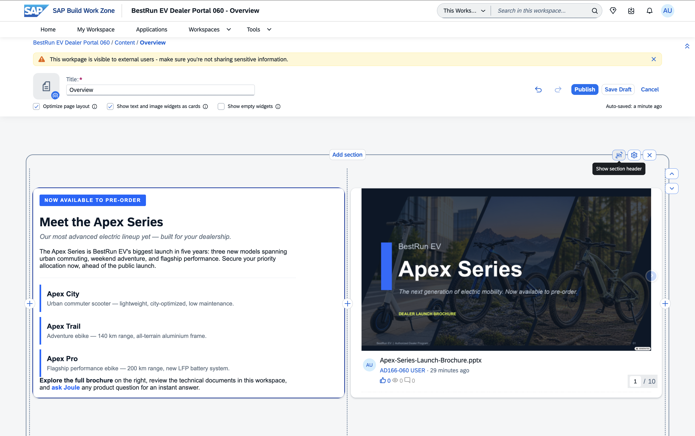

10. A section header input field appears above the section. Type **`Announcement: New Product Line Launch`** as the section title.

    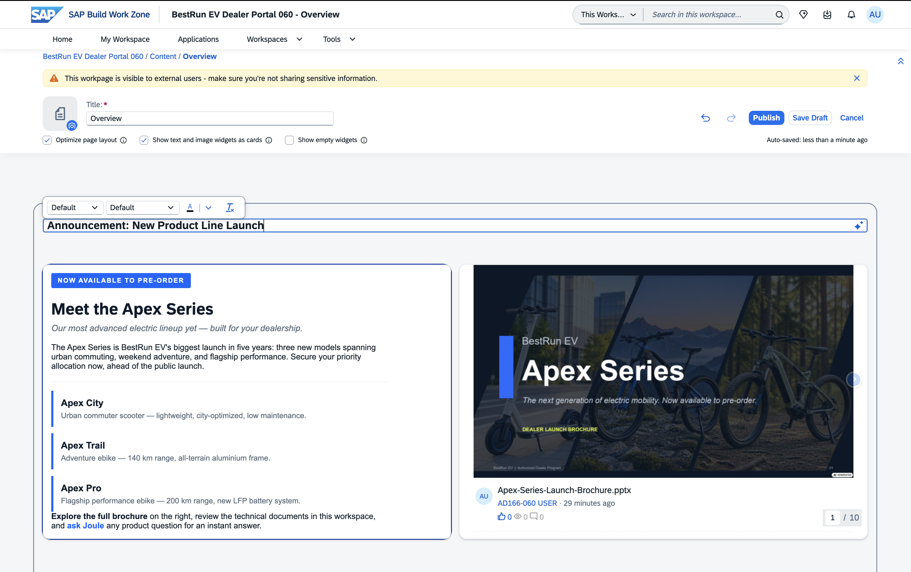

11. Click **Publish** in the top-right toolbar to publish the updated Overview page and make it visible to dealers.

---

## Exercise 3.4 Experience the Launch Content as a Dealer

Time to step into a dealer's shoes and see the portal exactly as they will on launch day.

1. Open the **profile menu** (your avatar / initials in the top-right corner) and select **Switch to Alias Account**, just as you did in Exercise 2.6. Choose your **Dealer-XXX** alias to switch into the dealer view.

2. Navigate to your **BestRun EV Dealer Portal AD166-XXX**. You will see the Overview page as a dealer — the new **Announcement: New Product Line Launch** section now sits prominently below the hero banner, with the styled announcement on the left and the interactive brochure slideshow on the right.

    > [!NOTE]
    > Document grounding is already enabled for this workspace, so Joule is ready to answer questions about the Apex Series content right away. Dealers can click **Ask Joule** in the announcement text or open Joule from the navigation to get instant answers grounded in the product documents you copied over.

    <a href="images/03_04_0010.png" target="_blank">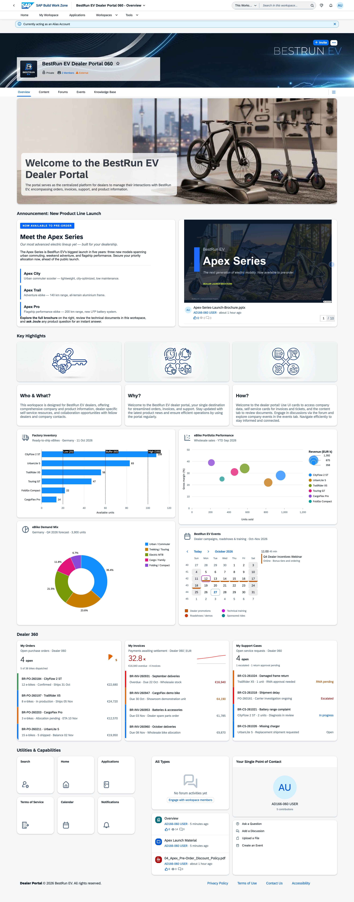</a>

3. Use the **`<`** and **`>`** navigation buttons on the brochure slideshow to flip through the presentation slides directly on the page — no download required.

    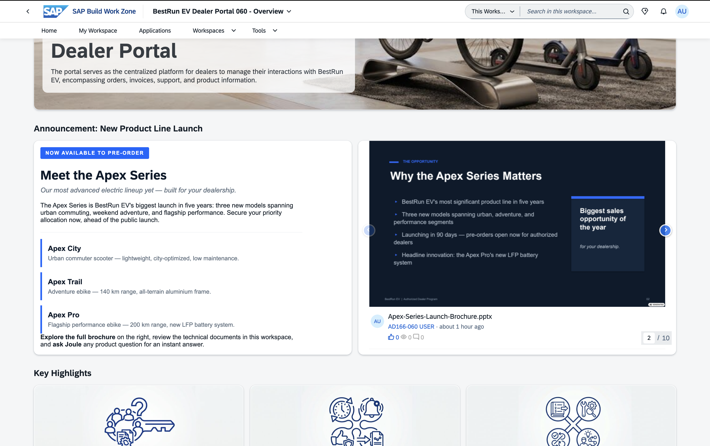

4. Click on the brochure itself to open its detail view. From here you can open it full-screen, download it, comment on it, or open it in a native application. Try clicking **✨ Summarize** — Joule generates a concise summary of the presentation without you having to read through all ten slides.

    > [!NOTE]
    > **Summarize** works across all content types in SAP Build Work Zone: uploaded documents, portal pages, native content like blogs, wikis, and Knowledge Base articles. Whenever a dealer (or any workspace member) wants a quick overview, one click is all it takes.

    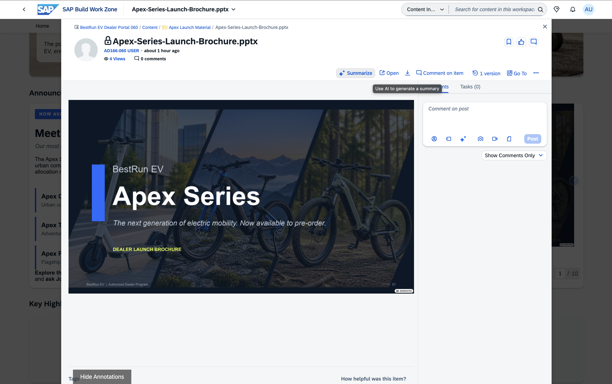

5. The **AI Generated Summary** appears above the document — a concise paragraph covering the key product highlights, pre-order opportunity, and dealer benefits, all extracted directly from the presentation content.

    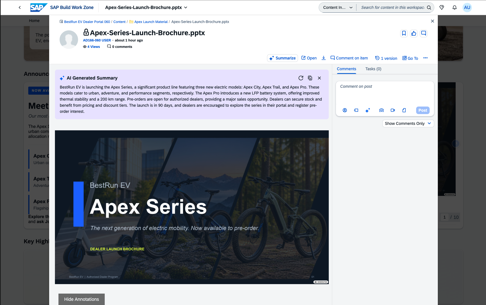

> [!NOTE]
> **TODO:** Joule interaction with Document Grounding (asking product questions, getting answers grounded in the Apex Launch Material documents) is pending and will be added here.

---

The next exercises are **optional**:
- [Exercise 4 - Create a Guided Experience (Optional)](../ex4/README.md)
- [Exercise 5 - Access the Dealer Portal from Joule Work Mobile (Optional)](../ex5/README.md)
