# Exercise 4 - Create the Apex Pre-Order Page

The Apex Series launch announcement is live on the Overview page. Now it's time to give dealers a place to act on it. In this exercise you will create a dedicated **Apex Pre-Order** page and build it out with three sections:

1. **An intro text widget** — a call-to-action banner that sets the context before the wizard
2. **A Guided Experience section** — a 5-step pre-order wizard that walks the dealer through model selection, quantities, payment terms, order review, and confirmation
3. **An order status card** — a live status card on the same page that reflects what the dealer has configured in the wizard

> [!NOTE]
> This exercise is performed as the **portal admin** (your primary **AD166-XXX** account). If you are still on your dealer alias from a previous exercise, switch back via the **Alias Account Switcher** in your profile menu first.

---

## Exercise 4.1 Create the Apex Pre-Order Page

First, create a new page in your Dealer Portal that will host the pre-order wizard.

1. Navigate to your **BestRun EV Dealer Portal AD166-XXX** workspace.

2. In the workspace navigation bar (where the **Overview**, **Content**, **Forums**, and **Events** tabs are), click the **+** icon at the right end of the tab row. The **Add Tab to Navigation Bar** dialog opens.

    In the dialog, under the **Overview** section, select **Workpage** — described as *"Create a freestyle page with layouts"*.

    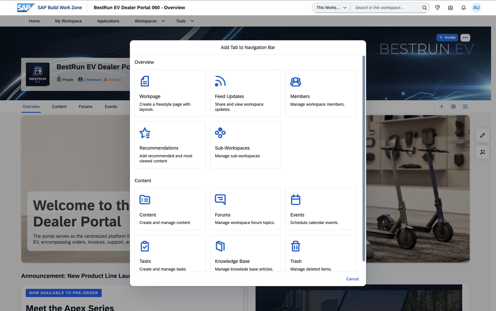

3. The **Add Workpage** dialog opens. Leave **New Workpage** selected. In the **Tab Name** field, enter:

    ```
    Apex Pre-Order
    ```

    Leave the **Save in Folder** set to **Content** (the default) and the **Contributor** as your user. Click **Add**.

    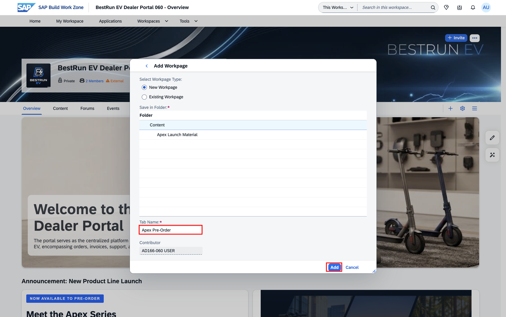

    The new **Apex Pre-Order** workpage opens in edit mode, showing the **Title** field pre-filled with `Apex Pre-Order` and an empty canvas with an **Add** button in the centre.

    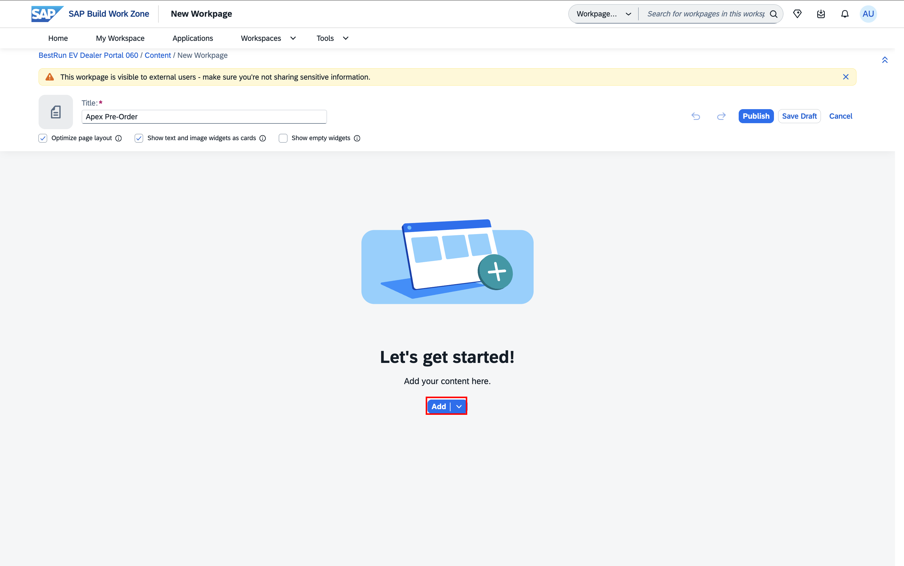

> [!NOTE]
> A yellow banner warns that *"This workpage is visible to external users"* — this is expected, since the workspace is configured as an external dealer portal. You will build out this page in the exercises below.

---

## Exercise 4.2 Add the Intro Text Widget

Before the wizard, add a short call-to-action banner so dealers understand what the page is for as soon as they land on it.

1. The **Apex Pre-Order** page is already open in edit mode from Exercise 4.1. Click the **Add** button (with the dropdown arrow) in the centre of the empty canvas. A new empty section appears on the page.

2. Inside the new section, click the **Add Content** button (the **+** icon inside the section). The **Add Content** dialog opens. Select **Text** — described as *"Create and format text with a rich text editor."*

    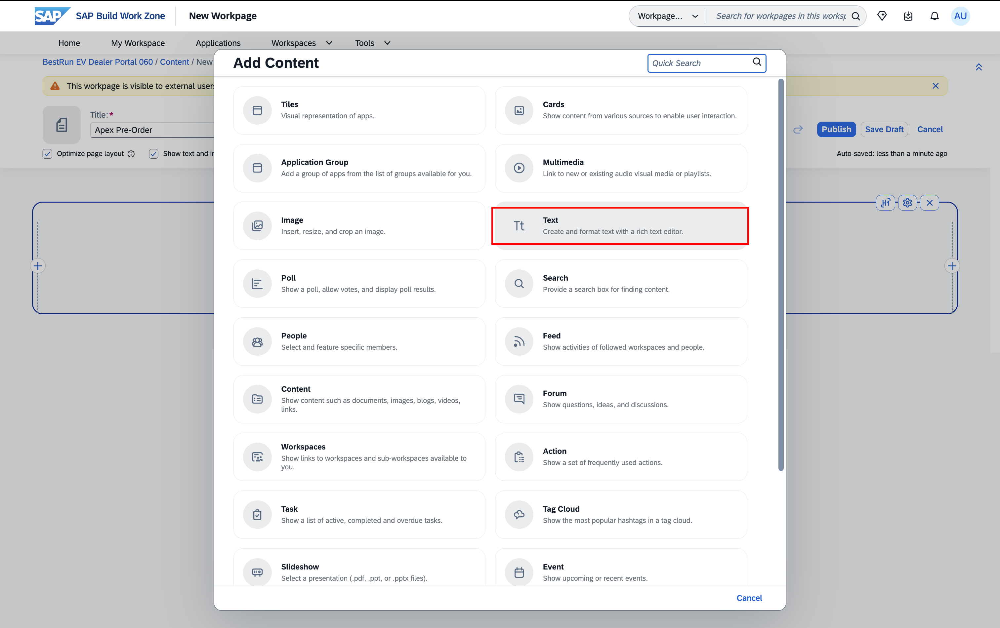

3. The rich text editor opens inside the section. In the editor toolbar, click the **Source code** button (the `<>` icon — hovering over it shows the tooltip *"Source code"*) to open the source code dialog.

    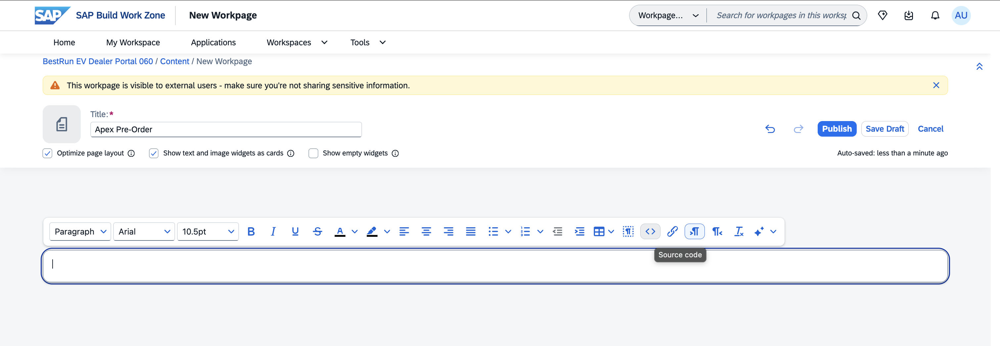

    In the source code dialog that opens, paste the following HTML and click **Save**:

    ```html
    <div style="font-family: Arial,Helvetica,sans-serif; text-align: center; padding: 28px 20px; background: linear-gradient(135deg, #e8f0fe 0%, #f0f4ff 100%); border-radius: 8px; border: 1px solid #c8d8f5;">
      <div style="display: inline-block; background: #0066FF; color: #fff; font-size: 11px; font-weight: bold; letter-spacing: 1.5px; padding: 4px 12px; border-radius: 3px; margin-bottom: 12px;">PRE-ORDER OPEN NOW</div>
      <h3 style="font-size: 22px; color: #0b1a2b; margin: 0 0 10px;">Ready to secure your Apex Series allocation?</h3>
      <p style="color: #5a6b7b; font-size: 14px; margin: 0 0 6px;">Use the 5-step guided wizard below to configure your order, choose your payment terms, and lock in your pre-order discount — all in under 5 minutes.</p>
      <p style="color: #5a6b7b; font-size: 13px; margin: 0;"><strong>Have questions along the way?</strong> Keep Joule open in the panel — it can answer any question about the Apex Series, pricing, or pre-order terms instantly.</p>
    </div>
    ```

4. Verify that the banner renders correctly inside the editor — you should see the blue **PRE-ORDER OPEN NOW** badge, the heading *"Ready to secure your Apex Series allocation?"*, and the two lines of supporting text below it.

    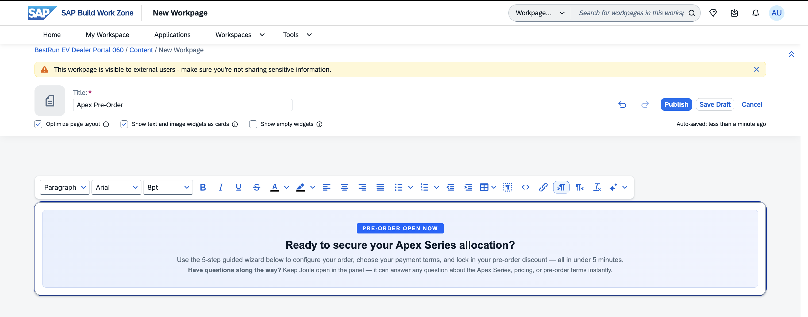

---

## Exercise 4.3 Add the Guided Experience Section

Now add the 5-step pre-order wizard below the intro banner.

### 4.3.1 Add the Guided Experience section

1. Hover below the intro banner section until the **Add section** bar appears. Click it. A small popup shows two section types — **Freestyle** and **Wizard**. Select **Wizard**.

    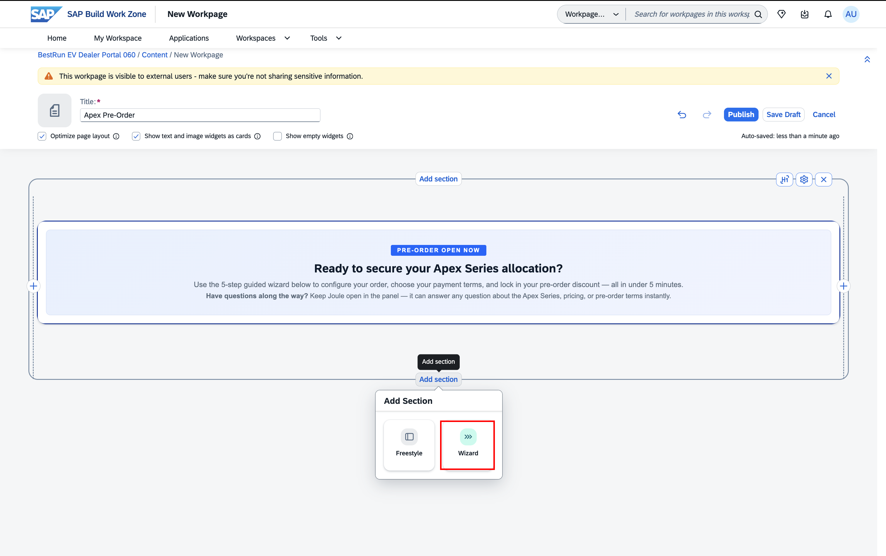

2. The **Add Wizard** dialog opens. Fill in the **Title** and **Description** fields:

    | Field | Value |
    |-------|-------|
    | Title | `Apex Series Pre-Order` |
    | Description | `Secure your Apex Series allocation before the public launch. Complete the 5-step wizard to configure your order, lock in your pre-order discount, and receive your confirmation.` |

3. Under **Display Options**, select **Opens as a dialog**. This opens the wizard in a full-screen dialog when dealers launch it, giving the cards more space to render comfortably.

    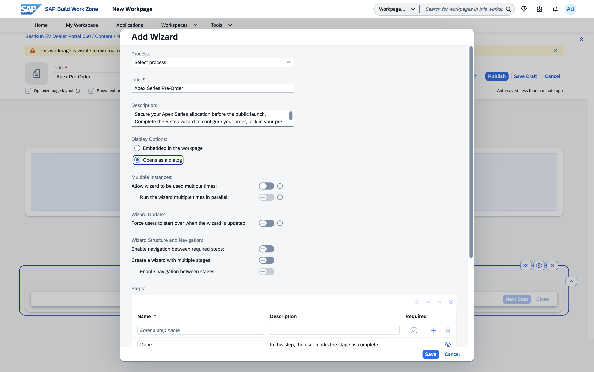

### 4.3.2 Add the five wizard steps

5. Click **Add step**. Set the step **Title** and **Description** exactly as shown:

    | Field | Value |
    |-------|-------|
    | Title | `Choose Your Models` |
    | Description | `Select the Apex Series models you want to pre-order. You can choose one or more models.` |

6. Click **Add step** again. Fill in:

    | Field | Value |
    |-------|-------|
    | Title | `Quantities & Variants` |
    | Description | `Set the quantity and color variant for each selected model. Your total units determine your base discount tier.` |

7. Click **Add step** again. Fill in:

    | Field | Value |
    |-------|-------|
    | Title | `Payment Terms` |
    | Description | `Choose how you'd like to pay. Payment terms affect your final pre-order discount — use Joule to clarify any questions.` |

8. Click **Add step** again. Fill in:

    | Field | Value |
    |-------|-------|
    | Title | `Order Summary` |
    | Description | `Review your complete pre-order: models, quantities, discounted prices, delivery windows, and terms.` |

9. Click **Add step** again. Fill in:

    | Field | Value |
    |-------|-------|
    | Title | `Confirm Pre-Order` |
    | Description | `Your pre-order is submitted. Note your reference number and explore what happens next.` |

The wizard now shows a 5-step indicator. Each step is empty until you assign a card in the next section.

10. **(Optional)** The dialog also shows a final **Done** step (auto-added by WZ to mark completion). Rename it to `Pre-Order Successful` to make the end state clearer for dealers.

    Once all steps are filled in you will see the **Wizard Cover Preview** at the bottom of the dialog — showing the wizard title and description as dealers will see it on the launch card.

    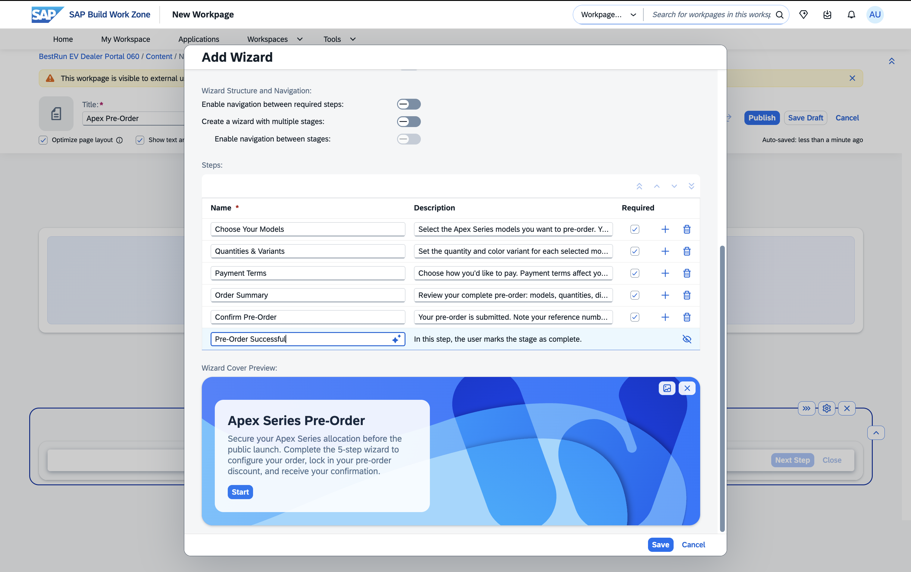

11. Click **Save** to create the wizard section.

The five pre-order cards have been pre-loaded into the **Card Catalog** of this tenant by the workshop team. You will assign one card to each step.

10. After saving, the wizard section appears on the page showing the 6-step indicator. Step 1 **Choose Your Models** is active. Click the **Add Content** button inside the step area.

    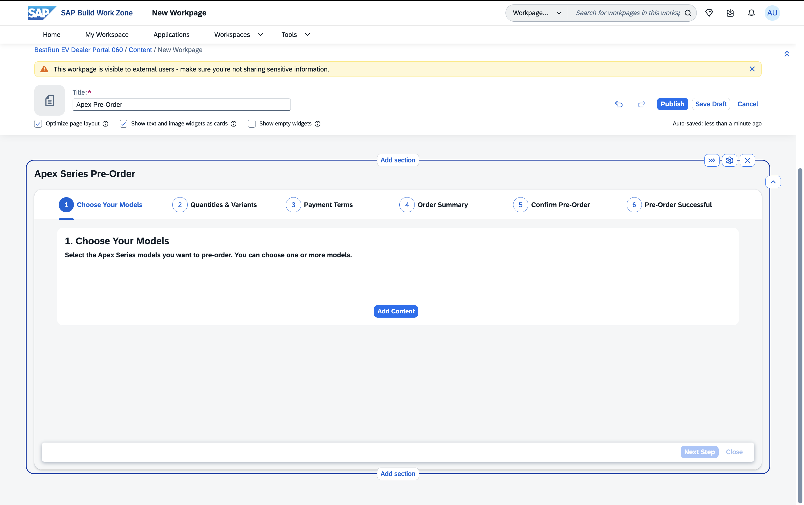

    In the **Add Content** dialog that opens, select **Cards** — described as *"Show content from various sources to enable user interaction."*

    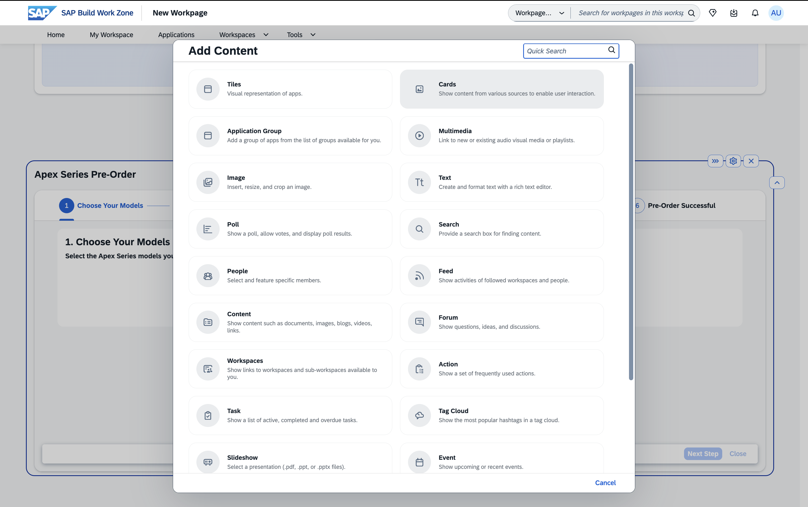

    In the card picker that follows, type `Guided` in the search box to filter the list. Select **Guided1 Card | Model Selection**.

    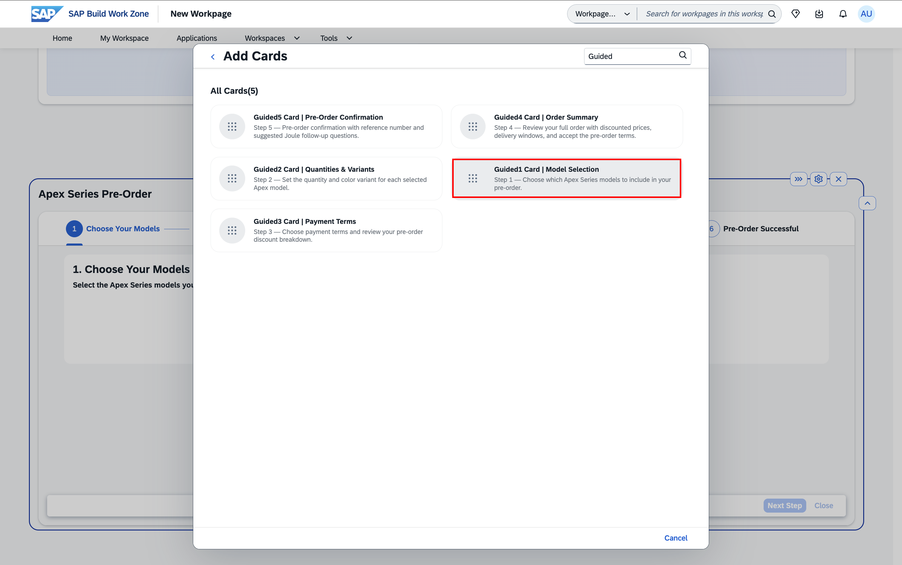

    The **Guided1 Card | Model Selection** card renders inside Step 1 of the wizard, showing the three Apex models.

    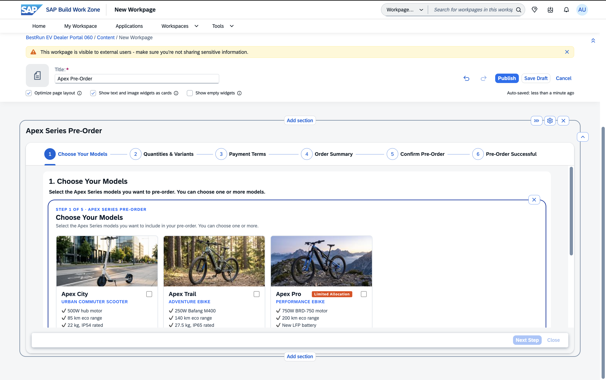

11. In the step indicator bar, click **2 — Quantities & Variants** to navigate to Step 2. The step area switches to an empty **Add Content** state. Repeat the same process — click **Add Content** → **Cards** → search `Guided` → select **Guided2 Card | Quantities & Variants**.

11. In the step indicator bar, click **2 — Quantities & Variants** to navigate to Step 2. The step area switches to an empty **Add Content** state, just like Step 1 looked before you added its card.

    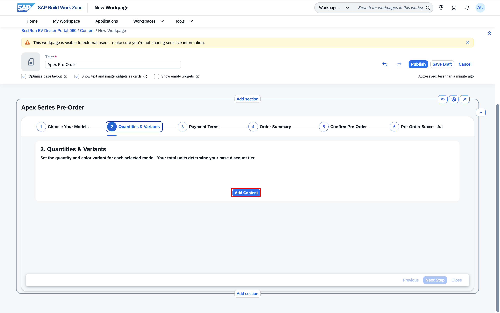

    Repeat the same process for each remaining step — click the step number in the indicator bar, then **Add Content** → **Cards** → search `Guided` → select the matching card:

    **Step 2 — Quantities & Variants** → select `Guided2 Card | Quantities & Variants`

    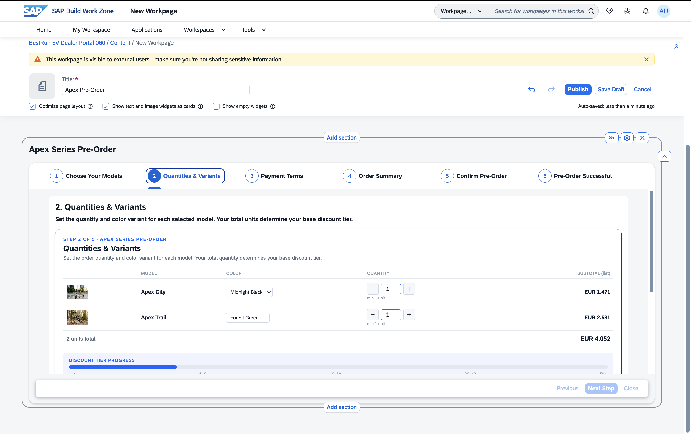

    **Step 3 — Payment Terms** → select `Guided3 Card | Payment Terms`

    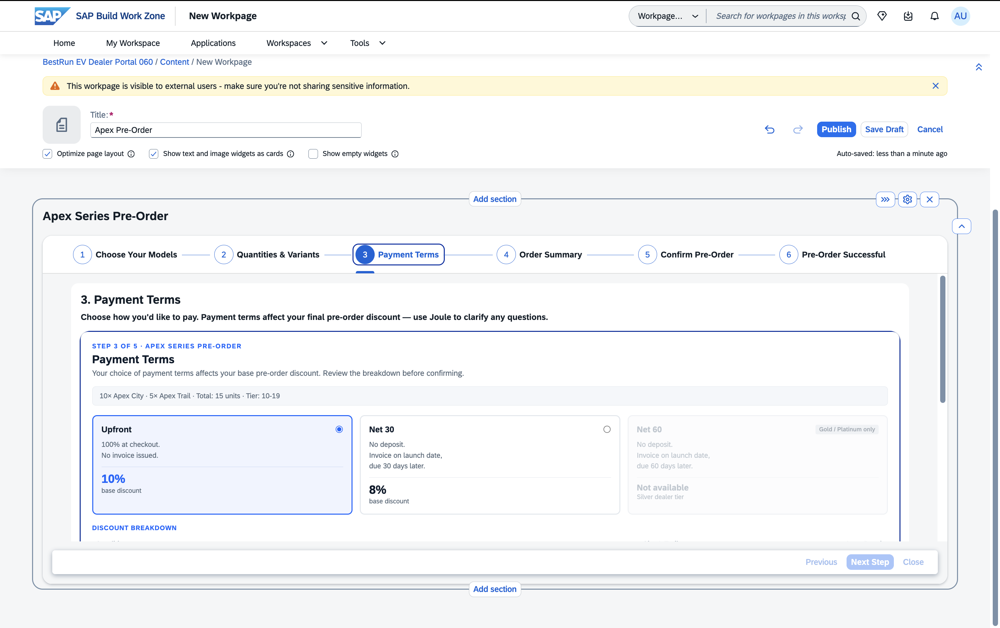

    **Step 4 — Order Summary** → select `Guided4 Card | Order Summary`

    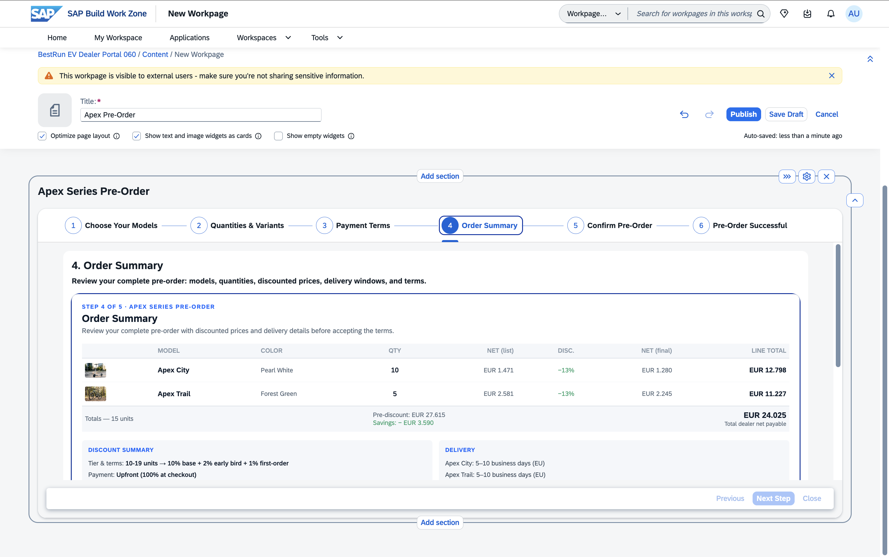

    **Step 5 — Confirm Pre-Order** → select `Guided5 Card | Pre-Order Confirmation`

    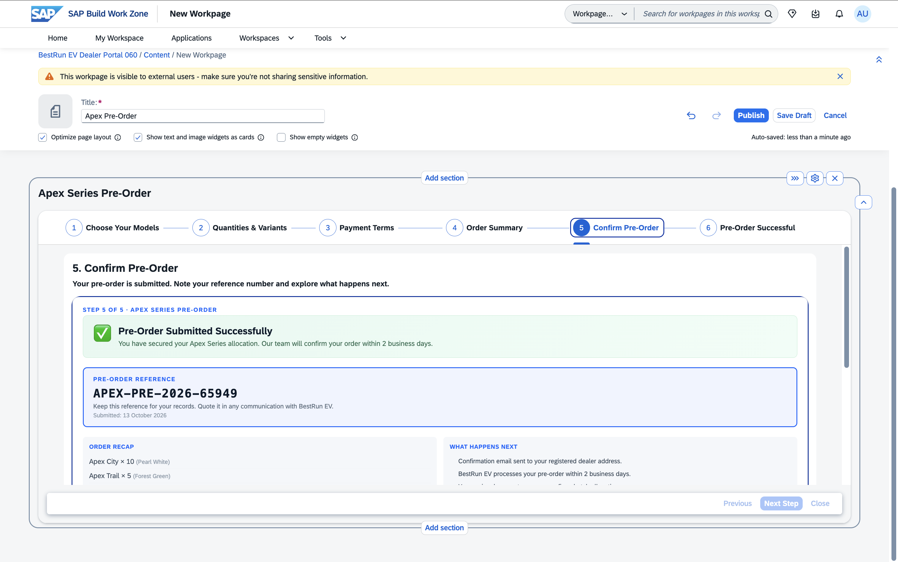

> [!NOTE]
> Each card passes context to the next step automatically via the browser's session storage. No additional card configuration is required — the cards read and write a shared `apexPreOrder` key that keeps the wizard state as the dealer progresses through the steps.

---

## Exercise 4.4 Add the Order Status Card

Below the wizard, add the **Pre-Order Status** card in a new Freestyle section. This card listens to the wizard's progress and shows the dealer a live summary of their pre-order on the same page — updating in real time as they move through the steps.

1. Hover below the Guided Experience (Wizard) section. An **Add section** bar appears. Click it.

    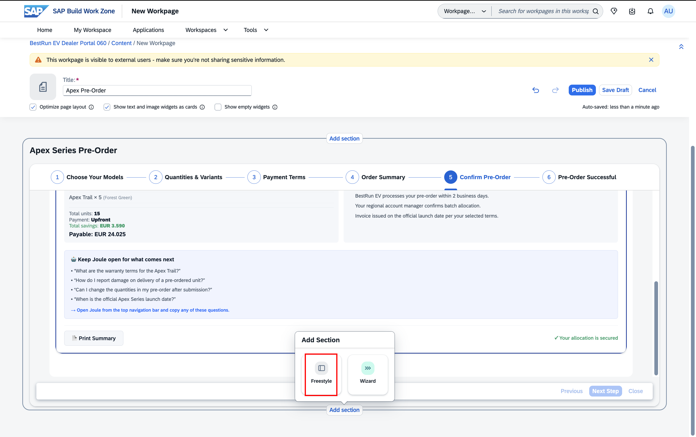

2. In the popup, select **Freestyle**.

    A new empty Freestyle section is added below the wizard.

3. In the new section, click **Add Content**.

4. In the Add Content dialog, select **Cards**.

5. In the Add Cards picker, search for:

    ```
    Pre-Order Status
    ```

    Select **BestRun EV | Pre-Order Status** and click **Add**.

    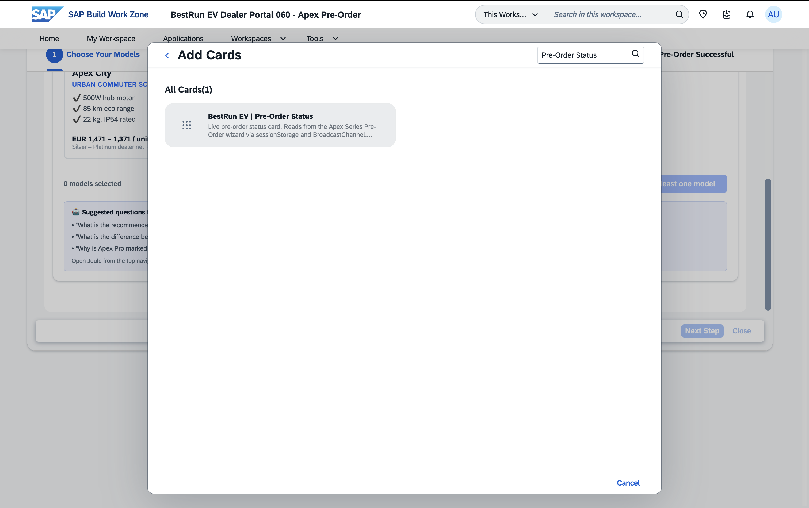

    > [!IMPORTANT]
    > Make sure you select **BestRun EV | Pre-Order Status**, *not* the Guided5 confirmation card. The status card is the one purpose-built for this page — it starts empty and fills in as the dealer works through the wizard. (If it doesn't appear in the picker, upload `preorder-status-card.card.zip` to the Card Catalog first.)

6. The card is added below the wizard. Because no pre-order has been started yet, it shows its empty state — a **"No pre-order started yet"** illustration. This is exactly what you want: the card stays empty until a dealer runs the wizard.

    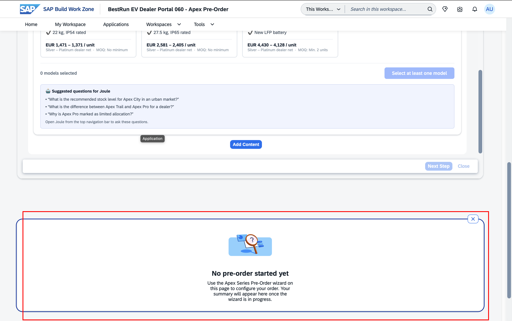

7. Click **Publish** in the top-right toolbar to publish the **Apex Pre-Order** page.

8. With the published **Apex Pre-Order** page open, **copy the full page URL** from your browser's address bar and keep it somewhere handy (a note or scratch file). You will paste it into the Button card's navigation target in Exercise 4.5.

    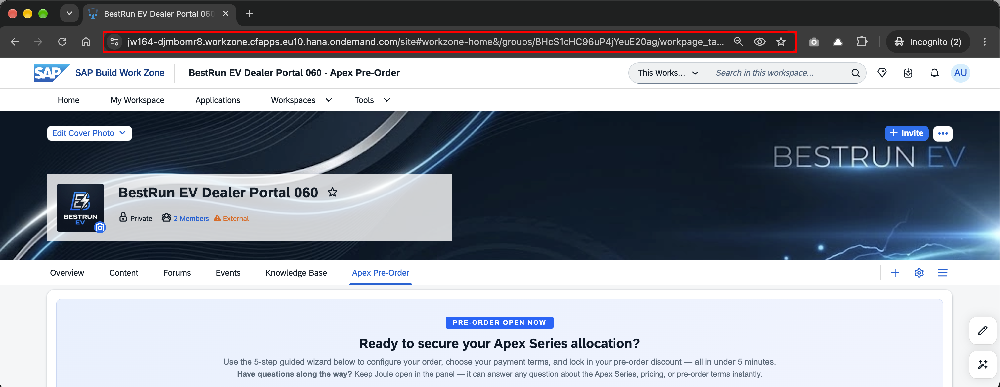

    > [!TIP]
    > The URL looks like `https://<host>.workzone.cfapps.eu10.hana.ondemand.com/site#workzone-home&/groups/<groupId>/workpage_tab/...`. Copy the whole thing — it points directly to this Apex Pre-Order workpage.

> [!NOTE]
> When no wizard data exists yet, the status card shows an empty-state illustration ("No pre-order started yet"). As soon as the dealer progresses through the wizard, the card updates automatically — first showing an "in progress" checklist, then switching to the confirmed order summary once Step 5 is completed.

---

## Exercise 4.5 Add a Button Card on the Overview Page

Now that the Apex Pre-Order page exists, give dealers a clear path to it straight from the **Overview** page. You will add a **Button card** below the Apex Series launch announcement that links directly to the pre-order wizard.

1. Open the **Overview** page (the one you built in Exercise 3) and enter **edit mode**. Scroll down to the **Apex Series launch announcement** section, hover just below it until the **Add section** bar appears, and click it. In the popup, select **Freestyle**.

    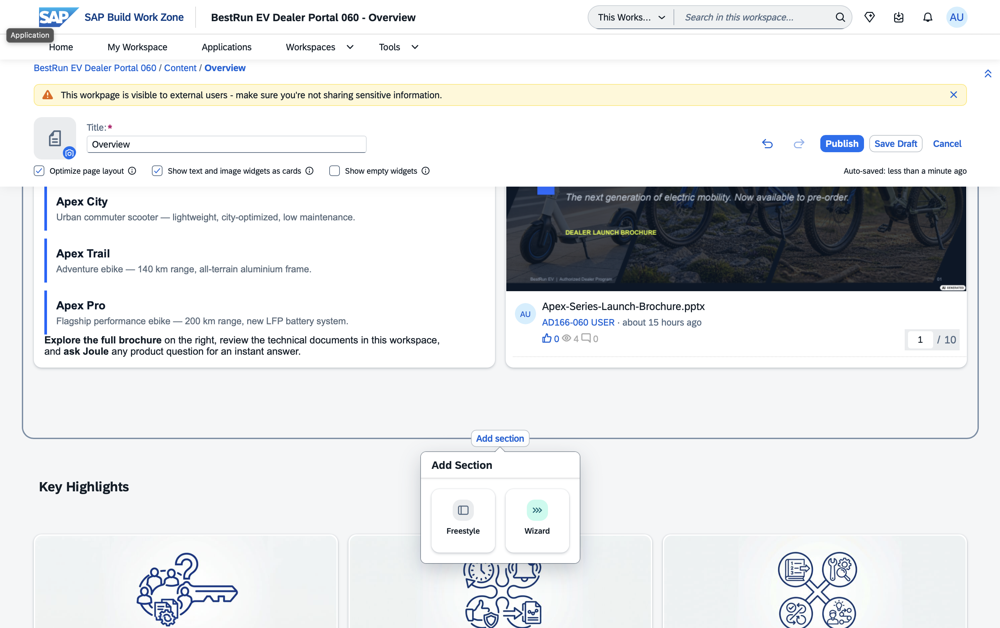

2. In the new Freestyle section, click **Add Content**, select **Cards**, and in the Add Cards picker search for:

    ```
    Button Card
    ```

    Select **Button Card** — "A component card that renders a fully configurable button with title, subtitle, icon, colors, borders and a navigation target" — and click **Add**.

    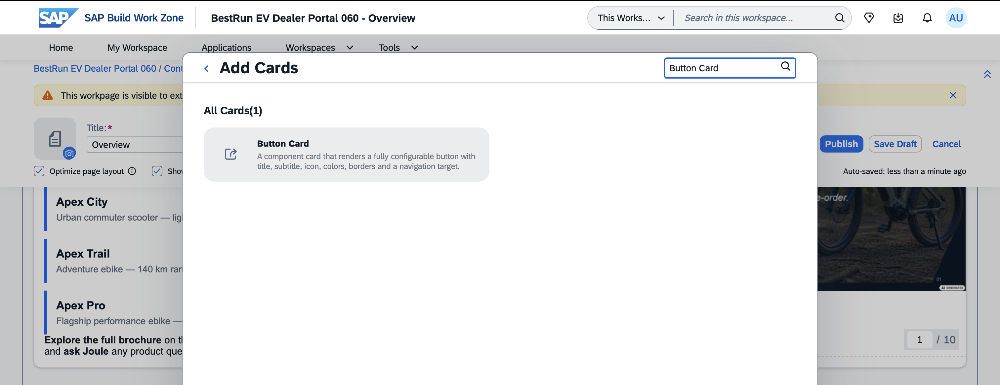

3. The Button Card configuration dialog opens. In the **General** section, set the following values — the live preview on the right updates as you type:

    | Field | Value |
    | --- | --- |
    | Fill Card Background | **Yes** |
    | Title | `Start Your Apex Series Pre-Order` |
    | Subtitle | `Reserve your units before public launch — secure special dealer pricing` |
    | Icon | Navigation Right Arrow |
    | Icon Size (rem) | `3` |
    | Title Font Size (rem) | `2` |
    | Subtitle Font Size (rem) | `1.5` |
    | Target URL | *paste the Apex Pre-Order page URL you copied in Exercise 4.4* |
    | Open in new tab | **Yes** |

    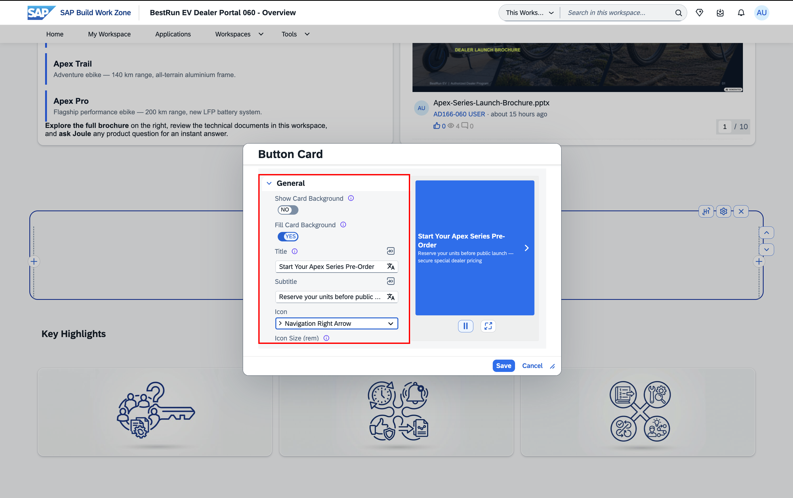

4. Click **Save** to close the Button card dialog, then click **Publish** in the top-right toolbar to publish the updated **Overview** page.

    The Overview page now shows a full-width **"Start Your Apex Series Pre-Order"** button beneath the Apex Series announcement. Click it to confirm it opens the **Apex Pre-Order** page (in a new tab).

    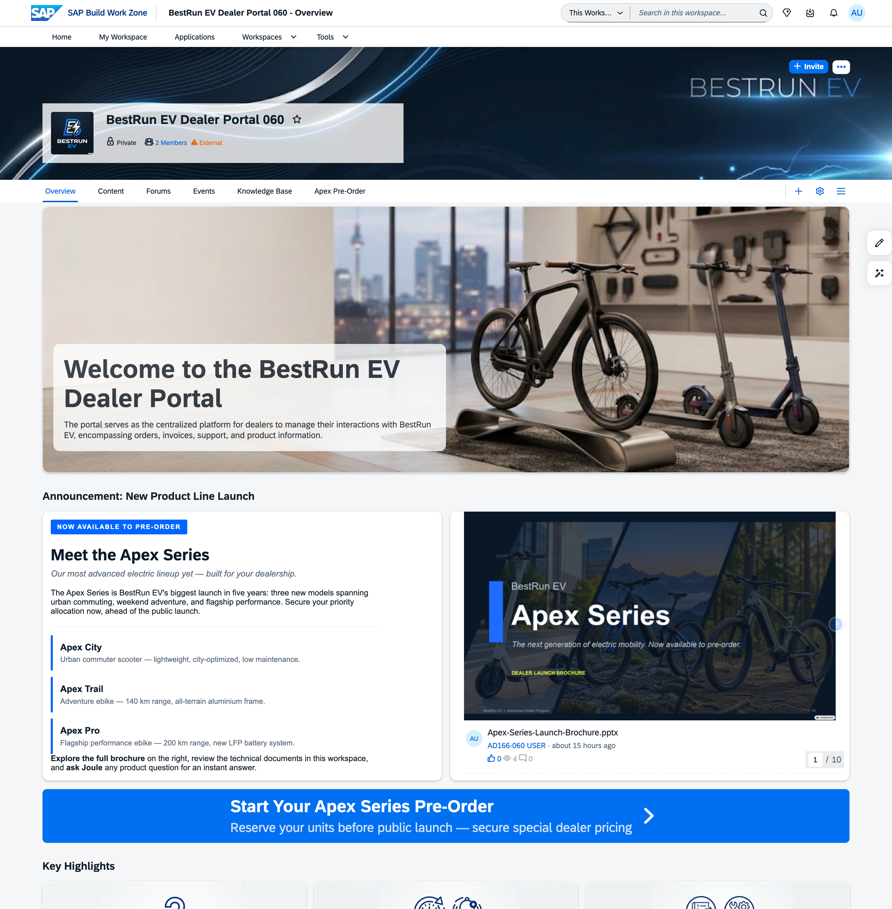

### Summary

Dealers now have a clear call-to-action on the Overview page that takes them straight into the Apex Pre-Order wizard.

---

## Exercise 4.6 Experience the Full Flow as Dealer-XXX

> [!NOTE]
> **This section is a work in progress.** Detailed steps and screenshots will be added once the full landscape setup is confirmed.
>
> **Planned content:** Switch to the **Dealer-XXX** alias and walk through the complete pre-order flow from start to finish — opening the Dealer Portal, navigating to the Apex Pre-Order page, completing all 5 wizard steps, using Joule at the Step 3 discount moment, and reviewing the confirmed pre-order summary in the status card.

---

Continue to — [Exercise 5 - Access the Dealer Portal from Joule Work Mobile (Optional)](../ex5/README.md)
