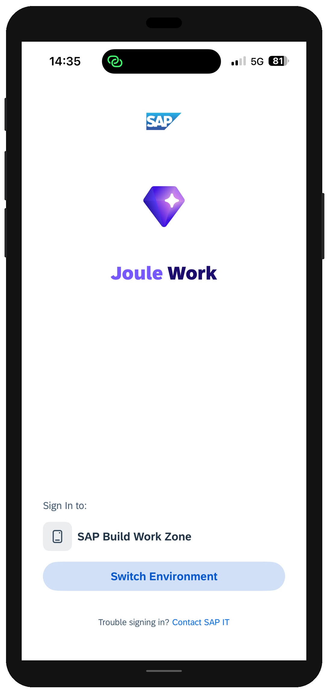
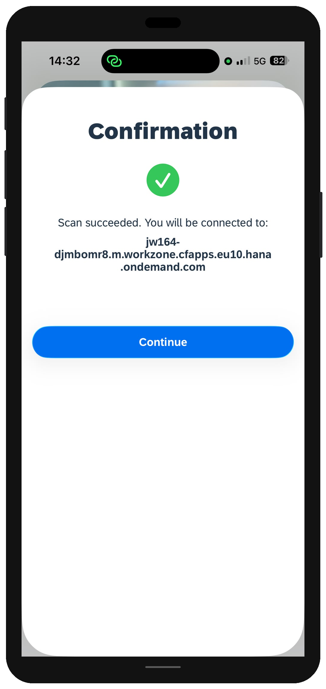
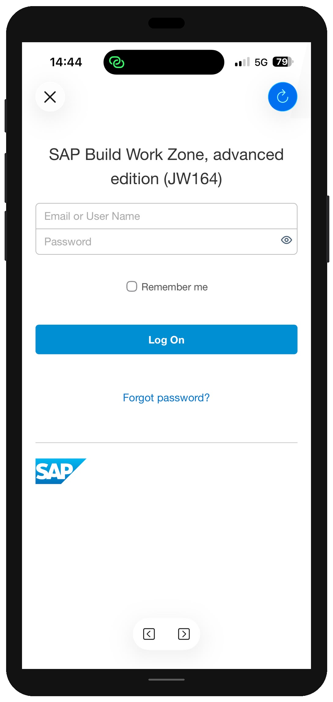
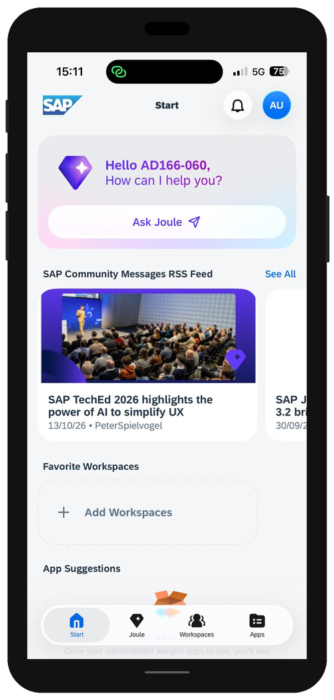

# Exercise 5 - Access the Dealer Portal from Joule Work (Optional)

> [!NOTE]
> This exercise is optional. You will need a smartphone (iOS or Android) to complete it.

SAP Build Work Zone content can be accessed not only from a desktop browser, but also from the native mobile app **Joule Work**, available on iOS and Android. In this exercise you access the BestRun EV Dealer Portal from the app and ask Joule a grounded product question, just as a dealer in the field would.

## Exercise 5.1 Set Up Joule Work

### Install the app

1. On your smartphone, install the **Joule Work** app:

    - **iOS:** [Joule Work on the App Store](https://apps.apple.com/us/app/joule-work/id1540195902)
    - **Android:** [Joule Work on Google Play](https://play.google.com/store/apps/details?id=com.sap.mobile.apps.sapstart)

    Start the download and continue with the next steps on the desktop while the app installs.

    > [!NOTE]
    > If you already have Joule Work installed and connected to another environment, you can still use it here. You can switch the connected environment from your user profile screen inside the app (+ Add New Environment)

### Generate the registration QR code (on the desktop)

2. In SAP Build Work Zone, click your **user avatar** in the top right of the shell bar, then click **Settings**.

    

3. In the Settings panel, select **Joule Work Mobile App**.

    

4. Click the **Register** tab. The QR code to register the app changes - this is the one you will scan from the phone in the next step.

    

### Connect the app to the landscape (on your phone)

5. Open **Joule Work** on your smartphone.

    - **Fresh install:** tap **Scan QR Code**.
    - **Already connected to another environment:** tap **Switch Environment?**, then scan the QR code from the next step.

    

    > [!CAUTION]
    > If you freshly installed Joule Work, your operating system may prompt you to allow push notifications. You can change this decision later in your device's settings.

     > [!IMPORTANT]
    > **TODO:** Confirm for fresh install if there is a Scan QR Code or not.. in case not, remove it from step 5 above 

6. Scan the QR code displayed on the desktop screen. The app shows a **Confirmation** screen — *"Scan succeeded. You will be connected to: jw164-djmbomr8..."*. Tap **Continue**.

    

7. Sign in with your participant credentials (**AD166-XXX**).

    

8. After signing in, Joule Work opens the **Start** tab. This is your home screen in the app. Notice the **bottom tab bar** with four tabs: **Start**, **Joule**, **Workspaces**, and **Apps** — you will use these to navigate the app in the next exercises.

    

### Summary

Joule Work is installed and connected to the session landscape. You are ready to access the BestRun EV Dealer Portal from your phone.

---

## Exercise 5.2 Access the BestRun EV Dealer Portal

1. Tap the **Workspaces** tab in the bottom bar. Your **BestRun EV Dealer Portal XXX** workspace appears in the **Recently Visited** list.

    

2. Tap **BestRun EV Dealer Portal XXX** to open it. The portal loads in a web view showing the Overview page — the hero banner, workspace header (Private, Members, External), and the Apex Series announcement below.

    

3. Navigate to the **Apex Series** page and scroll through the launch content — the product descriptions for Apex City, Apex Trail, and Apex Pro, and the brochure carousel below.

    

4. If you completed the optional **Guided Experience** (Exercise 4), navigate to the **Apex Pre-Order** page and confirm the wizard is accessible on mobile — the step-by-step cards render correctly on a phone screen.

    > [!NOTE]
    > This step only applies if you built the Guided Experience in Exercise 4.

    

### Summary

The dealer portal is fully accessible on mobile. The content and navigation all work in Joule Work. In the final step, you will use Joule from the mobile app.

---

## Exercise 5.3 Ask Joule a Question from Your Phone

1. Tap the **Joule** tab in the bottom bar (the second tab, between Start and Workspaces). Joule opens with a **"What's up?"** prompt and a **Message Joule** input bar at the bottom.

    

2. Tap **Message Joule** and type the following question, then send it:

    ```
    What color options are available for the Apex Trail?
    ```

    Joule answers directly from the portal's product documents: *"The Apex Trail model is available in Forest Green, Slate Grey, and Burnt Orange."* Notice the **Sources 1** badge — the answer is grounded in the content you published in Exercise 3, not generated from general knowledge.

    

3. Tap **Sources 1** to verify the citation links back to the Apex Series page in your dealer portal.

### Summary

You have completed all exercises. You have experienced the BestRun EV Dealer Portal across both desktop and mobile — as the admin who built it, and as the dealer who uses it.

---

## Session Complete

Congratulations — you have completed **AD166: Experience AI-enabled business sites with SAP Build Work Zone**.

Here is what you built and explored in this session:

| Exercise | What you did |
|---|---|
| **0** | Learned the scenario and explored a sample workspace |
| **1** | Used Joule to create the dealer portal workspace, made it private & external, and added your dealer alias |
| **2** | Built the generic portal content — hero, Key Highlights, and self-service cards — then experienced it as a dealer |
| **3** | Created the Apex Series product launch page and asked Joule a grounded product question as a dealer |
| **4** | *(Optional)* Assembled a Guided Experience wizard |
| **5** | *(Optional)* Accessed the portal from Joule Work |

## Further Resources

- [SAP Build Work Zone on SAP Community](https://pages.community.sap.com/topics/work-zone)
- [Documentation for SAP Build Work Zone, advanced edition](https://help.sap.com/docs/WZ)
- [Joule documentation](https://help.sap.com/docs/joule)
- [SAP Build Work Zone, advanced edition on Discovery Center](https://discovery-center.cloud.sap/serviceCatalog/sap-build-work-zone-advanced-edition?service_plan=advanced&region=all&commercialModel=btpea)

> [!IMPORTANT]
> **TODO:** Add the session feedback survey link once available for SAP TechEd 2026.
