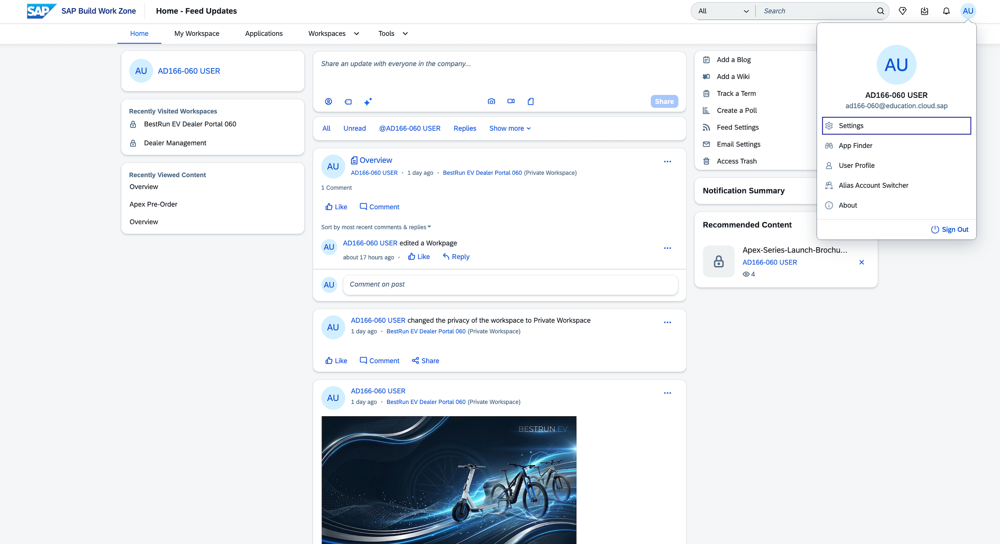
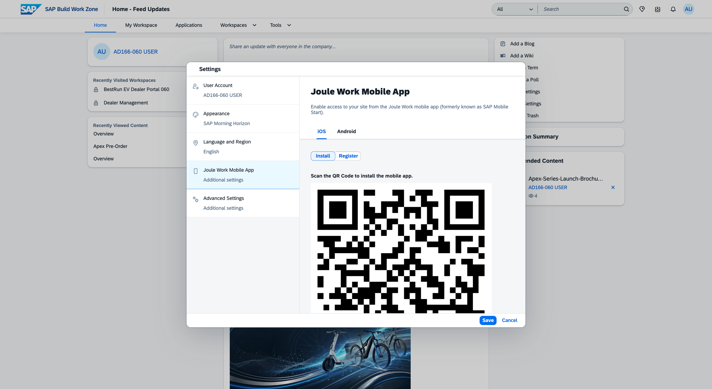
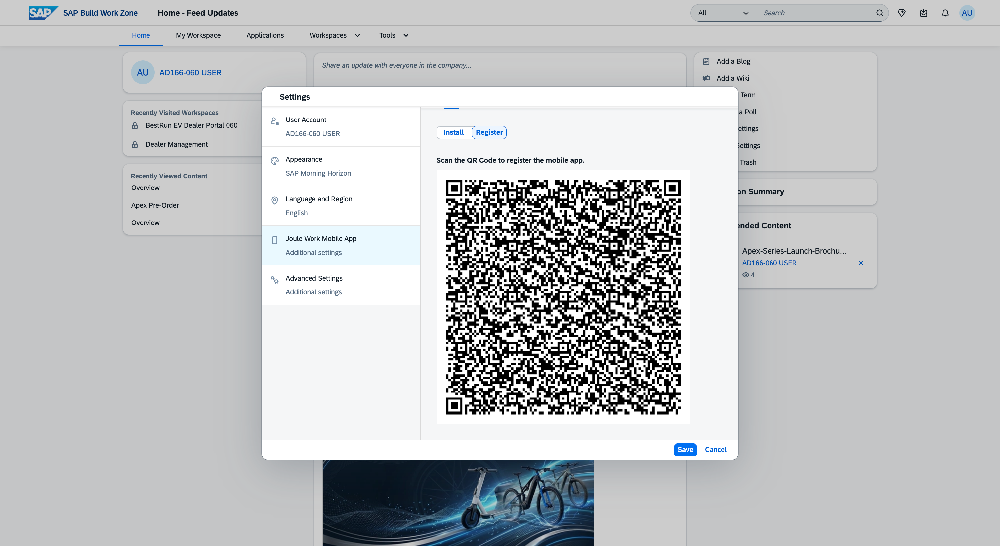
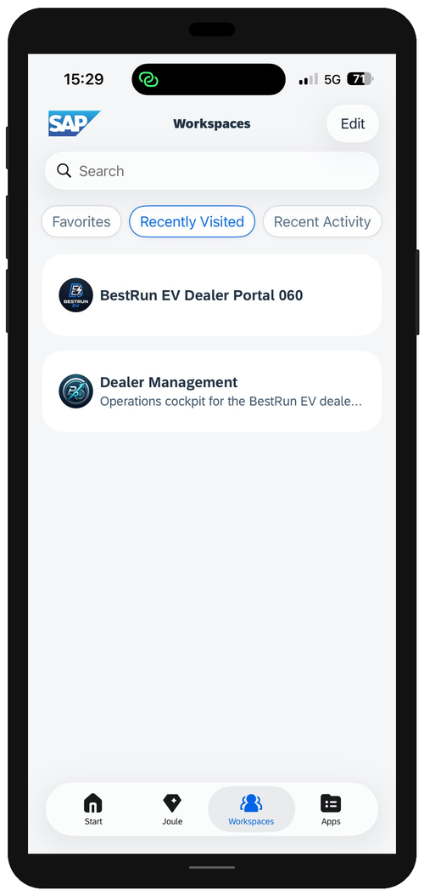
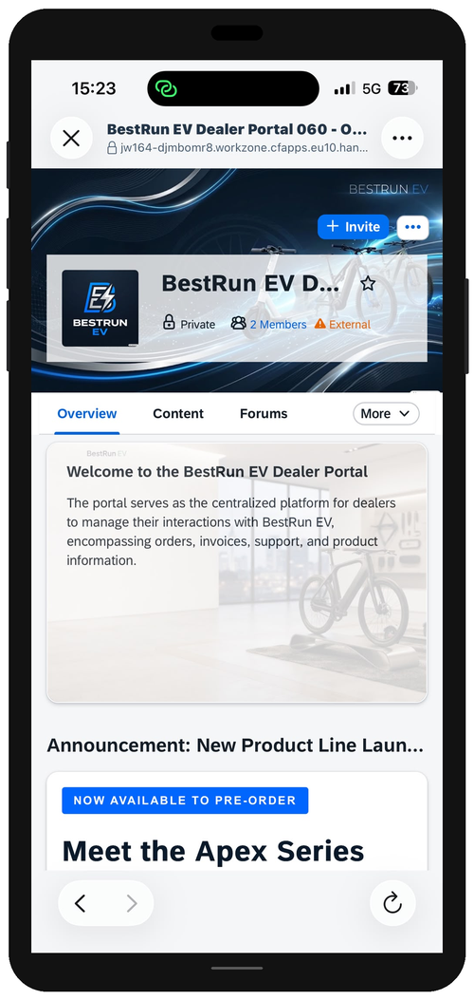
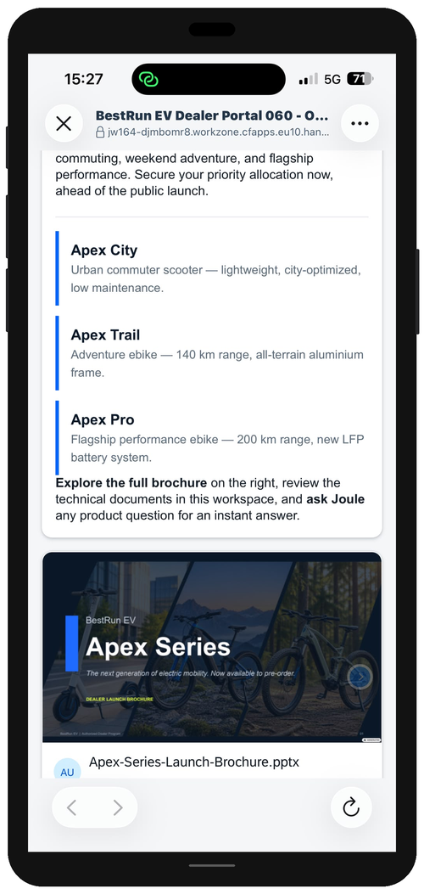
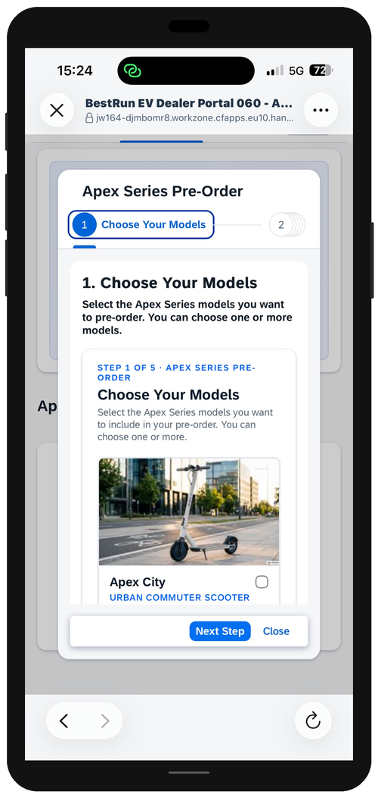
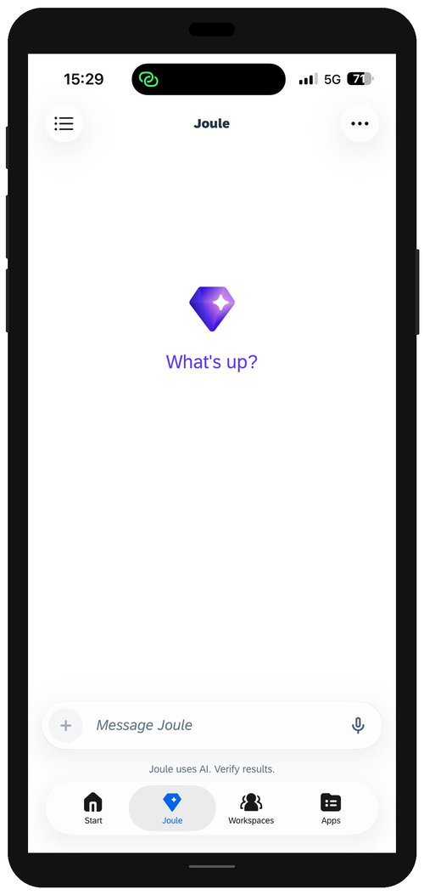
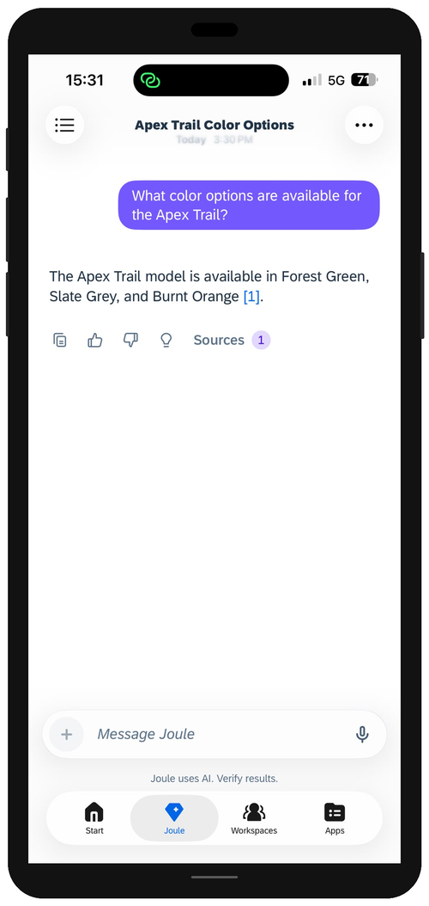

# Exercise 5 - Access the Dealer Portal from Joule Work Mobile (Optional)

> [!NOTE]
> This exercise is optional. You will need a smartphone (iOS or Android) to complete it.

In this exercise you access the BestRun EV Dealer Portal from **Joule Work Mobile** — the mobile app for SAP Build Work Zone workspaces. This demonstrates that the dealer portal is not tied to a desktop browser: a dealer in the field, at a trade show, or on a test ride can access the portal, browse product information, and ask Joule a question from their phone.

> [!IMPORTANT]
> **TODO:** Confirm the final app name and store availability for TechEd 2026. The app is referred to here as **Joule Work Mobile** (new name for SAP Mobile Start). Update this exercise if the branding or app name changes before the session.

## Exercise 5.1 Set Up Joule Work Mobile

1. On your smartphone, open the **App Store** (iOS) or **Google Play Store** (Android).

    > [!IMPORTANT]
    > **TODO:** Add the exact app store search term or direct links for Joule Work Mobile (iOS and Android) once confirmed.

2. Search for **Joule Work Mobile** and install the app.

    

3. Open the app after installation.

    

4. Sign in using your **Dealer-XXX** alias credentials — the same dealer alias you used on the desktop.

    > [!IMPORTANT]
    > **TODO:** Confirm the mobile app sign-in method for this landscape — direct URL entry, QR code scan, or SSO. A QR code displayed on the projector is common for TechEd sessions.

    

### Summary

Joule Work Mobile is installed and signed in. You are ready to access the BestRun EV Dealer Portal.

---

## Exercise 5.2 Access the BestRun EV Dealer Portal

1. On the Joule Work Mobile home screen, browse the available workspaces.

    

2. Tap the **BestRun EV Dealer Portal XXX** workspace to open it.

    

3. Navigate to the **Apex Series** page and scroll through the launch content on mobile — the carousel, product data sheet, and presentation.

    

4. If you completed the optional **Guided Experience** (Exercise 4), open that page and confirm the wizard is accessible on mobile.

    > [!NOTE]
    > This step only applies if you built the Guided Experience in Exercise 4.

    

### Summary

The dealer portal is fully accessible on mobile. The content and navigation all work in Joule Work Mobile. In the final step, you will use Joule from the mobile app.

---

## Exercise 5.3 Ask Joule a Question from Your Phone

1. In Joule Work Mobile, open the **Joule** assistant from within the BestRun EV Dealer Portal workspace.

    > [!IMPORTANT]
    > **TODO:** Confirm how Joule is accessed within a workspace in Joule Work Mobile — via a floating button, a menu item, or a dedicated tab.

    

2. Type the following question:

    ```
    What color options are available for the Apex Trail?
    ```

    

3. Observe that Joule returns the same grounded, sourced answer on mobile as it does on desktop.

### Summary

You have completed all exercises. You have experienced the BestRun EV Dealer Portal across both desktop and mobile — as the admin who built it, and as the dealer who uses it.

---

## Session Complete

Congratulations — you have completed **AD166: Experience AI-enabled business sites with SAP Build Work Zone**.

Here is what you built and explored in this session:

| Exercise | What you did |
|---|---|
| **0** | Learned the scenario and explored a sample workspace |
| **1** | Used Joule to create the dealer portal workspace, made it private & external, and added your dealer alias |
| **2** | Built the generic portal content — hero, Key Highlights, and self-service cards — then experienced it as a dealer |
| **3** | Created the Apex Series product launch page and asked Joule a grounded product question as a dealer |
| **4** | *(Optional)* Assembled a Guided Experience wizard |
| **5** | *(Optional)* Accessed the portal from Joule Work Mobile |

## Further Resources

- [SAP Build Work Zone on SAP Community](https://pages.community.sap.com/topics/work-zone)
- [Documentation for SAP Build Work Zone, advanced edition](https://help.sap.com/docs/WZ)
- [Joule documentation](https://help.sap.com/docs/joule)
- [SAP Build Work Zone, advanced edition on Discovery Center](https://discovery-center.cloud.sap/serviceCatalog/sap-build-work-zone-advanced-edition?service_plan=advanced&region=all&commercialModel=btpea)

> [!IMPORTANT]
> **TODO:** Add the session feedback survey link once available for SAP TechEd 2026.
